# Registro del estado energético del aula 504 comparado con la programación académica

**Proyecto de curso** · Ingeniería de Software I
**Grupo:** #6
**Integrantes:** Hilary Pérez Zúñiga · Luijeimm Agudelo Godoy
**Docente:** Gloria Amparo Lora Patiño
**Institución:** Corporación Universitaria Remington
**Fecha de entrega:** 6 de noviembre de 2026

> El documento completo en formato APA (Word y PDF) está en [`docs/`](docs/). Este README presenta el mismo contenido para consulta en GitHub.

## Estructura del repositorio

```
Registro-del-estado-energetico-del-aula-504/
├── README.md                     · documento del proyecto (este archivo)
├── docs/
│   ├── Proyecto_Aula504.docx     · documento APA para entregar
│   ├── Proyecto_Aula504.pdf
│   └── img/                      · figuras del documento (c1, c2, c3)
├── src/
│   ├── Main.java                 · pantalla principal (ambas integrantes)
│   ├── Util.java                 · lectura y validación (ambas integrantes)
│   ├── ProgramacionAcademica.java  · entidad de Hilary Pérez Zúñiga
│   ├── PilaProgramacion.java
│   ├── GestorProgramacion.java
│   ├── RegistroEstado.java       · entidad de Luijeimm Agudelo Godoy
│   ├── PilaRegistro.java
│   └── GestorRegistro.java
└── datos/
    ├── programacion.txt
    └── registros.txt
```

## Cómo ejecutar el prototipo

```
javac -d bin src/*.java
cd datos
java -cp ../bin Main
```

El programa lee y guarda `programacion.txt` y `registros.txt` en la carpeta desde donde se ejecuta, por eso se ejecuta dentro de `datos/`. Requiere JDK 8 o superior.

## Tabla de contenido

- [Introducción](#introducción)
- [Cuadrante 1. Explorar y observar](#cuadrante-1-explorar-y-observar)
  - [1. Datos generales](#1-datos-generales)
  - [2. Entorno observado](#2-entorno-observado)
  - [3. Problema, interés o necesidad (PIN)](#3-problema-interés-o-necesidad-pin)
  - [4. ODS relacionado](#4-ods-relacionado)
  - [5. Actores involucrados](#5-actores-involucrados)
  - [6. Justificación](#6-justificación)
  - [7. Hipótesis de solución](#7-hipótesis-de-solución)
  - [8. Alcance inicial](#8-alcance-inicial)
  - [9. Criterios de validación](#9-criterios-de-validación)
  - [10. Concepto de la docente](#10-concepto-de-la-docente)
- [Cuadrante 2. Idear y conceptualizar](#cuadrante-2-idear-y-conceptualizar)
  - [11. Mapa conceptual del valor del proyecto](#11-mapa-conceptual-del-valor-del-proyecto)
  - [12. Objetivos del proyecto](#12-objetivos-del-proyecto)
  - [13. Estado del arte](#13-estado-del-arte)
  - [14. Marco teórico](#14-marco-teórico)
  - [15. Técnicas de elicitación](#15-técnicas-de-elicitación)
  - [16. Lista de verificación del Cuadrante 2](#16-lista-de-verificación-del-cuadrante-2)
- [Cuadrante 3. Prototipar y optimizar](#cuadrante-3-prototipar-y-optimizar)
  - [17. Metodología de recolección de información](#17-metodología-de-recolección-de-información)
  - [18. Ampliación del alcance](#18-ampliación-del-alcance)
  - [19. Historias de usuario y criterios de aceptación](#19-historias-de-usuario-y-criterios-de-aceptación)
  - [20. Casos de uso](#20-casos-de-uso)
  - [21. Requisitos](#21-requisitos)
  - [22. Matriz de trazabilidad](#22-matriz-de-trazabilidad)
  - [23. Diccionario de datos](#23-diccionario-de-datos)
  - [24. Metodología de trabajo](#24-metodología-de-trabajo)
  - [25. Mockups](#25-mockups)
  - [26. Prototipo funcional](#26-prototipo-funcional)
- [Declaración de uso de inteligencia artificial](#declaración-de-uso-de-inteligencia-artificial)
- [Referencias](#referencias)
- [Anexos](#anexos)
  - [Anexo A. Instrumento aplicado: formulario de Google](#anexo-a-instrumento-aplicado-formulario-de-google)
  - [Anexo B. Bitácora de uso de inteligencia artificial](#anexo-b-bitácora-de-uso-de-inteligencia-artificial)
  - [Anexo C. Observaciones realizadas en la Torre 1](#anexo-c-observaciones-realizadas-en-la-torre-1)
  - [Anexo D. Formato de evidencias de la prueba de soluciones](#anexo-d-formato-de-evidencias-de-la-prueba-de-soluciones)
  - [Anexo E. Registro de cambios del Cuadrante 2](#anexo-e-registro-de-cambios-del-cuadrante-2)
  - [Anexo F. Decisiones de diseño que no salen del formulario](#anexo-f-decisiones-de-diseño-que-no-salen-del-formulario)
  - [Anexo G. Correspondencia con la versión anterior del Cuadrante 3](#anexo-g-correspondencia-con-la-versión-anterior-del-cuadrante-3)
  - [Anexo H. Fichas de casos de uso](#anexo-h-fichas-de-casos-de-uso)

### Lista de tablas

- [Tabla 1. Datos generales del proyecto](#tabla-1)
- [Tabla 2. Actores reales involucrados en el problema](#tabla-2)
- [Tabla 3. Tablas de información del prototipo (alcance del Cuadrante 2, reemplazado en el Cuadrante 3)](#tabla-3)
- [Tabla 4. Referentes iniciales: aporte, diferencias y aprendizaje](#tabla-4)
- [Tabla 5. Concepto de la docente](#tabla-5)
- [Tabla 6. Valor del proyecto por rama y forma de verificarlo](#tabla-6)
- [Tabla 7. Enlaces cruzados del mapa conceptual](#tabla-7)
- [Tabla 8. Objetivos específicos por fase del proyecto](#tabla-8)
- [Tabla 9. Rastreo de veintidós referentes](#tabla-9)
- [Tabla 10. Seis soluciones candidatas a prueba y tarea principal](#tabla-10)
- [Tabla 11. Criterios de comparación y pregunta de evaluación](#tabla-11)
- [Tabla 12. Escala de calificación de 0 a 5](#tabla-12)
- [Tabla 13. Matriz de calificación de soluciones](#tabla-13)
- [Tabla 14. Preguntas de viabilidad](#tabla-14)
- [Tabla 15. Qué se programa y qué se conecta (actualizado con las decisiones del Cuadrante 3)](#tabla-15)
- [Tabla 16. Elementos excluidos del alcance actual](#tabla-16)
- [Tabla 17. Límites entre el Cuadrante 2 y el Cuadrante 3, y estado en el Cuadrante 3](#tabla-17)
- [Tabla 18. Técnicas de elicitación seleccionadas y estado de aplicación](#tabla-18)
- [Tabla 19. Actores, información que interesa y estado del contacto](#tabla-19)
- [Tabla 20. Siete conceptos del marco teórico](#tabla-20)
- [Tabla 21. Anclaje en los ODS](#tabla-21)
- [Tabla 22. Tendencias tecnológicas aplicables](#tabla-22)
- [Tabla 23. Registro de campo de la observación (instrumento preparado, no aplicado)](#tabla-23)
- [Tabla 24. Declaración de uso de inteligencia artificial en el Cuadrante 2](#tabla-24)
- [Tabla 25. Lista de verificación del Cuadrante 2 y estado actualizado](#tabla-25)
- [Tabla 26. Alcance anterior y alcance modificado](#tabla-26)
- [Tabla 27. Cambios identificados a partir de la entrevista y la observación](#tabla-27)
- [Tabla 28. Historias de usuario de la entidad Aula](#tabla-28)
- [Tabla 29. Criterios de aceptación de la entidad Aula](#tabla-29)
- [Tabla 30. Historias de usuario de la entidad Persona](#tabla-30)
- [Tabla 31. Criterios de aceptación de la entidad Persona](#tabla-31)
- [Tabla 32. Historias de usuario de la entidad Programación Académica](#tabla-32)
- [Tabla 33. Criterios de aceptación de la entidad Programación Académica](#tabla-33)
- [Tabla 34. Historias de usuario de la entidad Registro Estado](#tabla-34)
- [Tabla 35. Criterios de aceptación de la entidad Registro Estado](#tabla-35)
- [Tabla 36. Historias de usuario de la entidad Ocupación](#tabla-36)
- [Tabla 37. Criterios de aceptación de la entidad Ocupación](#tabla-37)
- [Tabla 38. Historias de usuario de la entidad Luces](#tabla-38)
- [Tabla 39. Criterios de aceptación de la entidad Luces](#tabla-39)
- [Tabla 40. Historias de usuario de la entidad Computadores](#tabla-40)
- [Tabla 41. Criterios de aceptación de la entidad Computadores](#tabla-41)
- [Tabla 42. Historias de usuario de la entidad Aire Acondicionado](#tabla-42)
- [Tabla 43. Criterios de aceptación de la entidad Aire Acondicionado](#tabla-43)
- [Tabla 44. Historias de usuario de la entidad Historial](#tabla-44)
- [Tabla 45. Criterios de aceptación de la entidad Historial](#tabla-45)
- [Tabla 46. Historias de usuario de la entidad Alerta](#tabla-46)
- [Tabla 47. Criterios de aceptación de la entidad Alerta](#tabla-47)
- [Tabla 48. Ficha CU-01 · Gestionar aulas](#tabla-48)
- [Tabla 49. Ficha CU-02 · Gestionar personas](#tabla-49)
- [Tabla 50. Ficha CU-03 · Gestionar programación académica](#tabla-50)
- [Tabla 51. Ficha CU-04 · Gestionar observaciones](#tabla-51)
- [Tabla 52. Ficha CU-05 · Gestionar ocupación](#tabla-52)
- [Tabla 53. Ficha CU-06 · Gestionar luminarias](#tabla-53)
- [Tabla 54. Ficha CU-07 · Gestionar computadores](#tabla-54)
- [Tabla 55. Ficha CU-08 · Gestionar aire acondicionado](#tabla-55)
- [Tabla 56. Ficha CU-09 · Ejecutar comparación de observaciones](#tabla-56)
- [Tabla 57. Ficha CU-10 · Gestionar historial](#tabla-57)
- [Tabla 58. Ficha CU-11 · Gestionar alertas](#tabla-58)
- [Tabla 59. Ficha CU-12 · Deshacer última eliminación](#tabla-59)
- [Tabla 60. Requisitos funcionales de la entidad Aula](#tabla-60)
- [Tabla 61. Requisitos funcionales de la entidad Persona](#tabla-61)
- [Tabla 62. Requisitos funcionales de la entidad Programación Académica](#tabla-62)
- [Tabla 63. Requisitos funcionales de la entidad Registro Estado](#tabla-63)
- [Tabla 64. Requisitos funcionales de la entidad Ocupación](#tabla-64)
- [Tabla 65. Requisitos funcionales de la entidad Luces](#tabla-65)
- [Tabla 66. Requisitos funcionales de la entidad Computadores](#tabla-66)
- [Tabla 67. Requisitos funcionales de la entidad Aire Acondicionado](#tabla-67)
- [Tabla 68. Requisitos funcionales de la entidad Historial](#tabla-68)
- [Tabla 69. Requisitos funcionales de la entidad Alerta](#tabla-69)
- [Tabla 70. Requisitos no funcionales](#tabla-70)
- [Tabla 71. Reglas de negocio: gestión de aulas y programación académica](#tabla-71)
- [Tabla 72. Reglas de negocio: gestión de personas](#tabla-72)
- [Tabla 73. Reglas de negocio: gestión de observaciones](#tabla-73)
- [Tabla 74. Reglas de negocio: gestión de ocupación](#tabla-74)
- [Tabla 75. Reglas de negocio: gestión de luminarias](#tabla-75)
- [Tabla 76. Reglas de negocio: gestión de computadores](#tabla-76)
- [Tabla 77. Reglas de negocio: gestión de aire acondicionado](#tabla-77)
- [Tabla 78. Reglas de negocio: historial y alertas](#tabla-78)
- [Tabla 79. Matriz de trazabilidad HU – CA – RF – RNF – RN](#tabla-79)
- [Tabla 80. Entidad AULA](#tabla-80)
- [Tabla 81. Entidad PERSONA](#tabla-81)
- [Tabla 82. Entidad PROGRAMACIÓN_ACADÉMICA](#tabla-82)
- [Tabla 83. Entidad REGISTRO_ESTADO](#tabla-83)
- [Tabla 84. Entidad OCUPACIÓN](#tabla-84)
- [Tabla 85. Entidad LUCES](#tabla-85)
- [Tabla 86. Entidad COMPUTADORES](#tabla-86)
- [Tabla 87. Entidad AIRE_ACONDICIONADO](#tabla-87)
- [Tabla 88. Entidad HISTORIAL](#tabla-88)
- [Tabla 89. Entidad ALERTA](#tabla-89)
- [Tabla 90. Cómo avanzábamos de una reunión a la siguiente](#tabla-90)
- [Tabla 91. Mensajes de las pantallas de la programación académica](#tabla-91)
- [Tabla 92. Mensajes de las pantallas de los registros del aula](#tabla-92)
- [Tabla 93. Mensajes de las pantallas de consulta](#tabla-93)
- [Tabla 94. Reparto de entidades](#tabla-94)
- [Tabla 95. Operaciones del prototipo y requisitos que cumplen](#tabla-95)
- [Tabla 96. Capturas que pide la guía y criterio que evidencia cada una](#tabla-96)
- [Tabla 97. Hoja de predicción (formato)](#tabla-97)
- [Tabla 98. Preguntas de la sustentación y dónde está la respuesta en el diseño](#tabla-98)
- [Tabla 99. Preguntas y opciones del formulario aplicado](#tabla-99)
- [Tabla 100. Bitácora de Hilary Pérez Zúñiga](#tabla-100)
- [Tabla 101. Bitácora de Luijeimm Agudelo Godoy](#tabla-101)
- [Tabla 102. Observaciones realizadas en la Torre 1](#tabla-102)
- [Tabla 103. Registro de la prueba por solución](#tabla-103)
- [Tabla 104. Evidencia por celda de la matriz](#tabla-104)
- [Tabla 105. Texto aprobado y texto actualizado en el Cuadrante 2](#tabla-105)
- [Tabla 106. Decisiones de diseño del equipo](#tabla-106)
- [Tabla 107. Criterio actual y su origen](#tabla-107)

### Lista de figuras

- [Figura 1. Mapa conceptual del valor del proyecto](#figura-1)
- [Figura 2. Respuestas a la pregunta 1 en la hoja de respuestas del formulario de Google](#figura-2)
- [Figura 3. Respuestas a la pregunta 2 en la hoja de respuestas del formulario de Google](#figura-3)
- [Figura 4. Respuestas a la pregunta 3 en la hoja de respuestas del formulario de Google](#figura-4)
- [Figura 5. Respuestas a la pregunta 4 en la hoja de respuestas del formulario de Google](#figura-5)
- [Figura 6. Respuestas a la pregunta 5 en la hoja de respuestas del formulario de Google](#figura-6)
- [Figura 7. Respuestas a la pregunta 6 en la hoja de respuestas del formulario de Google](#figura-7)
- [Figura 8. Respuestas a la pregunta 7 en la hoja de respuestas del formulario de Google](#figura-8)
- [Figura 9. Respuestas a la pregunta 8 en la hoja de respuestas del formulario de Google](#figura-9)
- [Figura 10. Resumen de las respuestas a la pregunta 9 en el formulario de Google](#figura-10)
- [Figura 11. Respuestas a la pregunta 10 en la hoja de respuestas del formulario de Google](#figura-11)
- [Figura 12. Resumen de las respuestas a la pregunta 11 en el formulario de Google](#figura-12)
- [Figura 13. Respuestas a la pregunta 12 en la hoja de respuestas del formulario de Google](#figura-13)
- [Figura 14. Diagrama de casos de uso del sistema](#figura-14)
- [Figura 15. Mockup: Pantalla principal](#figura-15)
- [Figura 16. Mockup: Menú de la programación académica](#figura-16)
- [Figura 17. Mockup: Formulario de bloque (registrar y actualizar)](#figura-17)
- [Figura 18. Mockup: Consulta y búsqueda de bloques](#figura-18)
- [Figura 19. Mockup: Listado de bloques con duración, eliminar y deshacer](#figura-19)
- [Figura 20. Mockup: Menú de los registros del estado del aula](#figura-20)
- [Figura 21. Mockup: Formulario de registro del estado (registrar y actualizar)](#figura-21)
- [Figura 22. Mockup: Consulta y búsqueda de registros](#figura-22)
- [Figura 23. Mockup: Listado de registros con totales, eliminar y deshacer](#figura-23)
- [Figura 24. Mockup: Historial por rango de fechas](#figura-24)
- [Figura 25. Mockup: Detalle de la comparación de un registro](#figura-25)
- [Figura 26. Prototipo: crear tres registros y listarlos](#figura-26)
- [Figura 27. Prototipo: intentar crear uno con el identificador repetido: lo rechaza y avisa](#figura-27)
- [Figura 28. Prototipo: eliminar el del medio y listar: no queda hueco](#figura-28)
- [Figura 29. Prototipo: deshacer: el eliminado vuelve](#figura-29)
- [Figura 30. Prototipo: deshacer otra vez sin haber eliminado nada: un mensaje, no un error](#figura-30)
- [Figura 31. Prototipo: cerrar, volver a abrir y ver que los datos siguen ahí](#figura-31)
- [Figura 32. Cabecera y pantalla principal del programa en ejecución](#figura-32)

---

## Introducción

Este documento reúne en una sola versión los tres cuadrantes del proyecto «Registro del estado energético del aula 504 comparado con la programación académica», de la asignatura Ingeniería de Software I. El problema surgió de observaciones reales en la Torre 1: en las aulas de sistemas 504, 506 y 605 se encontraron computadores, luminarias o aires acondicionados encendidos con los espacios vacíos. El proyecto propone un prototipo para el aula 504 que permita registrar manualmente lo que se observa en el aula, cargar a mano la programación académica y comparar ambos datos para señalar posibles inconsistencias.

El prototipo tiene límites claros que se mantienen en todo el documento: trabaja solo con el aula 504; los registros y la programación se ingresan manualmente; no usa sensores ni conexiones eléctricas; no mide el consumo ni el tiempo que llevan encendidos los equipos; no demuestra un desperdicio real ni promete reducir el consumo, y no controla los equipos ni envía notificaciones externas. Una «posible inconsistencia» es un aviso en pantalla que invita a revisar; no es una confirmación de desperdicio.

La Parte I conserva el contenido de los cuadrantes 1 y 2, aprobados con modificaciones. Las frases y tablas que contradecían al Cuadrante 3 se actualizaron sin cambiar el problema, las observaciones ni la hipótesis aprobados; cada cambio está registrado en el Anexo E. La Parte II desarrolla el Cuadrante 3 según la guía del tercer corte: la entrevista aplicada por formulario, la ampliación del alcance, 14 historias de usuario con 81 criterios de aceptación, 80 requisitos funcionales, 5 no funcionales y 4 reglas de negocio, la matriz de trazabilidad, el diccionario de datos, los casos de uso, los mockups y el diseño del prototipo.

En todo el documento se distingue lo que está **diseñado** (requisitos, casos de uso, modelo de datos y mockups), lo que está **implementado** (el prototipo en Java, ya ejecutado: las seis capturas de la sección 10.6 son de la versión del 5 de noviembre) y lo que está **pendiente** (la hoja de predicción escrita a mano, la validación con usuarios y la prueba de las soluciones del estado del arte). Cuando un dato falta, se dice en el texto en vez de completarlo con supuestos.

Contenido aprobado de los cuadrantes 1 y 2, con las actualizaciones de coherencia registradas en el Anexo E. La numeración de secciones es la del Cuadrante 2.

Desarrollo del tercer cuadrante, con la numeración de secciones de la guía del tercer corte. Esta parte es la única fuente de requisitos: el código, los mockups y las capturas deben citar estos identificadores y ningún otro.

---

## Cuadrante 1. Explorar y observar

### 1. Datos generales

<a id="tabla-1"></a>

**Tabla 1**
*Datos generales del proyecto*

| **Dato** | **Registro** |
|---|---|
| No. de grupo | Grupo #6 |
| Integrante 1 (nombre completo) | Hilary Pérez Zúñiga |
| Integrante 2 (nombre completo) | Luijeimm Agudelo Godoy |
| Fecha de entrega del Cuadrante 2 | 2 de octubre de 2026 |
| Fecha de entrega del Cuadrante 3 | 6 de noviembre de 2026 |

*Nota.* Las fechas de consulta de los referentes (16 a 18 de septiembre de 2026) son anteriores a la entrega del Cuadrante 2.

### 2. Entorno observado

#### 2.1 Entorno observado

El 15 de agosto a las 2:45 p. m. se realizó un recorrido en la Torre 1, específicamente en los pisos 5 y 6, donde se ubican los bloques de sistemas de la Corporación Universitaria Remington. Al inspeccionar el salón 504, se observó que las luces estaban apagadas, pero permanecían tres computadores encendidos sin la presencia de estudiantes o docentes. Por el contrario, en las aulas 506 y 605 los sistemas de aire acondicionado y las luminarias continuaban en funcionamiento, encontrándose ambos espacios vacíos. Minutos después, se registró el ingreso del encargado, quien procedió a revisar las salas: en el aula 504 apagó los ordenadores y, en las aulas 506 y 605, desactivó los aires acondicionados y las luces.

El método fue la observación directa del entorno mediante recorrido por las aulas. Las observaciones complementarias del 8 de septiembre y del 31 de octubre de 2026 se resumen en el Anexo C.

### 3. Problema, interés o necesidad (PIN)

#### 2.2 Problema, interés o necesidad (PIN) identificado

Se ha observado que, en las aulas de sistemas de la Torre 1 previamente mencionadas, algunos computadores, sistemas de aire acondicionado y luces permanecen encendidos cuando no están siendo utilizados. Esta situación puede generar un consumo de energía que no corresponde al uso activo de los espacios. Debido a esta situación, surge el interés de comprender con qué frecuencia y en qué momentos se presenta en las aulas de sistemas observadas. Asimismo, se identifica la necesidad de conocer y registrar de manera más precisa las situaciones en las que estos elementos permanecen en funcionamiento sin ser utilizados, con el fin de contar con información que permita analizar el problema antes de definir una posible solución.

### 4. ODS relacionado

#### 2.3 ODS relacionado

La situación observada en las aulas de la Torre 1 se relaciona directamente con el ODS 12: Producción y consumo responsables, ya que el hecho de que los computadores, las luces y los aires acondicionados permanezcan encendidos en espacios vacíos representa una falta de uso responsable de los recursos, específicamente de la energía eléctrica en las aulas de sistemas. Asimismo, este problema se conecta de manera derivada con el ODS 7: Energía asequible y no contaminante, puesto que el tema central de la observación involucra el uso y consumo de energía eléctrica. Así, el hallazgo vincula directamente ambos objetivos al identificar un desaprovechamiento de la energía eléctrica en los salones de sistemas evaluados.

### 5. Actores involucrados

#### 2.4 Actores reales involucrados

Los actores identificados en el entorno observado, su categoría frente al problema y su relación con la posible solución son los siguientes:

<a id="tabla-2"></a>

**Tabla 2**
*Actores reales involucrados en el problema*

| **Actor real** | **Categoría (rol frente al problema)** | **Relación con la posible solución** |
|---|---|---|
| Estudiantes | Participan en el uso de los equipos y pueden dejar computadores encendidos. | Pueden recibir indicaciones o recordatorios. |
| Profesores | Supervisan el cierre de las aulas y el apagado de equipos. | Podrían utilizar la aplicación para verificar o reportar el estado del aula. |
| Personal de mantenimiento / administrativo | Revisan las aulas y detectan equipos, luces o aires que quedaron encendidos. | Podrían utilizar la aplicación para registrar las revisiones. |
| Autoridad institucional | Puede autorizar la implementación de cambios. | Recibiría la propuesta y los resultados para decidir si la implementa. |

El actor real observado en campo fue el **encargado de las aulas**, quien el 15 de agosto ingresó y apagó computadores, luces y aires acondicionados (sección 2.1). Este actor fue el priorizado para la entrevista (sección 6.2); en el Cuadrante 3 no se logró contactarlo, como se explica en la sección 1 de ese cuadrante.

### 6. Justificación

#### 2.5 Justificación

El problema es relevante porque durante la observación realizada en tres aulas de sistemas de la Torre 1 se encontraron equipos eléctricos encendidos mientras los espacios estaban vacíos. En el salón 504 se observaron tres computadores encendidos sin la presencia de estudiantes o docentes, mientras que en los salones 506 y 605 se encontraron encendidos los sistemas de aire acondicionado y las luminarias, a pesar de que ambos espacios estaban desocupados. Posteriormente, un encargado realizó la revisión de las aulas y apagó los equipos que permanecían en funcionamiento.

Esta situación puede generar un consumo innecesario de energía eléctrica, ya que los equipos permanecen encendidos, aunque las aulas no estén siendo utilizadas. Por esta razón, se considera necesario contar con una forma de registrar estas situaciones y conocer cuándo ocurren.

El prototipo propuesto permitirá registrar manualmente el estado de ocupación del aula y el estado de las luces, computadores y sistemas de aire acondicionado, para compararlos con la programación académica. De esta manera, se podrán identificar posibles inconsistencias entre el estado observado y la programación, que podrían indicar un uso innecesario de energía, y conservar un historial de los registros. El prototipo no mide el consumo ni confirma que haya desperdicio.

### 7. Hipótesis de solución

#### 2.6 Hipótesis de solución

Si se implementa un sistema digital que permita registrar manualmente el estado de ocupación de las aulas de sistemas y el estado de las luces, computadores y sistemas de aire acondicionado, comparando esta información con la programación académica, entonces será posible identificar y generar alertas sobre situaciones de posible desperdicio de energía eléctrica, además de conservar un historial de los registros que permita reconocer la repetición de estas situaciones en las aulas observadas.

La hipótesis se conserva tal como fue aprobada. En el Cuadrante 3 se precisó cómo se pone a prueba: la «alerta» es el aviso en pantalla del resultado «posible inconsistencia» (sección 7.1), que el prototipo calcula con las reglas RN-01 y RN-02; no mide energía ni confirma desperdicio.

### 8. Alcance inicial

#### 2.7 Alcance esperado del prototipo

Este es el alcance aprobado en el Cuadrante 2. Se conserva sin cambios porque es el «alcance anterior» que la guía del tercer cuadrante pide comparar con el alcance modificado. El alcance vigente es el de la sección 2 del Cuadrante 3, que también reemplaza la tabla de información del prototipo que aparece al final de este apartado.

El prototipo estará delimitado a la Torre 1 de la Corporación Universitaria Remington, específicamente al salón 504 del área de sistemas, ubicado en el quinto piso. Aunque la situación fue observada en los salones 504, 506 y 605, el prototipo se desarrollará únicamente para el salón 504 como espacio de prueba.

Durante el semestre, el prototipo permitirá registrar manualmente el estado de ocupación del aula y el estado de las luces, computadores y sistemas de aire acondicionado. También permitirá consultar la programación académica del aula y comparar esta información con los registros realizados. Con esta comparación, el prototipo permitirá identificar posibles situaciones de desperdicio de energía eléctrica y generar una alerta cuando se presenten. También conservará un historial de los registros y situaciones identificadas para poder revisar si estos casos se presentan nuevamente en el salón 504.

Al finalizar el semestre, se espera contar con un prototipo funcional que permita demostrar las siguientes funcionalidades:

- Registrar el estado de ocupación del aula.
- Registrar el estado de las luces, computadores y sistemas de aire acondicionado.
- Consultar la programación académica del aula.
- Comparar el estado registrado del aula con la programación académica.
- Identificar posibles situaciones de desperdicio de energía.
- Generar alertas ante posibles situaciones de desperdicio.
- Consultar el historial de registros y situaciones identificadas.
Los datos sobre la ocupación del aula y el estado de las luces, computadores y sistemas de aire acondicionado serán ingresados manualmente a partir de la observación del salón. La programación académica será registrada en el prototipo para realizar la comparación. El prototipo será utilizado para analizar y demostrar el funcionamiento de la propuesta. Los registros se realizarán manualmente y no se utilizarán sensores ni dispositivos físicos. El prototipo se limitará al trabajo realizado durante este semestre y no tendrá conexión directa con los equipos eléctricos del aula, por lo que no podrá encenderlos ni apagarlos. Además, durante este semestre no se contempla la implementación del prototipo en los salones 506 y 605 ni en otros espacios de la institución, la instalación de hardware, la medición directa del consumo de energía en kWh ni la conexión con sistemas institucionales.

El prototipo estará compuesto por las siguientes tablas, que guardarán la información necesaria para su funcionamiento:

<a id="tabla-3"></a>

**Tabla 3**
*Tablas de información del prototipo (alcance del Cuadrante 2, reemplazado en el Cuadrante 3)*

| **Tabla** | **Información que guarda** |
|---|---|
| Aula | Información relacionada con el salón 504. |
| Ocupación | Registro sobre si el aula está ocupada o vacía. |
| Luces | Registro sobre el estado de luces del aula. |
| Computadores | Registro sobre el estado de los computadores. |
| Aire acondicionado | Registro sobre el estado del aire acondicionado. |
| Programación académica | Información de las clases programadas del aula. |
| Alerta | Situaciones identificadas como posible desperdicio de energía. |
| Historial | Registros anteriores de las observaciones identificadas. |

*Nota.* En el Cuadrante 3 estas ocho tablas se reducen a dos entidades (PROGRAMACION_ACADEMICA y REGISTRO_ESTADO); la alerta y el historial pasan a ser resultados calculados. La razón está en la tabla de cambios del alcance del Cuadrante 3.

### 9. Criterios de validación

#### 2.8 Referentes iniciales del Cuadrante 1

<a id="tabla-4"></a>

**Tabla 4**
*Referentes iniciales: aporte, diferencias y aprendizaje*

| **Referente** | **¿Qué resuelve o aporta?** | **¿Qué no coincide completamente con el proyecto?** | **¿Qué se aprende?** |
|---|---|---|---|
| CoMo – Pontificia Universidad Javeriana Cali (s. f.) | Desarrolla un sistema para controlar el uso de equipos en aulas según los horarios académicos. Utiliza IoT, RFID, relés y una base de datos. https://vitela.javerianacali.edu.co/items/017caff9-8863-482c-af0a-77ee9fcbc790 | Es una solución mucho más avanzada: controla físicamente los equipos y utiliza hardware. El prototipo solamente registra información manualmente y señala posibles inconsistencias. | La programación académica puede utilizarse como referencia para determinar si el uso de un equipo corresponde al horario previsto. |
| Cargas energéticas – Universidad Nacional de Colombia (s. f.) | Analiza el consumo asociado a iluminación, equipos de cómputo y otros sistemas en diferentes edificios universitarios. En aulas de Ingeniería, por ejemplo, analiza iluminación y equipos de cómputo como componentes importantes del consumo. https://ogabogota.unal.edu.co/componente-antropico/energia/cargas-energeticas/ | Su enfoque está relacionado con medición y estimación del consumo energético; el prototipo no mide kWh. | Sirve para justificar que iluminación y equipos de cómputo son elementos relevantes cuando se estudia el consumo energético universitario. |
| Sistema de Gestión Energética – ESPOL (Pesantes Ocampo, 2024) | Propone un sistema de gestión energética para laboratorios y aulas universitarias, utilizando medición inteligente y técnicas de análisis para identificar patrones de consumo ineficiente. https://www.dspace.espol.edu.ec/handle/123456789/63030 | Utiliza medidores inteligentes, análisis de datos y técnicas como NILM; el proyecto no tendrá ese nivel tecnológico durante este semestre. | Se puede tomar como referente la idea de analizar registros históricos para reconocer patrones de uso ineficiente. |
| Sistema de eficiencia energética con IoT – Universidad de Pamplona (Moreno Arrieta et al., 2025) | Implementa tecnologías IoT para monitorear y gestionar el consumo energético en infraestructura educativa y detectar ineficiencias. La validación se realizó en un laboratorio de computadores. https://ojs.uac.edu.co/index.php/prospectiva/es/article/view/3768 | Nuevamente, utiliza sensores, dispositivos y automatización, mientras el prototipo será manual. | Confirma que los espacios educativos y laboratorios de computadores son escenarios donde se puede estudiar la eficiencia energética. |
| PROURE (Unidad de Planeación Minero Energética [UPME], s. f.) | Es una política pública colombiana orientada al uso racional y eficiente de la energía y establece metas y acciones de eficiencia energética. https://www.upme.gov.co/simec/planeacion-energetica/proure/ | No es una aplicación ni un sistema como el prototipo; es un referente normativo y de política energética. | Ayuda a relacionar el proyecto con el uso responsable y eficiente de la energía en Colombia. |
| Ley 2407 de 2024 (Congreso de Colombia, 2024) | Establece medidas para promover el uso racional y eficiente de la energía y contempla planes de gestión eficiente de energía. https://cancilleria.gov.co/normograma/compilacion/docs/ley_2407_2024.htm | No propone el tipo de prototipo ni está diseñada específicamente para aulas de sistemas universitarias. | Puede servir como respaldo normativo del propósito ambiental del proyecto. |

#### 2.9 Innovación

Los referentes consultados permiten conocer diferentes formas de abordar el consumo y el uso eficiente de la energía en espacios educativos. Algunos utilizan sensores, sistemas de monitoreo y tecnologías de automatización, mientras que otros aportan información sobre el consumo energético o sirven como referentes para el uso responsable de la energía.

A partir de estos referentes, la propuesta plantea una alternativa más sencilla para el aula 504, ya que permitirá registrar manualmente el estado de ocupación del aula, las luces, los computadores y el aire acondicionado, y comparar esta información con la programación académica. Con estos registros se podrán señalar posibles inconsistencias, que podrían indicar un uso innecesario de energía, y conservar un historial para revisar si estas situaciones se repiten.

La diferencia principal frente a los referentes tecnológicos es que el prototipo no utilizará sensores ni dispositivos físicos durante este semestre. Su propósito será probar, en un aula de sistemas, si el registro manual y la comparación con la programación académica pueden servir para identificar posibles situaciones de uso innecesario de energía antes de plantear una solución con mayor automatización.

**¿Por qué se considera innovadora y por qué no se ha implementado aún?** En los referentes revisados (sección 5.1) las soluciones identifican el uso ineficiente de la energía mediante sensores, medidores inteligentes, IoT o plataformas comerciales, es decir, con inversión en hardware o licencias. En el rastreo realizado no se identificó una alternativa de muy bajo alcance que combine registro manual del estado del aula, comparación con la programación académica, señalamiento de posibles inconsistencias e historial para validar el problema antes de invertir en automatización. Esta apreciación es provisional y se confirmará con la prueba directa de las soluciones (secciones 5.2 a 5.5). Además, el problema no está atendido en las aulas observadas: allí la detección depende de quien pase por el aula y, según el formulario aplicado en el Cuadrante 3, 21 de 30 personas dicen que no queda registro de lo encontrado o no conocen ninguno.

#### 2.10 Criterios de validación y concepto de la docente

La propuesta será aprobada únicamente si cumple con los siguientes criterios:

- El PIN surge de una observación real del entorno, no de una idea genérica preexistente; debe justificar por qué la idea es innovadora y no se ha implementado aún.
- El problema responde a un ODS claramente identificado y justificado.
- Involucra al menos un actor real e identificable.
- La hipótesis de solución y el alcance del prototipo son viables de desarrollar en el tiempo del semestre.

### 10. Concepto de la docente

<a id="tabla-5"></a>

**Tabla 5**
*Concepto de la docente*

| **Campo** | **Registro** |
|---|---|
| Estado | Aprobada con modificaciones (según lo informado por el equipo). |
| Observaciones / ajustes solicitados | No se cuenta con el soporte escrito de las observaciones de la docente. |
| Docente | Gloria Amparo Lora Patiño |
| Firma y fecha | Espacio para la docente. |

---

## Cuadrante 2. Idear y conceptualizar

### 11. Mapa conceptual del valor del proyecto

#### 3. Mapa conceptual del valor del proyecto

##### 3.1 Mapa conceptual del valor, con las cuatro ramas

<a id="figura-1"></a>

**Figura 1**
*Mapa conceptual del valor del proyecto*

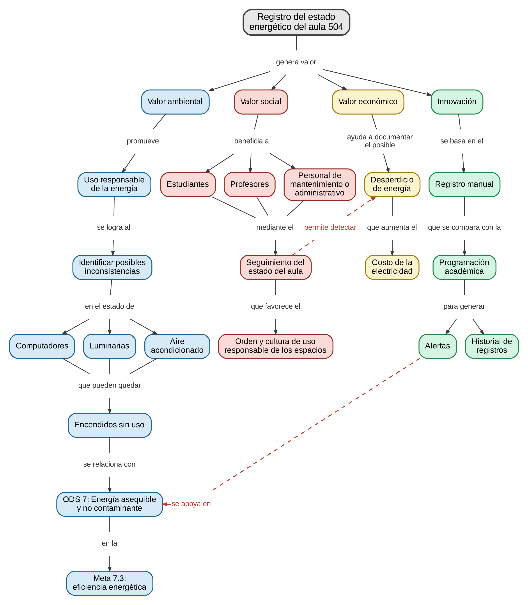

*Nota.* Mapa elaborado por el equipo en el Cuadrante 2 y redibujado en formato digital para corregir errores de digitación, agregar la palabra de enlace que faltaba en dos relaciones y unificar los términos con el Cuadrante 3 (Anexo E). Cada color corresponde a una rama; las líneas punteadas rojas son los dos enlaces cruzados (Tabla 7). El concepto «Alertas» se lee con la definición de la sección 7.1: aviso en pantalla de una posible inconsistencia.

##### 3.2 Valor ambiental, social, económico y de innovación

El mapa parte del concepto central **Registro del estado energético del aula 504** y se organiza en cuatro ramas de valor. Contiene 24 conceptos unidos por palabras de enlace y dos enlaces cruzados (líneas punteadas rojas) que conectan ramas distintas. A continuación se concreta el valor de cada rama y la forma en que podrá verificarse.

<a id="tabla-6"></a>

**Tabla 6**
*Valor del proyecto por rama y forma de verificarlo*

| **Rama** | **Valor concreto para el aula 504** | **¿Cómo se verificará?** |
|---|---|---|
| Ambiental | Contribuye al uso responsable de la energía eléctrica al hacer visibles los computadores, luminarias y aires acondicionados que permanecen encendidos sin uso, lo que se relaciona con la meta 7.3 (eficiencia energética) del ODS 7 y con la meta 12.2 (uso eficiente de recursos) del ODS 12. | Número de posibles inconsistencias registradas y repetidas en el historial durante el período de prueba. No se mide energía en kWh. |
| Social | Ofrece a estudiantes, profesores y personal de mantenimiento o administrativo una forma compartida de conocer el estado del aula, sin depender del recorrido de una sola persona, y favorece el orden y una cultura de uso responsable de los espacios. | Formulario aplicado en el Cuadrante 3; en la validación (objetivo específico 4), comprensión y utilidad percibida por los usuarios. |
| Económico | Aporta información documentada para que la institución pueda revisar el uso de la energía en el aula. Al no requerir sensores ni medidores, su costo de adopción es bajo frente a los referentes tecnológicos. El prototipo no mide ni reduce el consumo. | Comparación cualitativa de los requisitos de inversión frente a los referentes (matriz de la sección 5.4) y comprobación de que el prototipo funciona sin hardware adicional. |
| Innovación | Propone una alternativa de muy bajo alcance (registro manual + programación académica + señalamiento de posibles inconsistencias + historial) para validar el problema antes de invertir en automatización. | Resultado de la matriz de calificación (5.4) y declaración del vacío y del factor diferenciador (5.5). |

<a id="tabla-7"></a>

**Tabla 7**
*Enlaces cruzados del mapa conceptual*

| **N.º** | **Concepto de origen (rama)** | **Palabra de enlace** | **Concepto de destino (rama)** | **¿Por qué conecta las ramas?** |
|---|---|---|---|---|
| 1 | Alertas (innovación) | se apoya en | ODS 7 (ambiental) | Las alertas, entendidas como el aviso de una posible inconsistencia, permiten revisar el uso innecesario de energía, que es lo que busca la meta 7.3. |
| 2 | Seguimiento del estado del aula (social) | permite detectar | Desperdicio de energía (económico) | El seguimiento compartido del aula permite reconocer situaciones que podrían ser desperdicio y que la institución puede revisar. |

### 12. Objetivos del proyecto

#### 4. Objetivos del proyecto

##### 4.1 Objetivo general

Desarrollar un prototipo de sistema digital para el aula 504 de la Torre 1 de la Corporación Universitaria Remington que permita registrar manualmente su estado de ocupación y el estado de luces, computadores y aire acondicionado, compararlos con la programación académica e identificar posibles inconsistencias que podrían indicar un uso innecesario de energía, sin medir el consumo ni confirmar que exista desperdicio.

##### 4.2 Objetivos específicos

<a id="tabla-8"></a>

**Tabla 8**
*Objetivos específicos por fase del proyecto*

| **Fase** | **Objetivo específico** |
|---|---|
| 1. Indagación | Caracterizar el problema de uso innecesario de energía en el aula 504 a partir de la observación del entorno y de la información obtenida de los actores relacionados, para establecer un contexto verificable del problema y su relación con el ODS 7. |
| 2. Análisis y requisitos | Obtener y organizar los requisitos funcionales y no funcionales del sistema a partir de la información proporcionada por los actores reales, para definir qué debe registrar, comparar, señalar y conservar el prototipo. |
| 3. Diseño y prototipo | Diseñar y construir un prototipo funcional en consola que represente el registro del estado del aula, la carga de la programación académica, la comparación de información, el señalamiento de posibles inconsistencias y el historial, para visualizar una solución coherente con el alcance delimitado. |
| 4. Validación | Validar con usuarios relacionados con el problema la comprensión y utilidad del concepto y posteriormente del prototipo, para identificar ajustes necesarios y comprobar que la propuesta responde a situaciones reales del aula 504. |

*Nota.* El objetivo 4 sigue pendiente: en el Cuadrante 3 todavía no se ha validado el prototipo con usuarios.

### 13. Estado del arte

#### 5. Estado del arte: qué existe ya

El estado del arte se construye en dos niveles. Primero se realiza un rastreo amplio de referentes académicos, institucionales y de soluciones existentes. Después se seleccionan soluciones reales para abrirlas y probar la tarea principal relacionada con el proyecto. La guía exige mínimo 20 referentes, al menos 8 académicos y al menos 6 soluciones reales; el rastreo siguiente reúne 22 referentes: 12 académicos, 3 fuentes institucionales y 7 soluciones reales.

##### 5.1 Tabla de rastreo de referentes

<a id="tabla-9"></a>

**Tabla 9**
*Rastreo de veintidós referentes*

| **#** | **Referente y cita** | **Tipo** | **Motor / fuente** | **Año** | **Enlace** | **Factor diferenciador** | **Consulta** |
|---|---|---|---|---|---|---|---|
| 1 | Sistema para la eficiencia energética en edificaciones educativas utilizando tecnologías IoT (Moreno Arrieta et al., 2025) | Artículo académico | Google / portal de revista | 2025 | https://ojs.uac.edu.co/index.php/prospectiva/es/article/view/3768 | Integra sensores y automatización en infraestructura educativa. | 18/09/2026 |
| 2 | Sistema de Gestión Energética basado en medidores inteligentes y NILM (Pesantes Ocampo, 2024) | Trabajo de titulación | Google / repositorio ESPOL | 2024 | https://www.dspace.espol.edu.ec/handle/123456789/63030 | Analiza patrones de consumo de laboratorios y aulas mediante medición inteligente. | 18/09/2026 |
| 3 | Metodologías para la evaluación de la eficiencia energética en edificaciones universitarias: revisión literaria (Gonzalez Salcedo et al., 2023) | Artículo académico | Dialnet | 2023 | https://dialnet.unirioja.es/servlet/articulo?codigo=9824629 | Revisa metodologías para evaluar desempeño energético universitario. | 18/09/2026 |
| 4 | Application of an energy management system via the Internet of Things on a university campus (Shyr et al., 2017) | Artículo académico | Google / revista científica | 2017 | https://www.ejmste.com/article/application-of-an-energy-management-system-via-the-internet-of-things-on-a-university-campus-5384 | Control de iluminación mediante IoT en campus universitario. | 18/09/2026 |
| 5 | IoT platform for energy sustainability in university campuses (Moura et al., 2021) | Artículo académico | Google / PMC | 2021 | https://pmc.ncbi.nlm.nih.gov/articles/PMC7829703/ | Integra monitoreo y control de HVAC e iluminación. | 18/09/2026 |
| 6 | Toward an intelligent campus: IoT platform for remote monitoring and control of smart buildings (Ahmed et al., 2022) | Artículo académico | Google / MDPI | 2022 | https://doi.org/10.3390/s22239045 | Arquitectura jerárquica para campus, edificios y aulas. | 18/09/2026 |
| 7 | Real-time monitoring internet of things-based smart energy management system for university campuses (Ofem et al., 2026) | Artículo académico | Google / revista científica | 2026 | https://doi.org/10.4314/gjpas.v32i4.5 | Monitoreo en tiempo real con sensores, analítica y control. | 16/09/2026 |
| 8 | Análisis comparativo del consumo energético de un edificio universitario a partir de medición tradicional y medición inteligente (Téllez-Gutiérrez et al., 2026) | Artículo académico | Google / Universidad Nacional | 2026 | https://revistas.unal.edu.co/index.php/SICEL/article/view/121243 | Compara medición tradicional y medición avanzada en edificio universitario. | 17/09/2026 |
| 9 | IoT-based electricity and lecture room usage management information system (Jazuli & Sisephaputra, 2026) | Artículo académico | Google / revista científica | 2026 | https://ejournal.unesa.ac.id/index.php/JEISBI/article/view/76220 | Relaciona gestión de salas con consumo eléctrico mediante IoT. | 17/09/2026 |
| 10 | Comparison of energy consumption depending on the occupancy-based HVAC control in a university campus building (Seong & Hong, 2021) | Artículo académico | Google / KCI | 2021 | https://www.kci.go.kr/kciportal/ci/sereArticleSearch/ciSereArtiView.kci?sereArticleSearchBean.artiId=ART002790317 | Usa información de ocupación para ajustar operación de HVAC. | 17/09/2026 |
| 11 | Sistema IoT para automatización y monitoreo de iluminación y climatización (Delgado Mera & Véliz Noboa, 2026) | Artículo académico | Google / revista UTM | 2026 | https://revistas.utm.edu.ec/index.php/Riemat/article/view/7824 | Automatiza iluminación y climatización en aulas universitarias. | 18/09/2026 |
| 12 | Implementation of IOT based smart energy management system in college campus (Pazhanimuthu et al., 2020) | Artículo académico | Google / revista | 2020 | https://sersc.org/journals/index.php/IJFGCN/article/view/32847 | Monitorea variables eléctricas y genera reportes y alertas. | 18/09/2026 |
| 13 | Programa de Uso Racional y Eficiente de la Energía (UPME, s. f.) | Fuente institucional | Google / UPME | s. f. | https://www.upme.gov.co/simec/planeacion-energetica/proure/ | Marco de política pública para uso eficiente de energía (plan de acción 2022-2030). | 18/09/2026 |
| 14 | ODS 7: Energía asequible y no contaminante (Naciones Unidas, 2026a) | Fuente institucional | Google / Naciones Unidas | 2026 | https://sdgs.un.org/goals/goal7 | Incluye la meta 7.3 sobre mejora de la eficiencia energética. | 18/09/2026 |
| 15 | ODS 12: Producción y consumo responsables (Naciones Unidas, 2026b) | Fuente institucional | Google / Naciones Unidas | 2026 | https://sdgs.un.org/goals/goal12 | Incluye la meta 12.2 sobre uso eficiente de recursos. | 18/09/2026 |
| 16 | EnergyCAP – Energy and utility management for higher education (EnergyCAP, 2026) | Solución real | Google / sitio oficial | 2026 | https://www.energycap.com/industries/higher-education/ | Centraliza datos de energía y servicios públicos para educación superior. | 18/09/2026 |
| 17 | EcoStruxure Building Operation / Building Advisor (Schneider Electric, 2026) | Solución real | Google / sitio oficial | 2026 | https://www.se.com/ww/en/work/software/ecostruxure-building/large-buildings-energy-management/ | Monitorea, analiza y optimiza sistemas de edificios con datos históricos y en tiempo real. | 18/09/2026 |
| 18 | OpenBlue (Johnson Controls, 2026) | Solución real | Google / sitio oficial | 2026 | https://openblue.johnsoncontrols.com/ | Integra datos de edificios y ofrece optimización energética y automatización. | 18/09/2026 |
| 19 | GridPoint Intelligence / Energy Manager (GridPoint, 2026) | Solución real | Google / sitio oficial | 2026 | https://www.gridpoint.com/ | Combina medición, monitoreo, alertas y control de activos. | 18/09/2026 |
| 20 | Spacewell Energy – DEXMA Analyse / Detect / Optimise (Spacewell Energy, 2026) | Solución real | Google / sitio oficial | 2026 | https://www.dexma.com/spacewell-energy-platform-dexma-analyse/ | Ofrece monitoreo, análisis, alertas y detección de anomalías energéticas. | 18/09/2026 |
| 21 | Metasys – Johnson Controls, Energy Dashboard and Reporting (Johnson Controls, s. f.) | Solución real | Google / documentación oficial | s. f. | https://docs.johnsoncontrols.com/bas/r/Metasys/en-US/Metasys-UI-Energy-Dashboard-and-Reporting-Feature-User-Guide/16.0/Introduction | Monitorea la eficiencia energética, detecta problemas y permite consultar el uso energético. | 18/09/2026 |
| 22 | Building Energy Dashboard – Cornell University (Cornell University, s. f.) | Solución real | Google / sitio institucional | s. f. | https://sustainable.cornell.edu/buildings-energy/building-energy-dashboard | Permite visualizar y comparar datos de consumo energético de edificios del campus. | 18/09/2026 |

##### 5.2 Soluciones seleccionadas para prueba

Para no presentar como realizada una prueba que todavía no se ha hecho, se dejan seis soluciones seleccionadas como candidatas a prueba (S1 a S6). La guía exige haber usado de verdad al menos tres; el equipo probará las seis que estén accesibles y declarará cuáles no lo estuvieron. Cada prueba consiste en intentar una tarea comparable (identificar consumo o uso, revisar información de un espacio, generar o consultar una alerta, o visualizar historial) y la evidencia será una captura o una nota de la acción realmente realizada, registrada en el Anexo D.

<a id="tabla-10"></a>

**Tabla 10**
*Seis soluciones candidatas a prueba y tarea principal*

| **Solución** | **¿Qué hace?** | **Tarea principal que se debe lograr al usarla** | **Estado** | **Consulta** |
|---|---|---|---|---|
| S1 EnergyCAP | Gestión de energía y servicios públicos para educación superior. | Explorar la demo, los videos o la cuenta de prueba que estén disponibles y registrar si se puede consultar el consumo de un edificio y si existe alguna función de alertas o de historial. Documentar el tipo de acceso obtenido (con o sin cuenta). | Pendiente de prueba directa. | 16/09/2026 |
| S2 EcoStruxure Building Operation / Building Advisor | Monitoreo, análisis y optimización del desempeño energético de edificios. | Verificar si hay demo o recurso accesible y documentar una acción observable: consultar un diagnóstico, una alerta o un historial de un edificio. | Pendiente de prueba directa. | 17/09/2026 |
| S3 OpenBlue | Plataforma para optimización de edificios, energía y operación. | Verificar si existe una demostración o un entorno accesible y registrar la acción realizada: ver cómo se muestra el estado energético de un espacio. | Pendiente de prueba directa. | 18/09/2026 |
| S4 Spacewell Energy – DEXMA | Monitoreo, análisis, alertas y detección de anomalías energéticas. | Comprobar el acceso a demo o prueba gratuita y documentar la tarea principal: consultar o crear una alerta de consumo anómalo. | Pendiente de prueba directa. | 18/09/2026 |
| S5 Metasys – Johnson Controls | Monitoreo de la eficiencia energética, detecta problemas y permite consultar el uso energético. | Verificar el acceso (demo o guía de usuario) y documentar una acción observable: ubicar el reporte de uso energético y qué datos muestra. Si solo hay documentación, declarar que la prueba fue limitada. | Pendiente de prueba directa. | 18/09/2026 |
| S6 Building Energy Dashboard (Cornell) | Permite visualizar y comparar datos de consumo energético de edificios. | Abrir el tablero público, elegir un edificio y comparar su consumo entre dos períodos; registrar si muestra alertas o historial y si requiere capacitación. | Pendiente de prueba directa. | 18/09/2026 |

*Nota.* Estado actual: ninguna de las soluciones ha sido probada todavía; no se afirma nada sobre su funcionamiento hasta contar con la evidencia del Anexo D.

##### 5.3 Criterios de comparación

Los cuatro criterios propuestos son: adecuación funcional, usabilidad, compatibilidad y confiabilidad. Se eligen porque el proyecto necesita comprobar si una solución realiza funciones relacionadas con el problema, si una persona puede usarla sin capacitación extensa, si puede conectarse con otros sistemas o datos y si mantiene un funcionamiento estable. La adecuación funcional es el criterio obligatorio, porque determina si la solución atiende el problema observado.

<a id="tabla-11"></a>

**Tabla 11**
*Criterios de comparación y pregunta de evaluación*

| **Criterio** | **Pregunta de evaluación** | **Evidencia que se registrará** |
|---|---|---|
| Adecuación funcional | ¿Permite identificar o gestionar situaciones de uso energético ineficiente? | Captura o nota de la función usada (alerta, historial, consulta de estado o consumo). |
| Usabilidad | ¿Una persona sin capacitación logra realizar la tarea principal? | Pasos y tiempo que tomó la tarea, y si fue necesario consultar ayuda o manuales. |
| Compatibilidad | ¿Puede integrarse o intercambiar datos con otros sistemas? | Captura o nota de las opciones de exportar, importar o conectar datos. |
| Confiabilidad | ¿Funciona estable durante la prueba, sin fallos ni pérdida de información? | Nota de fallos, demoras o pérdida de información durante la prueba. |

<a id="tabla-12"></a>

**Tabla 12**
*Escala de calificación de 0 a 5*

| **Puntaje** | **Significado** |
|---|---|
| 5 | Cumple completamente, sin dificultades. |
| 4 | Cumple bien, con dificultades menores. |
| 3 | Cumple de forma aceptable, con algunas dificultades. |
| 2 | Cumple parcialmente, con dificultades importantes. |
| 1 | Cumple de forma mínima o con fallas graves. |
| 0 | No cumple o no fue posible probarlo (se justifica en la evidencia). |
| NE | No evaluado todavía. |

##### 5.4 Matriz de calificación y evidencias

La matriz cruza los cuatro criterios con las seis soluciones. Cada calificación debe respaldarse con evidencia concreta (Anexo D). Mientras la prueba no se realice, las celdas permanecen en NE, y el total se calcula sumando las calificaciones de cada criterio.

<a id="tabla-13"></a>

**Tabla 13**
*Matriz de calificación de soluciones*

| **Criterio** | **S1 EnergyCAP** | **S2 EcoStruxure** | **S3 OpenBlue** | **S4 DEXMA** | **S5 Metasys** | **S6 Cornell** |
|---|---|---|---|---|---|---|
| Adecuación funcional | NE | NE | NE | NE | NE | NE |
| Usabilidad | NE | NE | NE | NE | NE | NE |
| Compatibilidad | NE | NE | NE | NE | NE | NE |
| Confiabilidad | NE | NE | NE | NE | NE | NE |
| Total por solución | NE | NE | NE | NE | NE | NE |

*Nota.* NE = no evaluado todavía. Una vez completada, el criterio con menor puntaje total entre todas las soluciones se declara como el vacío (sección 5.5).

##### 5.5 Declaración del vacío encontrado y del factor diferenciador

**Declaración provisional, sujeta a la matriz definitiva.** Los referentes revisados muestran una fuerte presencia de soluciones basadas en sensores, medidores inteligentes, IoT, automatización y plataformas de monitoreo. El proyecto del equipo tiene un alcance deliberadamente menor: registro manual del estado del aula, comparación con la programación académica, señalamiento de posibles inconsistencias e historial, sin hardware ni conexión directa con los equipos eléctricos.

**Vacío que debe comprobarse con la prueba de las soluciones:** falta de una alternativa de muy bajo alcance y baja dependencia de hardware que permita probar, en un aula concreta, si la combinación de registro manual y programación académica puede servir para identificar posibles situaciones de uso innecesario de energía antes de invertir en automatización. El vacío definitivo será el criterio con el menor puntaje total en la matriz de la sección 5.4.

**Factor diferenciador provisional (con criterio y condición comprobable):** el criterio de calidad es la **usabilidad con baja dependencia de hardware**. Se comprobará así: una persona sin capacitación previa debe poder registrar el estado completo del aula 504 (ocupación, luces, computadores y aire acondicionado) en el prototipo en **menos de dos minutos**, y sin ningún dispositivo adicional; se cronometrarán tres registros reales. Esta condición quedó como el requisito no funcional RNF-01 del Cuadrante 3. Si la matriz muestra que el vacío corresponde a otro criterio, el factor se reformulará sobre ese criterio, conservando una condición medible.

##### 5.6 Alcance verificado: viabilidad, qué se programa y qué se conecta, exclusiones y límites

<a id="tabla-14"></a>

**Tabla 14**
*Preguntas de viabilidad*

| **Pregunta de viabilidad** | **Respuesta** | **Justificación** |
|---|---|---|
| ¿La solución le sirve de verdad a la comunidad o entidad que la recibiría? | Sí, de manera potencial y delimitada. | El problema fue observado en aulas reales y la solución se enfoca en el aula 504. La utilidad definitiva deberá confirmarse con usuarios reales mediante validación. |
| ¿La pueden construir dos personas en dos semestres, con lo que saben o pueden aprender? | Sí, con el alcance actual. | Se limita a un aula, registro manual, comparación con programación e historial; no contempla sensores, hardware, medición directa de kWh ni control físico. |
| ¿Se puede acoplar a lo que esas personas ya usan hoy? | Sí, de forma preliminar. | La propuesta puede trabajar con la observación manual y con la programación académica. La compatibilidad con sistemas institucionales no se asume porque el alcance excluye esa conexión. |

<a id="tabla-15"></a>

**Tabla 15**
*Qué se programa y qué se conecta (actualizado con las decisiones del Cuadrante 3)*

| **Componente** | **Se programa o se conecta** | **Detalle** |
|---|---|---|
| Registro manual del estado del aula (ocupación, luces, computadores y aire acondicionado) | Se programa | Formulario propio del prototipo; es el núcleo de la propuesta. |
| Programación académica del aula 504 | Se programa | Carga y gestión manual de los bloques de clase. Los datos los registra el equipo a partir del horario real del aula; no hay conexión con sistemas institucionales. |
| Comparación y señalamiento de posibles inconsistencias | Se programa | Reglas RN-01 y RN-02 definidas en el Cuadrante 3. El resultado se calcula cada vez; no se guarda como tabla. |
| Historial de registros | Se programa | Consulta de los registros guardados por rango de fechas, con el resultado de la comparación de cada uno. |
| Aviso del resultado | Se programa (en pantalla) | El resultado se muestra en la pantalla del prototipo. El envío por correo o celular quedó excluido en el Cuadrante 3. |
| Almacenamiento de datos | Se programa | Arreglos en memoria y archivos de texto, como exige la guía del tercer cuadrante. No se usa un motor de base de datos en este semestre. |
| Acceso de usuarios | No se implementa | El prototipo no tiene perfiles ni autenticación; quien registra escribe su nombre en persona_registra (exclusión del Cuadrante 3). |

*Nota.* En el Cuadrante 2 la tabla dejaba como «se conecta» el envío de avisos, el almacenamiento en un motor de base de datos y la autenticación, y aplazaba la elección al Cuadrante 3. Este cuadrante tomó la decisión y la tabla se actualizó (Anexo E).

<a id="tabla-16"></a>

**Tabla 16**
*Elementos excluidos del alcance actual*

| **Elemento excluido** | **Justificación** |
|---|---|
| Sensores y dispositivos físicos | Requieren compra, instalación y pruebas de hardware que superan el tiempo y los recursos del semestre; la hipótesis se puede probar con registro manual. |
| Medición directa del consumo en kWh | Necesita medidores o acceso a datos de consumo que el equipo no tiene; el proyecto identifica posibles situaciones, no mide ahorro. |
| Conexión con sistemas institucionales | Exige permisos y coordinación con la institución que no se pueden asegurar en el semestre. |
| Control físico de los equipos (encender o apagar) | Requiere hardware de control y condiciones de seguridad; el prototipo solo registra y señala. |
| Salones 506 y 605 y otros espacios | Un aula de prueba basta para validar la hipótesis; ampliar la cobertura queda como trabajo futuro. |
| Automatización con IoT | Se considera una evolución futura del prototipo, una vez validado el registro manual. |
| Tiempo que lleva encendido un elemento | Agregado en el Cuadrante 3: un registro manual no puede saber desde cuándo estaba encendido (RN-04). |
| Avisos por correo o celular, perfiles de usuario y seguimiento de alertas | Agregado en el Cuadrante 3: no se confirmó un proceso que los requiera y exigirían servicios externos o entidades adicionales. |

<a id="tabla-17"></a>

**Tabla 17**
*Límites entre el Cuadrante 2 y el Cuadrante 3, y estado en el Cuadrante 3*

| **Se definió en el Cuadrante 2** | **Se reservó para el Cuadrante 3** | **Estado en el Cuadrante 3** |
|---|---|---|
| Problema observado, ODS y valor del proyecto. | Requisitos funcionales y no funcionales definitivos, a partir de la información recolectada. | Hecho: secciones 3 y 5 del Cuadrante 3, a partir del formulario aplicado (la ficha de observación estructurada no se aplicó). |
| Objetivos general y específicos. | Prototipo y metodología de construcción. | Diseño hecho (secciones 8 a 10); código en revisión. |
| Estado del arte, matriz de comparación, vacío y factor diferenciador. | Arquitectura, modelo de datos y diseño definitivo del prototipo. | Hecho: secciones 4, 7 y 9 del Cuadrante 3. La prueba de soluciones sigue pendiente. |
| Alcance, exclusiones y distinción entre lo que se programa y lo que se conecta. | Elección concreta de los servicios que se conectan y condición exacta de la alerta. | Hecho: no se conecta ningún servicio externo; la condición está en RN-01 y RN-02. |
| Técnicas e instrumentos de elicitación (guion y fichas). | Resultados de las pruebas con usuarios y ajustes derivados. | Pendiente: la validación con usuarios no se ha realizado. |

### 14. Marco teórico

#### 7. Marco teórico

##### 7.1 Siete conceptos definidos, con fuente

<a id="tabla-20"></a>

**Tabla 20**
*Siete conceptos del marco teórico*

| **Concepto** | **Definición adoptada** | **Fuente** |
|---|---|---|
| Eficiencia energética | Relación entre el servicio energético útil y la energía utilizada para producirlo; un sistema es más eficiente cuando presta el mismo servicio con menor consumo de energía. | International Energy Agency (s. f.) |
| Sistema de gestión de la energía (SGEn) | Sistema que establece política, objetivos, metas, planes de acción y procesos para mejorar el desempeño energético de una organización. | ISO (2018a) |
| Desempeño energético | Resultado medible relacionado con la eficiencia energética, el uso de la energía y el consumo de energía. | ISO (2018a) |
| Consumo de energía | Cantidad de energía utilizada por equipos, procesos o actividades durante un periodo determinado. | ISO (2018a) |
| Ocupación | Condición de un espacio respecto de la presencia o ausencia de personas que lo utilizan; en este proyecto se registra de manera manual para contextualizar el estado de los equipos. | Definición operacional del proyecto. |
| IoT (Internet de las cosas) | Enfoque tecnológico en el que dispositivos y sensores conectados permiten recopilar e intercambiar datos para monitoreo o control. | Moreno Arrieta et al. (2025) |
| Alerta | Aviso que el prototipo muestra en pantalla cuando un registro da como resultado «posible inconsistencia» según las reglas RN-01 y RN-02 del Cuadrante 3. No confirma desperdicio de energía ni se envía fuera del prototipo. | Definición operacional del proyecto, precisada en el Cuadrante 3. |

##### 7.2 Anclaje en el ODS y su meta

<a id="tabla-21"></a>

**Tabla 21**
*Anclaje en los ODS*

| **Elemento** | **Contenido** |
|---|---|
| ODS principal | ODS 7 — Energía asequible y no contaminante (Naciones Unidas, 2026a). |
| Meta específica | Meta 7.3: de aquí a 2030, duplicar la tasa mundial de mejora de la eficiencia energética. |
| Contribución del proyecto | El prototipo busca identificar posibles situaciones de uso innecesario de energía en un aula mediante registro del estado de ocupación y equipos y comparación con la programación académica. No pretende medir por sí mismo el consumo real en kWh ni demostrar ahorro energético durante este semestre. |
| ODS complementario | ODS 12 — Producción y consumo responsables (Naciones Unidas, 2026b). |
| Meta relacionada | Meta 12.2: de aquí a 2030, lograr la gestión sostenible y el uso eficiente de los recursos naturales. |
| Contribución complementaria | La propuesta promueve información y seguimiento sobre el uso responsable de la energía en un espacio educativo. |

*Nota.* Coherencia con la sección 2.3: el hallazgo se justificó allí desde el uso responsable de los recursos (ODS 12) y su efecto sobre la energía (ODS 7). Para el anclaje técnico del prototipo se toma como principal la meta 7.3 del ODS 7, porque lo que el prototipo identifica es el posible uso innecesario de energía eléctrica; el ODS 12 (meta 12.2) permanece como complemento.

##### 7.3 Dos tendencias tecnológicas aplicables

<a id="tabla-22"></a>

**Tabla 22**
*Tendencias tecnológicas aplicables*

| **Tendencia / enfoque** | **Problema que ayuda a resolver** | **Aplicación al proyecto** | **Fuente** |
|---|---|---|---|
| Internet de las cosas (IoT) | Permite monitorear variables del entorno y equipos en tiempo real cuando existen sensores y conectividad. | Puede considerarse una evolución futura del prototipo para automatizar la captura de ocupación y estado de equipos; no se implementará durante este semestre. | Moreno Arrieta et al. (2025); Shyr et al. (2017) |
| Analítica y visualización de datos energéticos | Permite organizar históricos, detectar anomalías o patrones y facilitar decisiones sobre el uso de energía. | Se aplica desde el prototipo con registros manuales para consultar el historial y reconocer la repetición de posibles inconsistencias, sin afirmar medición energética directa. | Pesantes Ocampo (2024); EnergyCAP (2026) |

### 15. Técnicas de elicitación

#### 6. Recolección de información: la entrevista y las otras técnicas

La guía del segundo cuadrante exigía al menos dos técnicas de campo: entrevista obligatoria y una segunda entre observación, escenarios o reuniones facilitadas. En este proyecto se seleccionó observación como segunda técnica porque el problema está relacionado con conductas y rutinas que pueden no ser recordadas o descritas completamente por las personas. La aplicación real de las técnicas se describe en la sección 1 del Cuadrante 3.

##### 6.1 Técnicas seleccionadas y justificación de la elección

<a id="tabla-18"></a>

**Tabla 18**
*Técnicas de elicitación seleccionadas y estado de aplicación*

| **Técnica** | **Qué permite conocer** | **Justificación para este proyecto** | **Estado** |
|---|---|---|---|
| Entrevista | Cómo se realiza actualmente el cierre de las aulas, qué dificultades existen, quién revisa equipos, qué información sería útil y qué situaciones excepcionales ocurren. | Permite conocer el proceso desde la perspectiva de estudiantes, docentes y personal encargado, sin imponerles una solución predeterminada. | Aplicada en el Cuadrante 3 como entrevista estructurada por escrito (formulario de Google, 2 al 30 de octubre de 2026, 30 respuestas analizadas). El instrumento aplicado está en el Anexo A. |
| Observación estructurada | Qué ocurre realmente al finalizar una actividad: ocupación, luces, computadores, aire acondicionado, acciones del docente o encargado y condiciones del contexto. | El problema surgió de observaciones reales y puede contener rutinas que los actores no mencionen porque forman parte de su actividad cotidiana. | La ficha estructurada no se aplicó: 9 de 30 personas dicen que no hay un momento fijo de revisión, así que no hay una hora planeable para observar un cierre. Se hicieron observaciones directas por recorrido (15 de agosto, 8 de septiembre y 31 de octubre de 2026, Anexo C), que confirman el problema pero no se usaron para levantar requisitos. |

##### 6.2 Actores y personas a contactar

Los actores se listan con su relación con el problema, la información que interesaba obtener de cada uno y el estado del contacto. No se inventan nombres ni contactos.

<a id="tabla-19"></a>

**Tabla 19**
*Actores, información que interesa y estado del contacto*

| **Actor** | **Relación con el problema** | **Información que interesa obtener** | **Estado del contacto** |
|---|---|---|---|
| Personal encargado de revisar las aulas (actor priorizado) | Revisa aulas y detecta equipos o elementos encendidos; fue observado en campo el 15 de agosto. | Cómo realiza la revisión, qué información utiliza, qué dificultades encuentra y si queda registro de lo encontrado. | No se logró contactar. Pendiente: entrevista presencial para resolver los asuntos abiertos del Cuadrante 3. |
| Profesores | Supervisan actividades y pueden realizar el cierre del aula. | Cómo verifican el estado del aula, qué pasos siguen y qué excepciones enfrentan. | Pudieron responder el formulario; el formulario no preguntó el rol. |
| Estudiantes | Usan los computadores y pueden dejar equipos encendidos. | Qué hacen al terminar, qué les impide revisar o apagar, qué recordatorios serían útiles. | Respondieron el formulario; casi todas las personas que declararon su rol son estudiantes. |
| Autoridad institucional | Puede establecer orientaciones o procedimientos relacionados con el uso de los espacios. | Qué procedimientos existen y qué información institucional podría ser pertinente. | No contactada. |

#### 8. Recolección de información: los instrumentos

##### 8.1 Guion de entrevista propuesto en el Cuadrante 2

Este es el guion que se preparó en el Cuadrante 2 para una entrevista presencial con el personal encargado. Como esa persona no se logró contactar, el equipo adaptó las preguntas a un formulario escrito dirigido a quienes usan las aulas: las preguntas 1, 3, 5 y 6 se conservaron casi iguales y las demás se cambiaron por preguntas cerradas de frecuencia, tiempo, importancia y preferencia. El instrumento realmente aplicado está en el Anexo A.

**Objetivo.** Conocer cómo se realiza actualmente la revisión de las aulas de sistemas, qué información se utiliza durante este proceso, qué situaciones se presentan con los computadores, las luminarias y el aire acondicionado, cómo se actúa ante ellas y qué necesidades podría tener el personal encargado para realizar este proceso. **Actor al que estaba dirigida:** personal encargado de la revisión o cierre de las aulas de sistemas.

1. ¿Podría explicarnos paso a paso cómo realiza actualmente la revisión de un aula de sistemas cuando termina una actividad o cuando el aula queda sin estudiantes?
2. Durante esa revisión, ¿qué aspectos verifica en los computadores, las luminarias y el aire acondicionado?
3. ¿Cómo determina actualmente si el aula está ocupada, si una actividad ya terminó o si el aula se encuentra disponible?
4. ¿Qué información o herramientas consulta para saber si el aula debería estar siendo utilizada en ese momento?
5. Cuando durante una revisión encuentra algún computador, luminaria o aire acondicionado encendido y considera que no debería estarlo, ¿qué procedimiento sigue?
6. Después de realizar una acción sobre alguno de estos elementos, ¿queda algún registro de lo encontrado, de la acción realizada o de la fecha y hora? ¿Cómo se conserva actualmente esa información?
7. ¿Qué situaciones o dificultades se presentan con mayor frecuencia durante la revisión de las aulas y qué hace cuando ocurren?
8. Cuando necesita revisar varias aulas, ¿cómo organiza o prioriza las revisiones y qué información tiene en cuenta para hacerlo?
9. ¿Qué información considera necesaria para identificar que el estado de un aula no coincide con la actividad que debería estar realizando en ese momento?
10. Si una herramienta digital apoyara este proceso, ¿qué información necesitaría consultar para decidir qué acción realizar?
11. ¿Qué información considera importante conservar de cada revisión para poder consultar posteriormente lo ocurrido en un aula?
12. ¿Qué tendría que permitirle hacer una herramienta digital para que fuera útil dentro de sus actividades habituales y pudiera incorporarla a su proceso de trabajo?

**Cierre.** ¿Hay alguna necesidad, dificultad o situación relacionada con la revisión y el uso eficiente de la energía en el aula que no hayamos preguntado y que considere importante mencionar?

##### 8.2 Instrumento de la segunda técnica seleccionada: observación

**Objetivo.** Observar cómo se realiza en la práctica la revisión de un aula de sistemas, prestando atención al estado de los computadores, las luminarias y el aire acondicionado, a la información que utiliza la persona encargada y a las acciones que realiza cuando encuentra alguna situación que requiere atención. **Proceso que se observaría:** revisión de un aula de sistemas cuando termina una actividad o cuando el aula se encuentra sin estudiantes. **Lugar:** Torre 1, aula 504. **Aspectos:** estado del aula; computadores; luminarias; aire acondicionado; proceso de revisión; información utilizada; registro de la actividad; dificultades; aspectos adicionales. Este instrumento no se aplicó en el Cuadrante 3 (sección 6.1).

<a id="tabla-23"></a>

**Tabla 23**
*Registro de campo de la observación (instrumento preparado, no aplicado)*

| **Campo** | **Registro** |
|---|---|
| Fecha y hora |  |
| Lugar | Torre 1 — aula 504 |
| Actividad observada |  |
| Persona que realiza el cierre |  |
| Ocupación del aula al finalizar | ☐ Ocupada   ☐ Vacía   ☐ No fue posible determinar |
| Computadores | Cantidad encendida: ____   Cantidad en uso: ____   Cantidad sin uso: ____ |
| Luces | ☐ Encendidas   ☐ Apagadas   ☐ No fue posible determinar |
| Aire acondicionado | ☐ Encendido   ☐ Apagado   ☐ No fue posible determinar |
| Programación académica disponible | ☐ Sí   ☐ No |
| Coincidencia con la programación | ☐ Coincide   ☐ No coincide   ☐ No se puede determinar |
| Acción realizada al detectar el estado |  |
| Herramienta usada por la persona | ☐ Ninguna   ☐ Cuaderno   ☐ WhatsApp   ☐ Plataforma   ☐ Otra: ______ |
| Algo que no había sido mencionado |  |
| Dificultad observada |  |
| Evidencia adjunta | ☐ Notas   ☐ Foto autorizada   ☐ Captura   ☐ Otra: ______ |
| Observaciones adicionales |  |

### 16. Lista de verificación del Cuadrante 2

#### Lista de verificación del Cuadrante 2

<a id="tabla-25"></a>

**Tabla 25**
*Lista de verificación del Cuadrante 2 y estado actualizado*

| **Estado** | **Ítem de la guía del Cuadrante 2** |
|---|---|
| Hecho | Mapa conceptual elaborado digitalmente, con cuatro ramas, 24 conceptos, palabras de enlace y dos enlaces cruzados (Figura 1). |
| Hecho | Objetivo general alineado con el problema y el alcance del aula 504. |
| Hecho | Cuatro objetivos específicos: indagación, requisitos, diseño y prototipo, y validación. |
| Hecho | Rastreo con 22 referentes, enlaces y fechas de consulta; mínimo ocho académicos (12) y seis soluciones reales (7). |
| Hecho | Se registran al menos cuatro motores o fuentes de búsqueda distintos. |
| Pendiente | Las soluciones seleccionadas fueron realmente abiertas y usadas; se adjuntan evidencias (Anexo D). |
| Pendiente | Cada calificación de la matriz tiene evidencia (Anexo D). |
| Pendiente | El vacío final se determina por el criterio con menor puntaje total después de la prueba (regla definida en 5.5). |
| Hecho | El factor diferenciador nombra un criterio de calidad y cómo se comprobará (provisional hasta completar la matriz). |
| Hecho | Las tres preguntas de viabilidad están respondidas y la línea de conexiones está delimitada. |
| Hecho | Hay siete conceptos con fuentes; el proyecto está anclado al ODS 7 y meta 7.3, con ODS 12 como complemento. |
| Hecho | Hay dos tendencias tecnológicas aplicables y justificadas. |
| Hecho | Se eligieron entrevista y observación y se prepararon sus instrumentos. |
| Hecho con cambios | Entrevista aplicada: se aplicó por escrito: se recibieron 32 respuestas y se analizan 30 (Cuadrante 3, sección 1). No se alcanzó al encargado de las aulas. |
| Hecho con cambios | Observación: la ficha estructurada no se aplicó; se hicieron observaciones directas por recorrido, la última el 31 de octubre de 2026 (sección 6.1 y Anexo C). |
| Pendiente | Actor priorizado (encargado de las aulas) con nombre o iniciales y forma de contacto. |

---

## Cuadrante 3. Prototipar y optimizar

### 17. Metodología de recolección de información

#### 1. Metodología de recolección de información

##### 1.1 Técnica escogida y técnica descartada

De las seis técnicas vistas en clase (entrevista, observación, escenarios, prototipos, reuniones facilitadas e historias de usuario), el equipo escogió la entrevista, aplicada por escrito como entrevista estructurada mediante un formulario de Google de doce preguntas. Se escogió porque no se conocía un procedimiento escrito para el cierre de las aulas de sistemas y la entrevista era la técnica que permitía reconstruirlo preguntándoselo directamente a quienes lo viven. Se aplicó por escrito porque las personas que pasan por las aulas (estudiantes, docentes y personal de aseo) no coinciden en un mismo horario ni lugar, y el formulario permitió llegar a ellas sin acordar una cita con cada una. El costo de esta decisión es que no se pudo repreguntar ni aclarar respuestas ambiguas, y que no se alcanzó a quien cumple el rol de encargado de las aulas, el actor priorizado en el Cuadrante 2.

Se descartó la observación como técnica para levantar los requisitos. Las observaciones del 15 de agosto, del 8 de septiembre y del 31 de octubre de 2026 (Anexo C) sirvieron para identificar y confirmar el problema, pero no pueden repetirse de forma planeada: 9 de las 30 personas respondieron que no hay un momento fijo de revisión (pregunta 8), así que no existe una hora en la que el equipo pueda estar presente para ver cómo se cierra un aula. Los escenarios, los prototipos y las historias de usuario no se aplicaron como técnicas de recolección; se trabajan después, a partir de lo que produjo el formulario (secciones 3 y 9).

##### 1.2 Cómo se aplicó

El formulario tuvo doce preguntas: cuatro abiertas (1, 3, 5 y 6), cuatro de opción múltiple con una sola respuesta (2, 4, 8 y 10), una de casillas de verificación que admitía varias respuestas (12), una lista desplegable (7) y dos escalas de 1 a 5 (9 y 11). Se aplicó entre el 2 y el 30 de octubre de 2026 y se recibieron 32 respuestas, que ocupan las filas 2 a 33 de la hoja de respuestas (la fila 1 es el encabezado). Para el análisis se usan 30: dos personas respondieron dos veces, y de cada una se conserva su primera respuesta y se excluye la segunda (R20 y R25, filas 21 y 26), para que nadie cuente doble. En la hoja no aparece ninguna respuesta de las integrantes del equipo. Como el formulario no pidió un identificador único, la depuración se hizo por nombre: 30 es el conjunto depurado por criterio del equipo, no una verificación de identidad. El instrumento tal como se aplicó está en el Anexo A.

Los participantes se eligieron por conveniencia, dentro del entorno universitario del equipo, por lo que los resultados no representan a toda la comunidad de la sede. El formulario no preguntó el rol de quien respondía; algunas personas lo declararon en sus respuestas (por ejemplo, R23 y R24 se identifican como estudiantes) y ninguna se presentó como encargada de las aulas. En este documento los participantes se nombran solo con un código (R1 a R32, según el orden de llegada de la respuesta: R1 es la fila 2 de la hoja y R32, la fila 33; R20 y R25 no se analizan); no se publican nombres.

##### 1.3 Evidencia por pregunta

**Pregunta 1.** ¿Podría explicarnos paso a paso cómo realiza actualmente la revisión de un aula de sistemas cuando termina una actividad o cuando el aula queda sin estudiantes?

Respuestas (selección): «El profesor pasa puesto por puesto revisando los equipos» (R7). «Yo salgo del salón y el profe se encarga de apagar el resto» (R24). «Apago el mi computador y voy saliendo, no realizó ninguna revisión» (R11). Siete de las 30 personas dicen que no revisan o que no saben cómo se hace.

<a id="figura-2"></a>

**Figura 2**
*Respuestas a la pregunta 1 en la hoja de respuestas del formulario de Google*

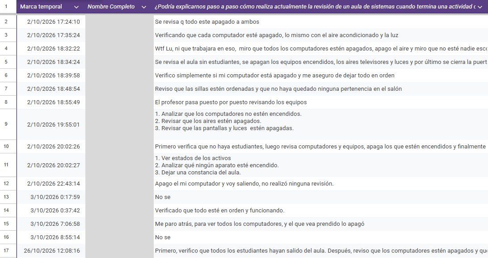

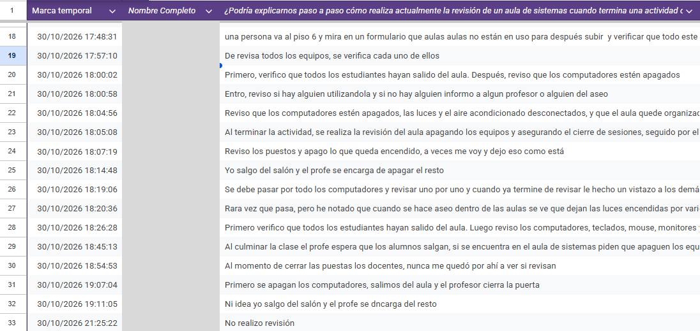

*Nota.* Captura de la hoja de respuestas del formulario de Google (una fila por respuesta). Arriba: filas 2 a 17 (R1 a R16); abajo: filas 18 a 33 (R17 a R32). Las filas 21 y 26 (R20 y R25) son segundas respuestas de una misma persona y no se cuentan (sección 1.2). La columna «Nombre Completo» se cubrió para no publicar nombres; las respuestas no se modificaron. Las respuestas largas aparecen cortadas por el ancho de la columna; las citas del texto se transcribieron de la respuesta completa.

**Pregunta 2.** Durante esa revisión, ¿qué aspectos verifica en los computadores, las luminarias y el aire acondicionado?

Se registraron 30 marcas, una por respuesta: computadores, 20; otro, 6; estado de puertas del aula, 2; aire acondicionado, 1; luminarias, 1. La opción «Otro» se presentó sin campo para escribir, por lo que no se sabe qué elementos incluye.

<a id="figura-3"></a>

**Figura 3**
*Respuestas a la pregunta 2 en la hoja de respuestas del formulario de Google*

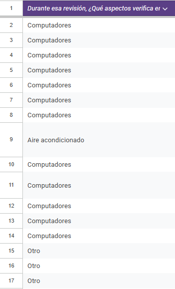
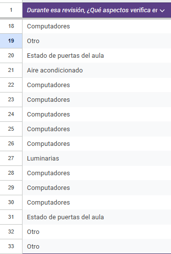

*Nota.* Captura de la hoja de respuestas del formulario de Google (una fila por respuesta). Izquierda: filas 2 a 17 (R1 a R16); derecha: filas 18 a 33 (R17 a R32). Las filas 21 y 26 (R20 y R25) son segundas respuestas de una misma persona y no se cuentan (sección 1.2).

**Pregunta 3.** ¿Cómo determina actualmente si el aula está ocupada, si una actividad ya terminó o si el aula se encuentra disponible?

Respuestas (selección): «Me pegó a la puerta, y escucho ruidos» (R14). «Si la puerta está cerrada o abierta» (R30). «Con el horario» (R7). «Voy a registro y control y pregunto» (R6). Al menos 19 de las 30 personas miran o escuchan la puerta o el interior del aula, y al menos siete consultan un horario.

<a id="figura-4"></a>

**Figura 4**
*Respuestas a la pregunta 3 en la hoja de respuestas del formulario de Google*

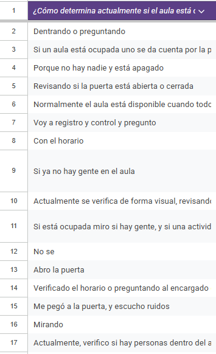
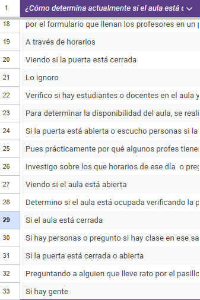

*Nota.* Captura de la hoja de respuestas del formulario de Google (una fila por respuesta). Izquierda: filas 2 a 17 (R1 a R16); derecha: filas 18 a 33 (R17 a R32). Las filas 21 y 26 (R20 y R25) son segundas respuestas de una misma persona y no se cuentan (sección 1.2). Las respuestas largas aparecen cortadas por el ancho de la columna; las citas del texto se transcribieron de la respuesta completa.

**Pregunta 4.** ¿Qué información o herramientas consulta para saber si el aula debería estar siendo utilizada en ese momento?

Se registraron 30 marcas, una por respuesta: horario de clases, 12; programación académica, 8; no consulta ninguna, 5; información de docentes, 3; información de estudiantes, 2.

<a id="figura-5"></a>

**Figura 5**
*Respuestas a la pregunta 4 en la hoja de respuestas del formulario de Google*

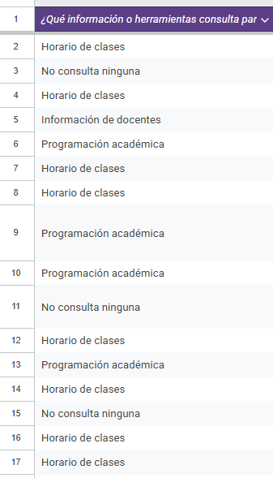
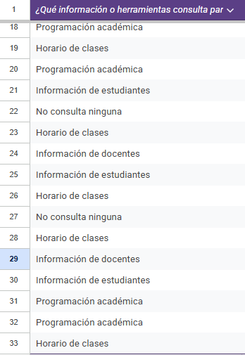

*Nota.* Captura de la hoja de respuestas del formulario de Google (una fila por respuesta). Izquierda: filas 2 a 17 (R1 a R16); derecha: filas 18 a 33 (R17 a R32). Las filas 21 y 26 (R20 y R25) son segundas respuestas de una misma persona y no se cuentan (sección 1.2).

**Pregunta 5.** Cuando durante una revisión encuentra algún computador, luminaria o aire acondicionado encendido y considera que no debería estarlo, ¿qué procedimiento sigue?

Respuestas (selección): «Si no tengo posibilidad de apagarlo, voy a piso 6 e informo la situación» (R6). «Avisar a un profesor» (R4). «Ni idea, yo creo que se apaga xd» (R30). Al menos nueve personas mencionan avisar o informar a otra persona (docente, encargado, personal de aseo o «piso 6»).

<a id="figura-6"></a>

**Figura 6**
*Respuestas a la pregunta 5 en la hoja de respuestas del formulario de Google*

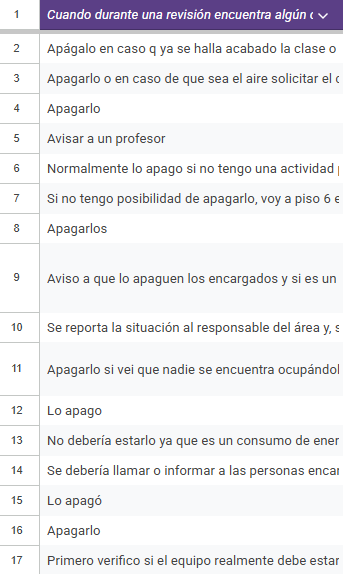
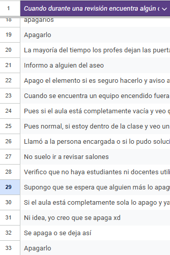

*Nota.* Captura de la hoja de respuestas del formulario de Google (una fila por respuesta). Izquierda: filas 2 a 17 (R1 a R16); derecha: filas 18 a 33 (R17 a R32). Las filas 21 y 26 (R20 y R25) son segundas respuestas de una misma persona y no se cuentan (sección 1.2). Las respuestas largas aparecen cortadas por el ancho de la columna; las citas del texto se transcribieron de la respuesta completa.

**Pregunta 6.** Después de realizar una acción sobre alguno de estos elementos, ¿queda algún registro de lo encontrado, de la acción realizada o de la fecha y hora? ¿Cómo se conserva esa información?

Respuestas (selección): «No queda registro de nada, simplemente lo apaga y ya» (R7). «Realmente no hay ninguna registro que conozca» (R5). «Pues ni idea supongo que sí, soy estudiante» (R24). «Sí, cada acción queda registrada de inmediato en una bitácora digital centralizada» (R22). Recuento: 15 dicen que no existe; 6 no saben o no contestaron; 3 afirman que existe un registro formal (R9, R16 y R22); 3 suponen que sí sin saberlo, y 3 dan otra respuesta (hipotética o ambigua).

<a id="figura-7"></a>

**Figura 7**
*Respuestas a la pregunta 6 en la hoja de respuestas del formulario de Google*

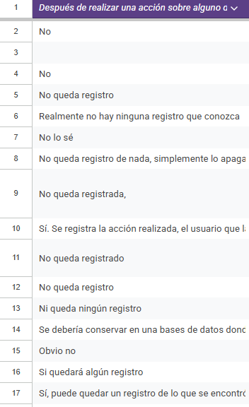
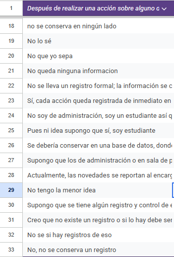

*Nota.* Captura de la hoja de respuestas del formulario de Google (una fila por respuesta). Izquierda: filas 2 a 17 (R1 a R16); derecha: filas 18 a 33 (R17 a R32). Las filas 21 y 26 (R20 y R25) son segundas respuestas de una misma persona y no se cuentan (sección 1.2). Las respuestas largas aparecen cortadas por el ancho de la columna; las citas del texto se transcribieron de la respuesta completa.

**Pregunta 7.** En las aulas 504, 506 y 605, ¿con qué frecuencia encuentra computadores, luminarias o aire acondicionado encendidos sin personas presentes?

Pocas veces al mes, 10; una o dos veces por semana, 9; nunca, 5; varias veces por semana, 5; casi a diario, 1. Es decir, 25 de las 30 personas los han encontrado encendidos alguna vez.

<a id="figura-8"></a>

**Figura 8**
*Respuestas a la pregunta 7 en la hoja de respuestas del formulario de Google*

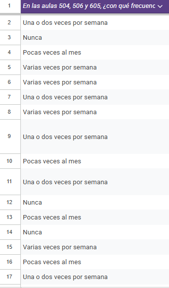
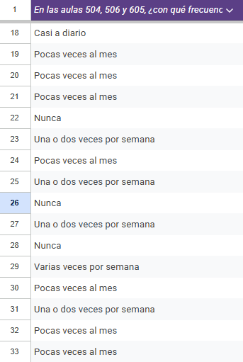

*Nota.* Captura de la hoja de respuestas del formulario de Google (una fila por respuesta). Izquierda: filas 2 a 17 (R1 a R16); derecha: filas 18 a 33 (R17 a R32). Las filas 21 y 26 (R20 y R25) son segundas respuestas de una misma persona y no se cuentan (sección 1.2).

**Pregunta 8.** Desde que termina una actividad en un aula de sistemas, ¿cuánto tiempo suele pasar hasta que se revisa el estado de los equipos?

Entre 15 y 30 minutos, 10; no hay un momento fijo de revisión, 9; menos de 15 minutos, 9; entre 30 minutos y 1 hora, 1; más de 1 hora, 1.

<a id="figura-9"></a>

**Figura 9**
*Respuestas a la pregunta 8 en la hoja de respuestas del formulario de Google*

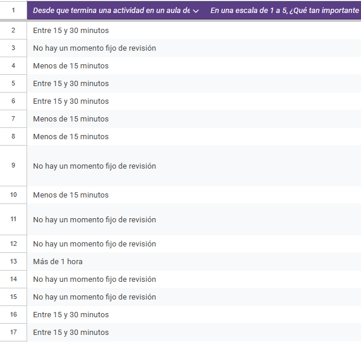

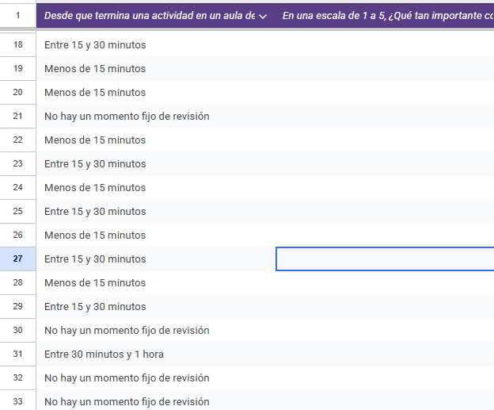

*Nota.* Captura de la hoja de respuestas del formulario de Google (una fila por respuesta). Arriba: filas 2 a 17 (R1 a R16); abajo: filas 18 a 33 (R17 a R32). Las filas 21 y 26 (R20 y R25) son segundas respuestas de una misma persona y no se cuentan (sección 1.2).

**Pregunta 9.** En una escala de 1 a 5, ¿qué tan importante considera detectar que un aula está sin personas mientras alguno de sus computadores, luminarias o aire acondicionado permanece encendido?

5, 14 personas; 4, 9 personas; 3, 7 personas; nadie marcó 1 o 2. Promedio: 4,23. El recuento se hizo sobre la columna de esta pregunta que aparece junto a la pregunta 10 en la Figura 11. Es una pregunta hipotética, por lo que se lee como una señal y no como un requisito.

<a id="figura-10"></a>

**Figura 10**
*Resumen de las respuestas a la pregunta 9 en el formulario de Google*

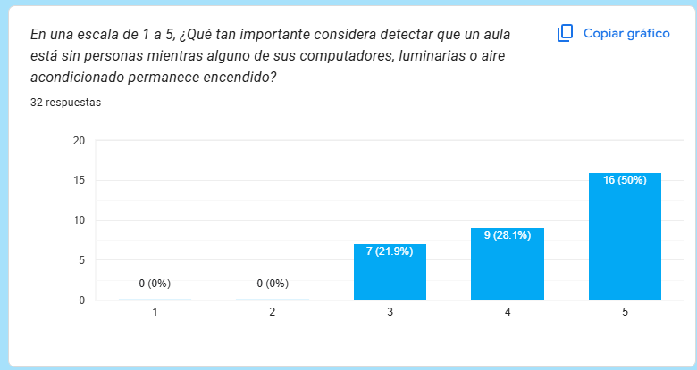

*Nota.* Gráfico de resumen del formulario de Google, que cuenta las 32 respuestas recibidas: 3, 7 personas; 4, 9; 5, 16; nadie marcó 1 o 2. En la hoja de respuestas de esta pregunta (la columna de números junto a la pregunta 10, Figura 11) las dos respuestas excluidas, R20 y R25, marcaron 5; por eso, sobre las 30 analizadas, el 5 queda en 14. A diferencia de las demás preguntas, aquí se usa el gráfico de resumen y no la hoja de respuestas.

**Pregunta 10.** Si se detectara que el aula 504 está sin personas pero algún equipo, luminaria o el aire acondicionado sigue encendido, ¿qué información necesitaría para decidir si requiere atención?

Estado de ocupación del aula, 10; horario o programación académica, 6; qué elemento permanece encendido, 5; tiempo que lleva encendido, 4; motivo de la actividad que se realizaba, 4; fecha y hora, 1.

<a id="figura-11"></a>

**Figura 11**
*Respuestas a la pregunta 10 en la hoja de respuestas del formulario de Google*

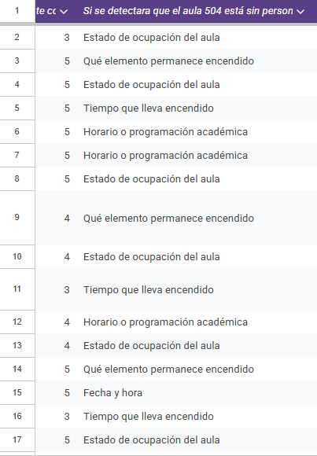
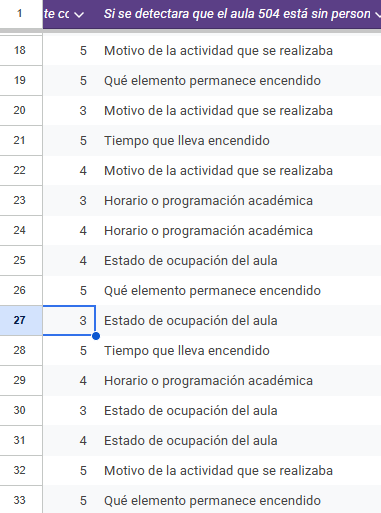

*Nota.* Captura de la hoja de respuestas del formulario de Google (una fila por respuesta). Izquierda: filas 2 a 17 (R1 a R16); derecha: filas 18 a 33 (R17 a R32). Las filas 21 y 26 (R20 y R25) son segundas respuestas de una misma persona y no se cuentan (sección 1.2). La columna de números, a la izquierda de cada captura, corresponde a la pregunta 9 (escala de 1 a 5).

**Pregunta 11.** En una escala de 1 a 5, ¿qué tan fácil sería para usted registrar manualmente el estado del aula (ocupación, luces, computadores y aire) al terminar su revisión?

En el resumen del formulario, sobre las 32 respuestas recibidas: 3, 13 personas; 4, 9; 5, 9; 2, 1; nadie marcó 1. Como el resumen no deja separar las dos respuestas excluidas, sobre las 30 analizadas el 3 sigue siendo la respuesta más frecuente (al menos 11) y entre 16 y 18 personas marcaron 4 o 5. Es una pregunta hipotética; se lee como una señal sobre el riesgo de que el registro manual sea una carga.

<a id="figura-12"></a>

**Figura 12**
*Resumen de las respuestas a la pregunta 11 en el formulario de Google*

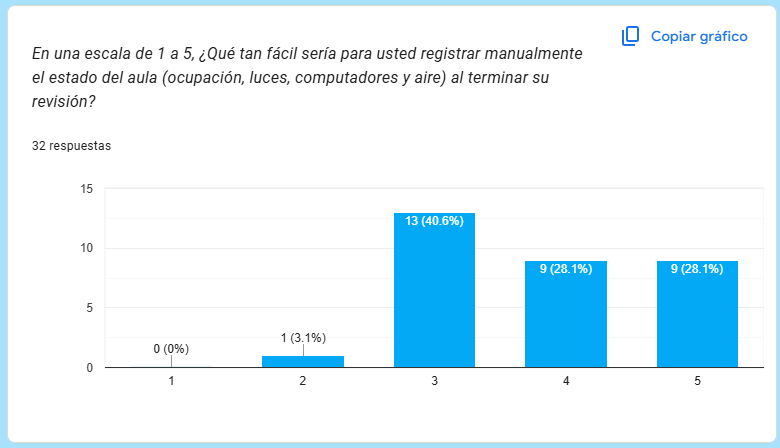

*Nota.* Gráfico de resumen del formulario de Google, que cuenta las 32 respuestas recibidas: 2, 1 persona; 3, 13; 4, 9; 5, 9; nadie marcó 1. El gráfico no muestra a qué valor corresponden las dos respuestas excluidas (R20 y R25), así que sobre las 30 analizadas cada valor puede ser hasta 2 menor. A diferencia de las demás preguntas, aquí se usa el gráfico de resumen y no la hoja de respuestas.

**Pregunta 12.** Si el estado del aula quedara registrado en un sistema, ¿cómo preferiría recibir la información cuando se detecte que algún elemento permanece encendido sin personas presentes?

Una alerta inmediata, 22; un resumen de las situaciones detectadas, 12; un aviso dentro del sistema para revisarlo después, 10; un registro para consultar al final de la jornada, 8; otra forma, al menos 1. En las filas 15 y 16 el texto está cortado en la captura después de «Un resu…»; se contaron solo las opciones que se alcanzan a leer. Se podía marcar más de una opción. También es una pregunta hipotética.

<a id="figura-13"></a>

**Figura 13**
*Respuestas a la pregunta 12 en la hoja de respuestas del formulario de Google*

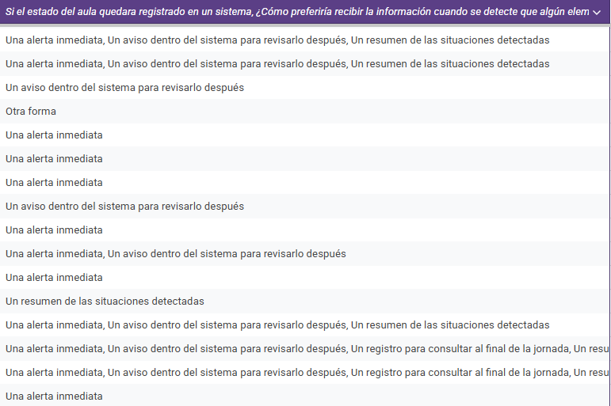

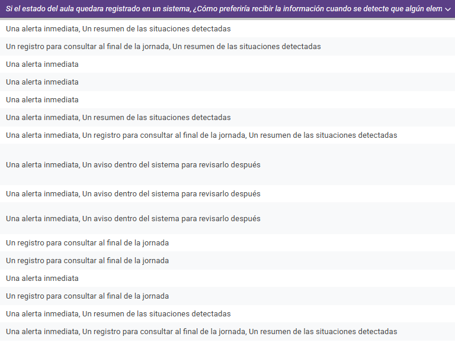

*Nota.* Captura de la hoja de respuestas del formulario de Google (una fila por respuesta). Arriba: filas 2 a 17 (R1 a R16); abajo: filas 18 a 33 (R17 a R32). Las filas 21 y 26 (R20 y R25) son segundas respuestas de una misma persona y no se cuentan (sección 1.2). En las filas 15 y 16 el texto de la celda queda cortado después de «Un resu…».

##### 1.4 Interpretación de los datos

Tomadas en conjunto, las respuestas muestran que el cierre de las aulas se hace de forma visual e informal, sin un procedimiento común y casi siempre sin registro: 21 de 30 personas dicen que no queda registro o no saben de ninguno (pregunta 6), 9 de 30 afirman que no hay un momento fijo de revisión (pregunta 8) y la ocupación de un aula se decide sobre todo mirando o escuchando la puerta (pregunta 3). El hallazgo del 15 de agosto no es entonces un descuido aislado: 25 de 30 personas han encontrado equipos encendidos sin personas alguna vez y 15 de 30 lo ven al menos una vez por semana (pregunta 7).

Las respuestas contradicen dos cosas que el equipo suponía antes de aplicar el formulario. Primero, se suponía que existía un encargado que revisaba las aulas después de cada actividad, y por eso se había priorizado como actor principal. Las respuestas muestran que apaga quien pasa (docente, estudiante o personal de aseo) y que la responsabilidad aparece repartida o supuesta: «el profe se encarga de apagar el resto» (R24) y «Supongo que se espera que alguien más lo apague» (R28). Por eso el prototipo no asigna responsabilidades institucionales: el campo persona_registra solo anota quién observó. Segundo, se suponía que la programación académica serviría de referencia para decidir si un aula debe estar en uso: 20 de las 30 marcas de la pregunta 4 son de horario de clases o programación académica, pero 5 personas no consultan nada y la mayoría decide mirando la puerta. Esto no invalida la comparación con la programación, pero obliga a que el prototipo no dependa de que alguien consulte el horario: la programación se carga una vez y la comparación la hace el sistema.

Hay dos grupos de respuestas que no concuerdan entre sí. El primero está en la pregunta 6: R9, R16 y R22 afirman que existe un registro formal («log de auditoría», «bitácora digital centralizada»), mientras R7, R5 y otras trece personas dicen que no queda nada. Las tres afirmativas están redactadas con un vocabulario formal y parecido entre sí, y contradicen a la mayoría; hasta verificarlo con una persona responsable de las aulas, el equipo toma como dato lo que dice la mayoría y no presenta el prototipo como reemplazo de un sistema institucional. El segundo está entre las preguntas 1 y 2: varias personas describen que revisan computadores, aire y luces (por ejemplo, R2 y R8), pero en la pregunta 2 solo una persona marcó luminarias. La diferencia sale del instrumento y no de quienes respondieron: la pregunta 2 admitía una sola opción. Por eso se lee únicamente como indicio de lo que cada persona revisa primero, y en la entrevista presencial se preguntará con varias respuestas posibles.

La pregunta 10 también corrigió una idea del borrador: cuatro personas pidieron saber «cuánto tiempo lleva encendido» un elemento, pero un registro manual solo sabe lo que se vio en un momento. Se decidió no prometer ese dato (RN-04). Las preguntas 9, 11 y 12 son hipotéticas y no se usan como requisitos: sirven como señal de que 22 de 30 esperan una alerta inmediata (el resultado se muestra en pantalla, no por correo) y de que el registro manual no es trivial para una parte importante de quienes respondieron (en la pregunta 11, el 3 fue la respuesta más frecuente: al menos 11 de las 30 analizadas), lo que justifica el RNF-01.

Quedaron sin resolver cuatro asuntos: (1) quién es el responsable formal de verificar y cerrar las aulas, y si Registro y Control o el «piso 6» (R6, R26) guarda algún registro; (2) si existe un horario digital consultable (R22) o si la programación se pregunta a una persona (R13); (3) qué elementos incluyen las seis marcas de «Otro» en la pregunta 2, y (4) el papel del personal de aseo, que aparece en dos respuestas (R26 y R28). Los cuatro quedan para una entrevista presencial con el encargado de las aulas.

### 18. Ampliación del alcance

#### 2. Ampliación del alcance de acuerdo con la entrevista

La columna izquierda reproduce el alcance anterior a la entrevista. En la columna derecha, lo agregado está en **negrita** y lo retirado, ~~tachado~~.

<a id="tabla-26"></a>

**Tabla 26**
*Alcance anterior y alcance modificado*

| **Alcance anterior** | **Alcance modificado** |
|---|---|
| El sistema registra bloques de programación académica del aula 504 y observaciones manuales relacionadas con la ocupación del aula y el estado de computadores, luminarias y aire acondicionado. Permite consultar los registros almacenados, realizar comparaciones entre las observaciones realizadas y la programación académica existente, generar alertas sobre posibles inconsistencias y conservar un historial de resultados. | El sistema ~~registra bloques de programación académica del aula 504 y observaciones manuales relacionadas con la ocupación del aula y el estado~~ **permitirá registrar, administrar y consultar información relacionada con las aulas de informática de la Corporación Universitaria Remington, tomando como caso piloto el aula 504 de la Torre 1, piso 5, utilizada para la recolección de información, validación de requisitos y pruebas del prototipo. La solución permitirá gestionar aulas, usuarios autorizados, programación académica, observaciones de ocupación y estados** de computadores, luminarias y aire acondicionado. ~~Permite consultar los registros almacenados,~~ **Igualmente, permitirá** realizar comparaciones entre ~~las observaciones realizadas y~~ la programación académica ~~existente, generar alertas sobre~~ **y las observaciones registradas, generar alertas por** posibles inconsistencias y ~~conservar~~ **mantener** un historial de resultados **para su seguimiento. Se incorporan operaciones CRUDL (Crear, Consultar, Actualizar, Eliminar y Listar) y la funcionalidad Deshacer para cada entidad del sistema. El sistema estará limitado exclusivamente al aula 504. Quedan excluidas la medición real del consumo energético, la automatización de dispositivos eléctricos, la implementación de sensores IoT y la integración automática con plataformas institucionales externas.** |

<a id="tabla-27"></a>

**Tabla 27**
*Cambios identificados a partir de la entrevista y la observación*

| **Qué cambió** | **De qué pregunta sale** | **Por qué entra o por qué no** |
|---|---|---|
| Se amplió el alcance de una sola aula a múltiples aulas informáticas. | Entrevista y análisis de aplicabilidad institucional. | La problemática observada no es exclusiva del aula 504 y puede presentarse en otros laboratorios informáticos de la institución. |
| El aula 504 pasó de ser el único entorno del sistema a convertirse en aula piloto. | Observación directa realizada en el aula 504. | Permite validar el prototipo en un contexto real sin restringir el alcance general de la solución. |
| Se incorporó la gestión de usuarios responsables de los registros. | Entrevista. | Permite garantizar trazabilidad y control sobre la información almacenada. |
| Se incorporó la funcionalidad Deshacer para todas las entidades. | Requerimiento establecido en la guía del curso. | Mejora la recuperación ante errores durante la administración de registros. |
| Se mantuvo el historial de comparaciones. | Entrevista y observación. | Permite realizar seguimiento y análisis de inconsistencias detectadas. |
| Se descartó la automatización energética. | Observación del entorno físico. | Requeriría infraestructura tecnológica adicional no contemplada dentro del alcance académico del proyecto. |
| Se descartó la integración con sistemas institucionales externos. | Análisis de viabilidad. | Incrementaría significativamente la complejidad técnica y el tiempo de desarrollo disponible para el proyecto. |

A partir de la información recopilada mediante las técnicas de entrevista y observación, se determinó que la problemática identificada puede manifestarse en distintas aulas de informática de la institución y no únicamente en el aula 504. Por esta razón, el alcance fue ampliado para permitir que la solución sea aplicable a cualquier aula informática de la Corporación Universitaria Remington. No obstante, el aula 504 continuará siendo utilizada como aula piloto para las actividades de validación, pruebas y demostración funcional del prototipo. Esta decisión favorece la escalabilidad de la propuesta sin comprometer la viabilidad técnica ni el tiempo disponible para su desarrollo.

### 19. Historias de usuario y criterios de aceptación

#### 3. Historias de usuario y criterios de aceptación

Las historias de usuario y sus criterios de aceptación se presentan por entidad del sistema: Aula, Persona, Programación Académica, Registro Estado, Ocupación, Luces, Computadores, Aire Acondicionado, Historial y Alerta. Cada entidad tiene seis historias, una por operación (registrar, consultar, actualizar, eliminar, listar y deshacer), y cada historia tiene tres criterios de aceptación: un camino bueno y dos fallas.

##### 3.1 Entidad Aula

<a id="tabla-28"></a>

**Tabla 28**
*Historias de usuario de la entidad Aula*

| **ID** | **Entidad** | **Como** | **Quiero** | **Para** |
|---|---|---|---|---|
| HU-AUL-01 | Aula | Administrador | registrar información de aula | gestionar correctamente los datos de aula |
| HU-AUL-02 | Aula | Administrador | consultar información de aula | gestionar correctamente los datos de aula |
| HU-AUL-03 | Aula | Administrador | actualizar información de aula | gestionar correctamente los datos de aula |
| HU-AUL-04 | Aula | Administrador | eliminar información de aula | gestionar correctamente los datos de aula |
| HU-AUL-05 | Aula | Administrador | listar información de aula | gestionar correctamente los datos de aula |
| HU-AUL-06 | Aula | Administrador | deshacer información de aula | gestionar correctamente los datos de aula |

<a id="tabla-29"></a>

**Tabla 29**
*Criterios de aceptación de la entidad Aula*

| **HU** | **CA** | **Tipo** | **Dado que** | **Cuando** | **Entonces** |
|---|---|---|---|---|---|
| HU-AUL-01 | CA-AUL-01.1 | Camino bueno | Existe un contexto válido para aula. | El usuario ejecuta la acción asociada a HU-AUL-01. | El sistema procesa correctamente la solicitud. |
| HU-AUL-01 | CA-AUL-01.2 | Falla | Existe un contexto válido para aula. | El usuario ejecuta la acción asociada a HU-AUL-01. | El sistema valida la condición e informa el error correspondiente. |
| HU-AUL-01 | CA-AUL-01.3 | Falla | Existe un contexto válido para aula. | El usuario ejecuta la acción asociada a HU-AUL-01. | El sistema valida la condición e informa el error correspondiente. |
| HU-AUL-02 | CA-AUL-02.1 | Camino bueno | Existe un contexto válido para aula. | El usuario ejecuta la acción asociada a HU-AUL-02. | El sistema procesa correctamente la solicitud. |
| HU-AUL-02 | CA-AUL-02.2 | Falla | Existe un contexto válido para aula. | El usuario ejecuta la acción asociada a HU-AUL-02. | El sistema valida la condición e informa el error correspondiente. |
| HU-AUL-02 | CA-AUL-02.3 | Falla | Existe un contexto válido para aula. | El usuario ejecuta la acción asociada a HU-AUL-02. | El sistema valida la condición e informa el error correspondiente. |
| HU-AUL-03 | CA-AUL-03.1 | Camino bueno | Existe un contexto válido para aula. | El usuario ejecuta la acción asociada a HU-AUL-03. | El sistema procesa correctamente la solicitud. |
| HU-AUL-03 | CA-AUL-03.2 | Falla | Existe un contexto válido para aula. | El usuario ejecuta la acción asociada a HU-AUL-03. | El sistema valida la condición e informa el error correspondiente. |
| HU-AUL-03 | CA-AUL-03.3 | Falla | Existe un contexto válido para aula. | El usuario ejecuta la acción asociada a HU-AUL-03. | El sistema valida la condición e informa el error correspondiente. |
| HU-AUL-04 | CA-AUL-04.1 | Camino bueno | Existe un contexto válido para aula. | El usuario ejecuta la acción asociada a HU-AUL-04. | El sistema procesa correctamente la solicitud. |
| HU-AUL-04 | CA-AUL-04.2 | Falla | Existe un contexto válido para aula. | El usuario ejecuta la acción asociada a HU-AUL-04. | El sistema valida la condición e informa el error correspondiente. |
| HU-AUL-04 | CA-AUL-04.3 | Falla | Existe un contexto válido para aula. | El usuario ejecuta la acción asociada a HU-AUL-04. | El sistema valida la condición e informa el error correspondiente. |
| HU-AUL-05 | CA-AUL-05.1 | Camino bueno | Existe un contexto válido para aula. | El usuario ejecuta la acción asociada a HU-AUL-05. | El sistema procesa correctamente la solicitud. |
| HU-AUL-05 | CA-AUL-05.2 | Falla | Existe un contexto válido para aula. | El usuario ejecuta la acción asociada a HU-AUL-05. | El sistema valida la condición e informa el error correspondiente. |
| HU-AUL-05 | CA-AUL-05.3 | Falla | Existe un contexto válido para aula. | El usuario ejecuta la acción asociada a HU-AUL-05. | El sistema valida la condición e informa el error correspondiente. |
| HU-AUL-06 | CA-AUL-06.1 | Camino bueno | Existe un contexto válido para aula. | El usuario ejecuta la acción asociada a HU-AUL-06. | El sistema procesa correctamente la solicitud. |
| HU-AUL-06 | CA-AUL-06.2 | Falla | Existe un contexto válido para aula. | El usuario ejecuta la acción asociada a HU-AUL-06. | El sistema valida la condición e informa el error correspondiente. |
| HU-AUL-06 | CA-AUL-06.3 | Falla | Existe un contexto válido para aula. | El usuario ejecuta la acción asociada a HU-AUL-06. | El sistema valida la condición e informa el error correspondiente. |

##### 3.2 Entidad Persona

<a id="tabla-30"></a>

**Tabla 30**
*Historias de usuario de la entidad Persona*

| **ID** | **Entidad** | **Como** | **Quiero** | **Para** |
|---|---|---|---|---|
| HU-PER-01 | Persona | Administrador | registrar información de persona | gestionar correctamente los datos de persona |
| HU-PER-02 | Persona | Administrador | consultar información de persona | gestionar correctamente los datos de persona |
| HU-PER-03 | Persona | Administrador | actualizar información de persona | gestionar correctamente los datos de persona |
| HU-PER-04 | Persona | Administrador | eliminar información de persona | gestionar correctamente los datos de persona |
| HU-PER-05 | Persona | Administrador | listar información de persona | gestionar correctamente los datos de persona |
| HU-PER-06 | Persona | Administrador | deshacer información de persona | gestionar correctamente los datos de persona |

<a id="tabla-31"></a>

**Tabla 31**
*Criterios de aceptación de la entidad Persona*

| **HU** | **CA** | **Tipo** | **Dado que** | **Cuando** | **Entonces** |
|---|---|---|---|---|---|
| HU-PER-01 | CA-PER-01.1 | Camino bueno | Existe un contexto válido para persona. | El usuario ejecuta la acción asociada a HU-PER-01. | El sistema procesa correctamente la solicitud. |
| HU-PER-01 | CA-PER-01.2 | Falla | Existe un contexto válido para persona. | El usuario ejecuta la acción asociada a HU-PER-01. | El sistema valida la condición e informa el error correspondiente. |
| HU-PER-01 | CA-PER-01.3 | Falla | Existe un contexto válido para persona. | El usuario ejecuta la acción asociada a HU-PER-01. | El sistema valida la condición e informa el error correspondiente. |
| HU-PER-02 | CA-PER-02.1 | Camino bueno | Existe un contexto válido para persona. | El usuario ejecuta la acción asociada a HU-PER-02. | El sistema procesa correctamente la solicitud. |
| HU-PER-02 | CA-PER-02.2 | Falla | Existe un contexto válido para persona. | El usuario ejecuta la acción asociada a HU-PER-02. | El sistema valida la condición e informa el error correspondiente. |
| HU-PER-02 | CA-PER-02.3 | Falla | Existe un contexto válido para persona. | El usuario ejecuta la acción asociada a HU-PER-02. | El sistema valida la condición e informa el error correspondiente. |
| HU-PER-03 | CA-PER-03.1 | Camino bueno | Existe un contexto válido para persona. | El usuario ejecuta la acción asociada a HU-PER-03. | El sistema procesa correctamente la solicitud. |
| HU-PER-03 | CA-PER-03.2 | Falla | Existe un contexto válido para persona. | El usuario ejecuta la acción asociada a HU-PER-03. | El sistema valida la condición e informa el error correspondiente. |
| HU-PER-03 | CA-PER-03.3 | Falla | Existe un contexto válido para persona. | El usuario ejecuta la acción asociada a HU-PER-03. | El sistema valida la condición e informa el error correspondiente. |
| HU-PER-04 | CA-PER-04.1 | Camino bueno | Existe un contexto válido para persona. | El usuario ejecuta la acción asociada a HU-PER-04. | El sistema procesa correctamente la solicitud. |
| HU-PER-04 | CA-PER-04.2 | Falla | Existe un contexto válido para persona. | El usuario ejecuta la acción asociada a HU-PER-04. | El sistema valida la condición e informa el error correspondiente. |
| HU-PER-04 | CA-PER-04.3 | Falla | Existe un contexto válido para persona. | El usuario ejecuta la acción asociada a HU-PER-04. | El sistema valida la condición e informa el error correspondiente. |
| HU-PER-05 | CA-PER-05.1 | Camino bueno | Existe un contexto válido para persona. | El usuario ejecuta la acción asociada a HU-PER-05. | El sistema procesa correctamente la solicitud. |
| HU-PER-05 | CA-PER-05.2 | Falla | Existe un contexto válido para persona. | El usuario ejecuta la acción asociada a HU-PER-05. | El sistema valida la condición e informa el error correspondiente. |
| HU-PER-05 | CA-PER-05.3 | Falla | Existe un contexto válido para persona. | El usuario ejecuta la acción asociada a HU-PER-05. | El sistema valida la condición e informa el error correspondiente. |
| HU-PER-06 | CA-PER-06.1 | Camino bueno | Existe un contexto válido para persona. | El usuario ejecuta la acción asociada a HU-PER-06. | El sistema procesa correctamente la solicitud. |
| HU-PER-06 | CA-PER-06.2 | Falla | Existe un contexto válido para persona. | El usuario ejecuta la acción asociada a HU-PER-06. | El sistema valida la condición e informa el error correspondiente. |
| HU-PER-06 | CA-PER-06.3 | Falla | Existe un contexto válido para persona. | El usuario ejecuta la acción asociada a HU-PER-06. | El sistema valida la condición e informa el error correspondiente. |

##### 3.3 Entidad Programación Académica

<a id="tabla-32"></a>

**Tabla 32**
*Historias de usuario de la entidad Programación Académica*

| **ID** | **Entidad** | **Como** | **Quiero** | **Para** |
|---|---|---|---|---|
| HU-PRO-01 | Programación Académica | Administrador | registrar información de programación académica | gestionar correctamente los datos de programación académica |
| HU-PRO-02 | Programación Académica | Administrador | consultar información de programación académica | gestionar correctamente los datos de programación académica |
| HU-PRO-03 | Programación Académica | Administrador | actualizar información de programación académica | gestionar correctamente los datos de programación académica |
| HU-PRO-04 | Programación Académica | Administrador | eliminar información de programación académica | gestionar correctamente los datos de programación académica |
| HU-PRO-05 | Programación Académica | Administrador | listar información de programación académica | gestionar correctamente los datos de programación académica |
| HU-PRO-06 | Programación Académica | Administrador | deshacer información de programación académica | gestionar correctamente los datos de programación académica |

<a id="tabla-33"></a>

**Tabla 33**
*Criterios de aceptación de la entidad Programación Académica*

| **HU** | **CA** | **Tipo** | **Dado que** | **Cuando** | **Entonces** |
|---|---|---|---|---|---|
| HU-PRO-01 | CA-PRO-01.1 | Camino bueno | Existe un contexto válido para programación académica. | El usuario ejecuta la acción asociada a HU-PRO-01. | El sistema procesa correctamente la solicitud. |
| HU-PRO-01 | CA-PRO-01.2 | Falla | Existe un contexto válido para programación académica. | El usuario ejecuta la acción asociada a HU-PRO-01. | El sistema valida la condición e informa el error correspondiente. |
| HU-PRO-01 | CA-PRO-01.3 | Falla | Existe un contexto válido para programación académica. | El usuario ejecuta la acción asociada a HU-PRO-01. | El sistema valida la condición e informa el error correspondiente. |
| HU-PRO-02 | CA-PRO-02.1 | Camino bueno | Existe un contexto válido para programación académica. | El usuario ejecuta la acción asociada a HU-PRO-02. | El sistema procesa correctamente la solicitud. |
| HU-PRO-02 | CA-PRO-02.2 | Falla | Existe un contexto válido para programación académica. | El usuario ejecuta la acción asociada a HU-PRO-02. | El sistema valida la condición e informa el error correspondiente. |
| HU-PRO-02 | CA-PRO-02.3 | Falla | Existe un contexto válido para programación académica. | El usuario ejecuta la acción asociada a HU-PRO-02. | El sistema valida la condición e informa el error correspondiente. |
| HU-PRO-03 | CA-PRO-03.1 | Camino bueno | Existe un contexto válido para programación académica. | El usuario ejecuta la acción asociada a HU-PRO-03. | El sistema procesa correctamente la solicitud. |
| HU-PRO-03 | CA-PRO-03.2 | Falla | Existe un contexto válido para programación académica. | El usuario ejecuta la acción asociada a HU-PRO-03. | El sistema valida la condición e informa el error correspondiente. |
| HU-PRO-03 | CA-PRO-03.3 | Falla | Existe un contexto válido para programación académica. | El usuario ejecuta la acción asociada a HU-PRO-03. | El sistema valida la condición e informa el error correspondiente. |
| HU-PRO-04 | CA-PRO-04.1 | Camino bueno | Existe un contexto válido para programación académica. | El usuario ejecuta la acción asociada a HU-PRO-04. | El sistema procesa correctamente la solicitud. |
| HU-PRO-04 | CA-PRO-04.2 | Falla | Existe un contexto válido para programación académica. | El usuario ejecuta la acción asociada a HU-PRO-04. | El sistema valida la condición e informa el error correspondiente. |
| HU-PRO-04 | CA-PRO-04.3 | Falla | Existe un contexto válido para programación académica. | El usuario ejecuta la acción asociada a HU-PRO-04. | El sistema valida la condición e informa el error correspondiente. |
| HU-PRO-05 | CA-PRO-05.1 | Camino bueno | Existe un contexto válido para programación académica. | El usuario ejecuta la acción asociada a HU-PRO-05. | El sistema procesa correctamente la solicitud. |
| HU-PRO-05 | CA-PRO-05.2 | Falla | Existe un contexto válido para programación académica. | El usuario ejecuta la acción asociada a HU-PRO-05. | El sistema valida la condición e informa el error correspondiente. |
| HU-PRO-05 | CA-PRO-05.3 | Falla | Existe un contexto válido para programación académica. | El usuario ejecuta la acción asociada a HU-PRO-05. | El sistema valida la condición e informa el error correspondiente. |
| HU-PRO-06 | CA-PRO-06.1 | Camino bueno | Existe un contexto válido para programación académica. | El usuario ejecuta la acción asociada a HU-PRO-06. | El sistema procesa correctamente la solicitud. |
| HU-PRO-06 | CA-PRO-06.2 | Falla | Existe un contexto válido para programación académica. | El usuario ejecuta la acción asociada a HU-PRO-06. | El sistema valida la condición e informa el error correspondiente. |
| HU-PRO-06 | CA-PRO-06.3 | Falla | Existe un contexto válido para programación académica. | El usuario ejecuta la acción asociada a HU-PRO-06. | El sistema valida la condición e informa el error correspondiente. |

##### 3.4 Entidad Registro Estado

<a id="tabla-34"></a>

**Tabla 34**
*Historias de usuario de la entidad Registro Estado*

| **ID** | **Entidad** | **Como** | **Quiero** | **Para** |
|---|---|---|---|---|
| HU-REG-01 | Registro Estado | Observador | registrar información de registro estado | gestionar correctamente los datos de registro estado |
| HU-REG-02 | Registro Estado | Observador | consultar información de registro estado | gestionar correctamente los datos de registro estado |
| HU-REG-03 | Registro Estado | Observador | actualizar información de registro estado | gestionar correctamente los datos de registro estado |
| HU-REG-04 | Registro Estado | Observador | eliminar información de registro estado | gestionar correctamente los datos de registro estado |
| HU-REG-05 | Registro Estado | Observador | listar información de registro estado | gestionar correctamente los datos de registro estado |
| HU-REG-06 | Registro Estado | Observador | deshacer información de registro estado | gestionar correctamente los datos de registro estado |

<a id="tabla-35"></a>

**Tabla 35**
*Criterios de aceptación de la entidad Registro Estado*

| **HU** | **CA** | **Tipo** | **Dado que** | **Cuando** | **Entonces** |
|---|---|---|---|---|---|
| HU-REG-01 | CA-REG-01.1 | Camino bueno | Existe un contexto válido para registro estado. | El usuario ejecuta la acción asociada a HU-REG-01. | El sistema procesa correctamente la solicitud. |
| HU-REG-01 | CA-REG-01.2 | Falla | Existe un contexto válido para registro estado. | El usuario ejecuta la acción asociada a HU-REG-01. | El sistema valida la condición e informa el error correspondiente. |
| HU-REG-01 | CA-REG-01.3 | Falla | Existe un contexto válido para registro estado. | El usuario ejecuta la acción asociada a HU-REG-01. | El sistema valida la condición e informa el error correspondiente. |
| HU-REG-02 | CA-REG-02.1 | Camino bueno | Existe un contexto válido para registro estado. | El usuario ejecuta la acción asociada a HU-REG-02. | El sistema procesa correctamente la solicitud. |
| HU-REG-02 | CA-REG-02.2 | Falla | Existe un contexto válido para registro estado. | El usuario ejecuta la acción asociada a HU-REG-02. | El sistema valida la condición e informa el error correspondiente. |
| HU-REG-02 | CA-REG-02.3 | Falla | Existe un contexto válido para registro estado. | El usuario ejecuta la acción asociada a HU-REG-02. | El sistema valida la condición e informa el error correspondiente. |
| HU-REG-03 | CA-REG-03.1 | Camino bueno | Existe un contexto válido para registro estado. | El usuario ejecuta la acción asociada a HU-REG-03. | El sistema procesa correctamente la solicitud. |
| HU-REG-03 | CA-REG-03.2 | Falla | Existe un contexto válido para registro estado. | El usuario ejecuta la acción asociada a HU-REG-03. | El sistema valida la condición e informa el error correspondiente. |
| HU-REG-03 | CA-REG-03.3 | Falla | Existe un contexto válido para registro estado. | El usuario ejecuta la acción asociada a HU-REG-03. | El sistema valida la condición e informa el error correspondiente. |
| HU-REG-04 | CA-REG-04.1 | Camino bueno | Existe un contexto válido para registro estado. | El usuario ejecuta la acción asociada a HU-REG-04. | El sistema procesa correctamente la solicitud. |
| HU-REG-04 | CA-REG-04.2 | Falla | Existe un contexto válido para registro estado. | El usuario ejecuta la acción asociada a HU-REG-04. | El sistema valida la condición e informa el error correspondiente. |
| HU-REG-04 | CA-REG-04.3 | Falla | Existe un contexto válido para registro estado. | El usuario ejecuta la acción asociada a HU-REG-04. | El sistema valida la condición e informa el error correspondiente. |
| HU-REG-05 | CA-REG-05.1 | Camino bueno | Existe un contexto válido para registro estado. | El usuario ejecuta la acción asociada a HU-REG-05. | El sistema procesa correctamente la solicitud. |
| HU-REG-05 | CA-REG-05.2 | Falla | Existe un contexto válido para registro estado. | El usuario ejecuta la acción asociada a HU-REG-05. | El sistema valida la condición e informa el error correspondiente. |
| HU-REG-05 | CA-REG-05.3 | Falla | Existe un contexto válido para registro estado. | El usuario ejecuta la acción asociada a HU-REG-05. | El sistema valida la condición e informa el error correspondiente. |
| HU-REG-06 | CA-REG-06.1 | Camino bueno | Existe un contexto válido para registro estado. | El usuario ejecuta la acción asociada a HU-REG-06. | El sistema procesa correctamente la solicitud. |
| HU-REG-06 | CA-REG-06.2 | Falla | Existe un contexto válido para registro estado. | El usuario ejecuta la acción asociada a HU-REG-06. | El sistema valida la condición e informa el error correspondiente. |
| HU-REG-06 | CA-REG-06.3 | Falla | Existe un contexto válido para registro estado. | El usuario ejecuta la acción asociada a HU-REG-06. | El sistema valida la condición e informa el error correspondiente. |

##### 3.5 Entidad Ocupación

<a id="tabla-36"></a>

**Tabla 36**
*Historias de usuario de la entidad Ocupación*

| **ID** | **Entidad** | **Como** | **Quiero** | **Para** |
|---|---|---|---|---|
| HU-OCU-01 | Ocupación | Observador | registrar información de ocupación | gestionar correctamente los datos de ocupación |
| HU-OCU-02 | Ocupación | Observador | consultar información de ocupación | gestionar correctamente los datos de ocupación |
| HU-OCU-03 | Ocupación | Observador | actualizar información de ocupación | gestionar correctamente los datos de ocupación |
| HU-OCU-04 | Ocupación | Observador | eliminar información de ocupación | gestionar correctamente los datos de ocupación |
| HU-OCU-05 | Ocupación | Observador | listar información de ocupación | gestionar correctamente los datos de ocupación |
| HU-OCU-06 | Ocupación | Observador | deshacer información de ocupación | gestionar correctamente los datos de ocupación |

<a id="tabla-37"></a>

**Tabla 37**
*Criterios de aceptación de la entidad Ocupación*

| **HU** | **CA** | **Tipo** | **Dado que** | **Cuando** | **Entonces** |
|---|---|---|---|---|---|
| HU-OCU-01 | CA-OCU-01.1 | Camino bueno | Existe un contexto válido para ocupación. | El usuario ejecuta la acción asociada a HU-OCU-01. | El sistema procesa correctamente la solicitud. |
| HU-OCU-01 | CA-OCU-01.2 | Falla | Existe un contexto válido para ocupación. | El usuario ejecuta la acción asociada a HU-OCU-01. | El sistema valida la condición e informa el error correspondiente. |
| HU-OCU-01 | CA-OCU-01.3 | Falla | Existe un contexto válido para ocupación. | El usuario ejecuta la acción asociada a HU-OCU-01. | El sistema valida la condición e informa el error correspondiente. |
| HU-OCU-02 | CA-OCU-02.1 | Camino bueno | Existe un contexto válido para ocupación. | El usuario ejecuta la acción asociada a HU-OCU-02. | El sistema procesa correctamente la solicitud. |
| HU-OCU-02 | CA-OCU-02.2 | Falla | Existe un contexto válido para ocupación. | El usuario ejecuta la acción asociada a HU-OCU-02. | El sistema valida la condición e informa el error correspondiente. |
| HU-OCU-02 | CA-OCU-02.3 | Falla | Existe un contexto válido para ocupación. | El usuario ejecuta la acción asociada a HU-OCU-02. | El sistema valida la condición e informa el error correspondiente. |
| HU-OCU-03 | CA-OCU-03.1 | Camino bueno | Existe un contexto válido para ocupación. | El usuario ejecuta la acción asociada a HU-OCU-03. | El sistema procesa correctamente la solicitud. |
| HU-OCU-03 | CA-OCU-03.2 | Falla | Existe un contexto válido para ocupación. | El usuario ejecuta la acción asociada a HU-OCU-03. | El sistema valida la condición e informa el error correspondiente. |
| HU-OCU-03 | CA-OCU-03.3 | Falla | Existe un contexto válido para ocupación. | El usuario ejecuta la acción asociada a HU-OCU-03. | El sistema valida la condición e informa el error correspondiente. |
| HU-OCU-04 | CA-OCU-04.1 | Camino bueno | Existe un contexto válido para ocupación. | El usuario ejecuta la acción asociada a HU-OCU-04. | El sistema procesa correctamente la solicitud. |
| HU-OCU-04 | CA-OCU-04.2 | Falla | Existe un contexto válido para ocupación. | El usuario ejecuta la acción asociada a HU-OCU-04. | El sistema valida la condición e informa el error correspondiente. |
| HU-OCU-04 | CA-OCU-04.3 | Falla | Existe un contexto válido para ocupación. | El usuario ejecuta la acción asociada a HU-OCU-04. | El sistema valida la condición e informa el error correspondiente. |
| HU-OCU-05 | CA-OCU-05.1 | Camino bueno | Existe un contexto válido para ocupación. | El usuario ejecuta la acción asociada a HU-OCU-05. | El sistema procesa correctamente la solicitud. |
| HU-OCU-05 | CA-OCU-05.2 | Falla | Existe un contexto válido para ocupación. | El usuario ejecuta la acción asociada a HU-OCU-05. | El sistema valida la condición e informa el error correspondiente. |
| HU-OCU-05 | CA-OCU-05.3 | Falla | Existe un contexto válido para ocupación. | El usuario ejecuta la acción asociada a HU-OCU-05. | El sistema valida la condición e informa el error correspondiente. |
| HU-OCU-06 | CA-OCU-06.1 | Camino bueno | Existe un contexto válido para ocupación. | El usuario ejecuta la acción asociada a HU-OCU-06. | El sistema procesa correctamente la solicitud. |
| HU-OCU-06 | CA-OCU-06.2 | Falla | Existe un contexto válido para ocupación. | El usuario ejecuta la acción asociada a HU-OCU-06. | El sistema valida la condición e informa el error correspondiente. |
| HU-OCU-06 | CA-OCU-06.3 | Falla | Existe un contexto válido para ocupación. | El usuario ejecuta la acción asociada a HU-OCU-06. | El sistema valida la condición e informa el error correspondiente. |

##### 3.6 Entidad Luces

<a id="tabla-38"></a>

**Tabla 38**
*Historias de usuario de la entidad Luces*

| **ID** | **Entidad** | **Como** | **Quiero** | **Para** |
|---|---|---|---|---|
| HU-LUZ-01 | Luces | Observador | registrar información de luces | gestionar correctamente los datos de luces |
| HU-LUZ-02 | Luces | Observador | consultar información de luces | gestionar correctamente los datos de luces |
| HU-LUZ-03 | Luces | Observador | actualizar información de luces | gestionar correctamente los datos de luces |
| HU-LUZ-04 | Luces | Observador | eliminar información de luces | gestionar correctamente los datos de luces |
| HU-LUZ-05 | Luces | Observador | listar información de luces | gestionar correctamente los datos de luces |
| HU-LUZ-06 | Luces | Observador | deshacer información de luces | gestionar correctamente los datos de luces |

<a id="tabla-39"></a>

**Tabla 39**
*Criterios de aceptación de la entidad Luces*

| **HU** | **CA** | **Tipo** | **Dado que** | **Cuando** | **Entonces** |
|---|---|---|---|---|---|
| HU-LUZ-01 | CA-LUZ-01.1 | Camino bueno | Existe un contexto válido para luces. | El usuario ejecuta la acción asociada a HU-LUZ-01. | El sistema procesa correctamente la solicitud. |
| HU-LUZ-01 | CA-LUZ-01.2 | Falla | Existe un contexto válido para luces. | El usuario ejecuta la acción asociada a HU-LUZ-01. | El sistema valida la condición e informa el error correspondiente. |
| HU-LUZ-01 | CA-LUZ-01.3 | Falla | Existe un contexto válido para luces. | El usuario ejecuta la acción asociada a HU-LUZ-01. | El sistema valida la condición e informa el error correspondiente. |
| HU-LUZ-02 | CA-LUZ-02.1 | Camino bueno | Existe un contexto válido para luces. | El usuario ejecuta la acción asociada a HU-LUZ-02. | El sistema procesa correctamente la solicitud. |
| HU-LUZ-02 | CA-LUZ-02.2 | Falla | Existe un contexto válido para luces. | El usuario ejecuta la acción asociada a HU-LUZ-02. | El sistema valida la condición e informa el error correspondiente. |
| HU-LUZ-02 | CA-LUZ-02.3 | Falla | Existe un contexto válido para luces. | El usuario ejecuta la acción asociada a HU-LUZ-02. | El sistema valida la condición e informa el error correspondiente. |
| HU-LUZ-03 | CA-LUZ-03.1 | Camino bueno | Existe un contexto válido para luces. | El usuario ejecuta la acción asociada a HU-LUZ-03. | El sistema procesa correctamente la solicitud. |
| HU-LUZ-03 | CA-LUZ-03.2 | Falla | Existe un contexto válido para luces. | El usuario ejecuta la acción asociada a HU-LUZ-03. | El sistema valida la condición e informa el error correspondiente. |
| HU-LUZ-03 | CA-LUZ-03.3 | Falla | Existe un contexto válido para luces. | El usuario ejecuta la acción asociada a HU-LUZ-03. | El sistema valida la condición e informa el error correspondiente. |
| HU-LUZ-04 | CA-LUZ-04.1 | Camino bueno | Existe un contexto válido para luces. | El usuario ejecuta la acción asociada a HU-LUZ-04. | El sistema procesa correctamente la solicitud. |
| HU-LUZ-04 | CA-LUZ-04.2 | Falla | Existe un contexto válido para luces. | El usuario ejecuta la acción asociada a HU-LUZ-04. | El sistema valida la condición e informa el error correspondiente. |
| HU-LUZ-04 | CA-LUZ-04.3 | Falla | Existe un contexto válido para luces. | El usuario ejecuta la acción asociada a HU-LUZ-04. | El sistema valida la condición e informa el error correspondiente. |
| HU-LUZ-05 | CA-LUZ-05.1 | Camino bueno | Existe un contexto válido para luces. | El usuario ejecuta la acción asociada a HU-LUZ-05. | El sistema procesa correctamente la solicitud. |
| HU-LUZ-05 | CA-LUZ-05.2 | Falla | Existe un contexto válido para luces. | El usuario ejecuta la acción asociada a HU-LUZ-05. | El sistema valida la condición e informa el error correspondiente. |
| HU-LUZ-05 | CA-LUZ-05.3 | Falla | Existe un contexto válido para luces. | El usuario ejecuta la acción asociada a HU-LUZ-05. | El sistema valida la condición e informa el error correspondiente. |
| HU-LUZ-06 | CA-LUZ-06.1 | Camino bueno | Existe un contexto válido para luces. | El usuario ejecuta la acción asociada a HU-LUZ-06. | El sistema procesa correctamente la solicitud. |
| HU-LUZ-06 | CA-LUZ-06.2 | Falla | Existe un contexto válido para luces. | El usuario ejecuta la acción asociada a HU-LUZ-06. | El sistema valida la condición e informa el error correspondiente. |
| HU-LUZ-06 | CA-LUZ-06.3 | Falla | Existe un contexto válido para luces. | El usuario ejecuta la acción asociada a HU-LUZ-06. | El sistema valida la condición e informa el error correspondiente. |

##### 3.7 Entidad Computadores

<a id="tabla-40"></a>

**Tabla 40**
*Historias de usuario de la entidad Computadores*

| **ID** | **Entidad** | **Como** | **Quiero** | **Para** |
|---|---|---|---|---|
| HU-COM-01 | Computadores | Observador | registrar información de computadores | gestionar correctamente los datos de computadores |
| HU-COM-02 | Computadores | Observador | consultar información de computadores | gestionar correctamente los datos de computadores |
| HU-COM-03 | Computadores | Observador | actualizar información de computadores | gestionar correctamente los datos de computadores |
| HU-COM-04 | Computadores | Observador | eliminar información de computadores | gestionar correctamente los datos de computadores |
| HU-COM-05 | Computadores | Observador | listar información de computadores | gestionar correctamente los datos de computadores |
| HU-COM-06 | Computadores | Observador | deshacer información de computadores | gestionar correctamente los datos de computadores |

<a id="tabla-41"></a>

**Tabla 41**
*Criterios de aceptación de la entidad Computadores*

| **HU** | **CA** | **Tipo** | **Dado que** | **Cuando** | **Entonces** |
|---|---|---|---|---|---|
| HU-COM-01 | CA-COM-01.1 | Camino bueno | Existe un contexto válido para computadores. | El usuario ejecuta la acción asociada a HU-COM-01. | El sistema procesa correctamente la solicitud. |
| HU-COM-01 | CA-COM-01.2 | Falla | Existe un contexto válido para computadores. | El usuario ejecuta la acción asociada a HU-COM-01. | El sistema valida la condición e informa el error correspondiente. |
| HU-COM-01 | CA-COM-01.3 | Falla | Existe un contexto válido para computadores. | El usuario ejecuta la acción asociada a HU-COM-01. | El sistema valida la condición e informa el error correspondiente. |
| HU-COM-02 | CA-COM-02.1 | Camino bueno | Existe un contexto válido para computadores. | El usuario ejecuta la acción asociada a HU-COM-02. | El sistema procesa correctamente la solicitud. |
| HU-COM-02 | CA-COM-02.2 | Falla | Existe un contexto válido para computadores. | El usuario ejecuta la acción asociada a HU-COM-02. | El sistema valida la condición e informa el error correspondiente. |
| HU-COM-02 | CA-COM-02.3 | Falla | Existe un contexto válido para computadores. | El usuario ejecuta la acción asociada a HU-COM-02. | El sistema valida la condición e informa el error correspondiente. |
| HU-COM-03 | CA-COM-03.1 | Camino bueno | Existe un contexto válido para computadores. | El usuario ejecuta la acción asociada a HU-COM-03. | El sistema procesa correctamente la solicitud. |
| HU-COM-03 | CA-COM-03.2 | Falla | Existe un contexto válido para computadores. | El usuario ejecuta la acción asociada a HU-COM-03. | El sistema valida la condición e informa el error correspondiente. |
| HU-COM-03 | CA-COM-03.3 | Falla | Existe un contexto válido para computadores. | El usuario ejecuta la acción asociada a HU-COM-03. | El sistema valida la condición e informa el error correspondiente. |
| HU-COM-04 | CA-COM-04.1 | Camino bueno | Existe un contexto válido para computadores. | El usuario ejecuta la acción asociada a HU-COM-04. | El sistema procesa correctamente la solicitud. |
| HU-COM-04 | CA-COM-04.2 | Falla | Existe un contexto válido para computadores. | El usuario ejecuta la acción asociada a HU-COM-04. | El sistema valida la condición e informa el error correspondiente. |
| HU-COM-04 | CA-COM-04.3 | Falla | Existe un contexto válido para computadores. | El usuario ejecuta la acción asociada a HU-COM-04. | El sistema valida la condición e informa el error correspondiente. |
| HU-COM-05 | CA-COM-05.1 | Camino bueno | Existe un contexto válido para computadores. | El usuario ejecuta la acción asociada a HU-COM-05. | El sistema procesa correctamente la solicitud. |
| HU-COM-05 | CA-COM-05.2 | Falla | Existe un contexto válido para computadores. | El usuario ejecuta la acción asociada a HU-COM-05. | El sistema valida la condición e informa el error correspondiente. |
| HU-COM-05 | CA-COM-05.3 | Falla | Existe un contexto válido para computadores. | El usuario ejecuta la acción asociada a HU-COM-05. | El sistema valida la condición e informa el error correspondiente. |
| HU-COM-06 | CA-COM-06.1 | Camino bueno | Existe un contexto válido para computadores. | El usuario ejecuta la acción asociada a HU-COM-06. | El sistema procesa correctamente la solicitud. |
| HU-COM-06 | CA-COM-06.2 | Falla | Existe un contexto válido para computadores. | El usuario ejecuta la acción asociada a HU-COM-06. | El sistema valida la condición e informa el error correspondiente. |
| HU-COM-06 | CA-COM-06.3 | Falla | Existe un contexto válido para computadores. | El usuario ejecuta la acción asociada a HU-COM-06. | El sistema valida la condición e informa el error correspondiente. |

##### 3.8 Entidad Aire Acondicionado

<a id="tabla-42"></a>

**Tabla 42**
*Historias de usuario de la entidad Aire Acondicionado*

| **ID** | **Entidad** | **Como** | **Quiero** | **Para** |
|---|---|---|---|---|
| HU-AIR-01 | Aire Acondicionado | Observador | registrar información de aire acondicionado | gestionar correctamente los datos de aire acondicionado |
| HU-AIR-02 | Aire Acondicionado | Observador | consultar información de aire acondicionado | gestionar correctamente los datos de aire acondicionado |
| HU-AIR-03 | Aire Acondicionado | Observador | actualizar información de aire acondicionado | gestionar correctamente los datos de aire acondicionado |
| HU-AIR-04 | Aire Acondicionado | Observador | eliminar información de aire acondicionado | gestionar correctamente los datos de aire acondicionado |
| HU-AIR-05 | Aire Acondicionado | Observador | listar información de aire acondicionado | gestionar correctamente los datos de aire acondicionado |
| HU-AIR-06 | Aire Acondicionado | Observador | deshacer información de aire acondicionado | gestionar correctamente los datos de aire acondicionado |

<a id="tabla-43"></a>

**Tabla 43**
*Criterios de aceptación de la entidad Aire Acondicionado*

| **HU** | **CA** | **Tipo** | **Dado que** | **Cuando** | **Entonces** |
|---|---|---|---|---|---|
| HU-AIR-01 | CA-AIR-01.1 | Camino bueno | Existe un contexto válido para aire acondicionado. | El usuario ejecuta la acción asociada a HU-AIR-01. | El sistema procesa correctamente la solicitud. |
| HU-AIR-01 | CA-AIR-01.2 | Falla | Existe un contexto válido para aire acondicionado. | El usuario ejecuta la acción asociada a HU-AIR-01. | El sistema valida la condición e informa el error correspondiente. |
| HU-AIR-01 | CA-AIR-01.3 | Falla | Existe un contexto válido para aire acondicionado. | El usuario ejecuta la acción asociada a HU-AIR-01. | El sistema valida la condición e informa el error correspondiente. |
| HU-AIR-02 | CA-AIR-02.1 | Camino bueno | Existe un contexto válido para aire acondicionado. | El usuario ejecuta la acción asociada a HU-AIR-02. | El sistema procesa correctamente la solicitud. |
| HU-AIR-02 | CA-AIR-02.2 | Falla | Existe un contexto válido para aire acondicionado. | El usuario ejecuta la acción asociada a HU-AIR-02. | El sistema valida la condición e informa el error correspondiente. |
| HU-AIR-02 | CA-AIR-02.3 | Falla | Existe un contexto válido para aire acondicionado. | El usuario ejecuta la acción asociada a HU-AIR-02. | El sistema valida la condición e informa el error correspondiente. |
| HU-AIR-03 | CA-AIR-03.1 | Camino bueno | Existe un contexto válido para aire acondicionado. | El usuario ejecuta la acción asociada a HU-AIR-03. | El sistema procesa correctamente la solicitud. |
| HU-AIR-03 | CA-AIR-03.2 | Falla | Existe un contexto válido para aire acondicionado. | El usuario ejecuta la acción asociada a HU-AIR-03. | El sistema valida la condición e informa el error correspondiente. |
| HU-AIR-03 | CA-AIR-03.3 | Falla | Existe un contexto válido para aire acondicionado. | El usuario ejecuta la acción asociada a HU-AIR-03. | El sistema valida la condición e informa el error correspondiente. |
| HU-AIR-04 | CA-AIR-04.1 | Camino bueno | Existe un contexto válido para aire acondicionado. | El usuario ejecuta la acción asociada a HU-AIR-04. | El sistema procesa correctamente la solicitud. |
| HU-AIR-04 | CA-AIR-04.2 | Falla | Existe un contexto válido para aire acondicionado. | El usuario ejecuta la acción asociada a HU-AIR-04. | El sistema valida la condición e informa el error correspondiente. |
| HU-AIR-04 | CA-AIR-04.3 | Falla | Existe un contexto válido para aire acondicionado. | El usuario ejecuta la acción asociada a HU-AIR-04. | El sistema valida la condición e informa el error correspondiente. |
| HU-AIR-05 | CA-AIR-05.1 | Camino bueno | Existe un contexto válido para aire acondicionado. | El usuario ejecuta la acción asociada a HU-AIR-05. | El sistema procesa correctamente la solicitud. |
| HU-AIR-05 | CA-AIR-05.2 | Falla | Existe un contexto válido para aire acondicionado. | El usuario ejecuta la acción asociada a HU-AIR-05. | El sistema valida la condición e informa el error correspondiente. |
| HU-AIR-05 | CA-AIR-05.3 | Falla | Existe un contexto válido para aire acondicionado. | El usuario ejecuta la acción asociada a HU-AIR-05. | El sistema valida la condición e informa el error correspondiente. |
| HU-AIR-06 | CA-AIR-06.1 | Camino bueno | Existe un contexto válido para aire acondicionado. | El usuario ejecuta la acción asociada a HU-AIR-06. | El sistema procesa correctamente la solicitud. |
| HU-AIR-06 | CA-AIR-06.2 | Falla | Existe un contexto válido para aire acondicionado. | El usuario ejecuta la acción asociada a HU-AIR-06. | El sistema valida la condición e informa el error correspondiente. |
| HU-AIR-06 | CA-AIR-06.3 | Falla | Existe un contexto válido para aire acondicionado. | El usuario ejecuta la acción asociada a HU-AIR-06. | El sistema valida la condición e informa el error correspondiente. |

##### 3.9 Entidad Historial

<a id="tabla-44"></a>

**Tabla 44**
*Historias de usuario de la entidad Historial*

| **ID** | **Entidad** | **Como** | **Quiero** | **Para** |
|---|---|---|---|---|
| HU-HIS-01 | Historial | Consultor | registrar información de historial | gestionar correctamente los datos de historial |
| HU-HIS-02 | Historial | Consultor | consultar información de historial | gestionar correctamente los datos de historial |
| HU-HIS-03 | Historial | Consultor | actualizar información de historial | gestionar correctamente los datos de historial |
| HU-HIS-04 | Historial | Consultor | eliminar información de historial | gestionar correctamente los datos de historial |
| HU-HIS-05 | Historial | Consultor | listar información de historial | gestionar correctamente los datos de historial |
| HU-HIS-06 | Historial | Consultor | deshacer información de historial | gestionar correctamente los datos de historial |

<a id="tabla-45"></a>

**Tabla 45**
*Criterios de aceptación de la entidad Historial*

| **HU** | **CA** | **Tipo** | **Dado que** | **Cuando** | **Entonces** |
|---|---|---|---|---|---|
| HU-HIS-01 | CA-HIS-01.1 | Camino bueno | Existe un contexto válido para historial. | El usuario ejecuta la acción asociada a HU-HIS-01. | El sistema procesa correctamente la solicitud. |
| HU-HIS-01 | CA-HIS-01.2 | Falla | Existe un contexto válido para historial. | El usuario ejecuta la acción asociada a HU-HIS-01. | El sistema valida la condición e informa el error correspondiente. |
| HU-HIS-01 | CA-HIS-01.3 | Falla | Existe un contexto válido para historial. | El usuario ejecuta la acción asociada a HU-HIS-01. | El sistema valida la condición e informa el error correspondiente. |
| HU-HIS-02 | CA-HIS-02.1 | Camino bueno | Existe un contexto válido para historial. | El usuario ejecuta la acción asociada a HU-HIS-02. | El sistema procesa correctamente la solicitud. |
| HU-HIS-02 | CA-HIS-02.2 | Falla | Existe un contexto válido para historial. | El usuario ejecuta la acción asociada a HU-HIS-02. | El sistema valida la condición e informa el error correspondiente. |
| HU-HIS-02 | CA-HIS-02.3 | Falla | Existe un contexto válido para historial. | El usuario ejecuta la acción asociada a HU-HIS-02. | El sistema valida la condición e informa el error correspondiente. |
| HU-HIS-03 | CA-HIS-03.1 | Camino bueno | Existe un contexto válido para historial. | El usuario ejecuta la acción asociada a HU-HIS-03. | El sistema procesa correctamente la solicitud. |
| HU-HIS-03 | CA-HIS-03.2 | Falla | Existe un contexto válido para historial. | El usuario ejecuta la acción asociada a HU-HIS-03. | El sistema valida la condición e informa el error correspondiente. |
| HU-HIS-03 | CA-HIS-03.3 | Falla | Existe un contexto válido para historial. | El usuario ejecuta la acción asociada a HU-HIS-03. | El sistema valida la condición e informa el error correspondiente. |
| HU-HIS-04 | CA-HIS-04.1 | Camino bueno | Existe un contexto válido para historial. | El usuario ejecuta la acción asociada a HU-HIS-04. | El sistema procesa correctamente la solicitud. |
| HU-HIS-04 | CA-HIS-04.2 | Falla | Existe un contexto válido para historial. | El usuario ejecuta la acción asociada a HU-HIS-04. | El sistema valida la condición e informa el error correspondiente. |
| HU-HIS-04 | CA-HIS-04.3 | Falla | Existe un contexto válido para historial. | El usuario ejecuta la acción asociada a HU-HIS-04. | El sistema valida la condición e informa el error correspondiente. |
| HU-HIS-05 | CA-HIS-05.1 | Camino bueno | Existe un contexto válido para historial. | El usuario ejecuta la acción asociada a HU-HIS-05. | El sistema procesa correctamente la solicitud. |
| HU-HIS-05 | CA-HIS-05.2 | Falla | Existe un contexto válido para historial. | El usuario ejecuta la acción asociada a HU-HIS-05. | El sistema valida la condición e informa el error correspondiente. |
| HU-HIS-05 | CA-HIS-05.3 | Falla | Existe un contexto válido para historial. | El usuario ejecuta la acción asociada a HU-HIS-05. | El sistema valida la condición e informa el error correspondiente. |
| HU-HIS-06 | CA-HIS-06.1 | Camino bueno | Existe un contexto válido para historial. | El usuario ejecuta la acción asociada a HU-HIS-06. | El sistema procesa correctamente la solicitud. |
| HU-HIS-06 | CA-HIS-06.2 | Falla | Existe un contexto válido para historial. | El usuario ejecuta la acción asociada a HU-HIS-06. | El sistema valida la condición e informa el error correspondiente. |
| HU-HIS-06 | CA-HIS-06.3 | Falla | Existe un contexto válido para historial. | El usuario ejecuta la acción asociada a HU-HIS-06. | El sistema valida la condición e informa el error correspondiente. |

##### 3.10 Entidad Alerta

<a id="tabla-46"></a>

**Tabla 46**
*Historias de usuario de la entidad Alerta*

| **ID** | **Entidad** | **Como** | **Quiero** | **Para** |
|---|---|---|---|---|
| HU-ALE-01 | Alerta | Consultor | registrar información de alerta | gestionar correctamente los datos de alerta |
| HU-ALE-02 | Alerta | Consultor | consultar información de alerta | gestionar correctamente los datos de alerta |
| HU-ALE-03 | Alerta | Consultor | actualizar información de alerta | gestionar correctamente los datos de alerta |
| HU-ALE-04 | Alerta | Consultor | eliminar información de alerta | gestionar correctamente los datos de alerta |
| HU-ALE-05 | Alerta | Consultor | listar información de alerta | gestionar correctamente los datos de alerta |
| HU-ALE-06 | Alerta | Consultor | deshacer información de alerta | gestionar correctamente los datos de alerta |

<a id="tabla-47"></a>

**Tabla 47**
*Criterios de aceptación de la entidad Alerta*

| **HU** | **CA** | **Tipo** | **Dado que** | **Cuando** | **Entonces** |
|---|---|---|---|---|---|
| HU-ALE-01 | CA-ALE-01.1 | Camino bueno | Existe un contexto válido para alerta. | El usuario ejecuta la acción asociada a HU-ALE-01. | El sistema procesa correctamente la solicitud. |
| HU-ALE-01 | CA-ALE-01.2 | Falla | Existe un contexto válido para alerta. | El usuario ejecuta la acción asociada a HU-ALE-01. | El sistema valida la condición e informa el error correspondiente. |
| HU-ALE-01 | CA-ALE-01.3 | Falla | Existe un contexto válido para alerta. | El usuario ejecuta la acción asociada a HU-ALE-01. | El sistema valida la condición e informa el error correspondiente. |
| HU-ALE-02 | CA-ALE-02.1 | Camino bueno | Existe un contexto válido para alerta. | El usuario ejecuta la acción asociada a HU-ALE-02. | El sistema procesa correctamente la solicitud. |
| HU-ALE-02 | CA-ALE-02.2 | Falla | Existe un contexto válido para alerta. | El usuario ejecuta la acción asociada a HU-ALE-02. | El sistema valida la condición e informa el error correspondiente. |
| HU-ALE-02 | CA-ALE-02.3 | Falla | Existe un contexto válido para alerta. | El usuario ejecuta la acción asociada a HU-ALE-02. | El sistema valida la condición e informa el error correspondiente. |
| HU-ALE-03 | CA-ALE-03.1 | Camino bueno | Existe un contexto válido para alerta. | El usuario ejecuta la acción asociada a HU-ALE-03. | El sistema procesa correctamente la solicitud. |
| HU-ALE-03 | CA-ALE-03.2 | Falla | Existe un contexto válido para alerta. | El usuario ejecuta la acción asociada a HU-ALE-03. | El sistema valida la condición e informa el error correspondiente. |
| HU-ALE-03 | CA-ALE-03.3 | Falla | Existe un contexto válido para alerta. | El usuario ejecuta la acción asociada a HU-ALE-03. | El sistema valida la condición e informa el error correspondiente. |
| HU-ALE-04 | CA-ALE-04.1 | Camino bueno | Existe un contexto válido para alerta. | El usuario ejecuta la acción asociada a HU-ALE-04. | El sistema procesa correctamente la solicitud. |
| HU-ALE-04 | CA-ALE-04.2 | Falla | Existe un contexto válido para alerta. | El usuario ejecuta la acción asociada a HU-ALE-04. | El sistema valida la condición e informa el error correspondiente. |
| HU-ALE-04 | CA-ALE-04.3 | Falla | Existe un contexto válido para alerta. | El usuario ejecuta la acción asociada a HU-ALE-04. | El sistema valida la condición e informa el error correspondiente. |
| HU-ALE-05 | CA-ALE-05.1 | Camino bueno | Existe un contexto válido para alerta. | El usuario ejecuta la acción asociada a HU-ALE-05. | El sistema procesa correctamente la solicitud. |
| HU-ALE-05 | CA-ALE-05.2 | Falla | Existe un contexto válido para alerta. | El usuario ejecuta la acción asociada a HU-ALE-05. | El sistema valida la condición e informa el error correspondiente. |
| HU-ALE-05 | CA-ALE-05.3 | Falla | Existe un contexto válido para alerta. | El usuario ejecuta la acción asociada a HU-ALE-05. | El sistema valida la condición e informa el error correspondiente. |
| HU-ALE-06 | CA-ALE-06.1 | Camino bueno | Existe un contexto válido para alerta. | El usuario ejecuta la acción asociada a HU-ALE-06. | El sistema procesa correctamente la solicitud. |
| HU-ALE-06 | CA-ALE-06.2 | Falla | Existe un contexto válido para alerta. | El usuario ejecuta la acción asociada a HU-ALE-06. | El sistema valida la condición e informa el error correspondiente. |
| HU-ALE-06 | CA-ALE-06.3 | Falla | Existe un contexto válido para alerta. | El usuario ejecuta la acción asociada a HU-ALE-06. | El sistema valida la condición e informa el error correspondiente. |

### 20. Casos de uso

#### 4.1 Diagrama general

El sistema se documenta con doce casos de uso (CU-01 a CU-12), que se representan con sus actores en la Figura 14.

<a id="figura-14"></a>

**Figura 14**
*Diagrama de casos de uso del sistema*

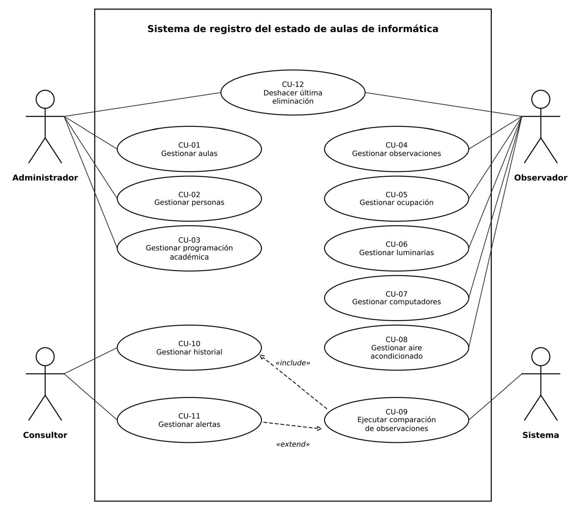

### 21. Requisitos

#### 5. Requisitos y reglas de negocio

Los requisitos funcionales (RF-001 a RF-126) se presentan por entidad, los requisitos no funcionales (RNF-01 a RNF-20) se clasifican según la característica de calidad de la norma ISO/IEC 25010 y las reglas de negocio (RN-01 a RN-40) se agrupan por tema.

##### 5.1 Requisitos funcionales

Documento consolidado de requisitos funcionales del proyecto, agrupados por entidad.

<a id="tabla-60"></a>

**Tabla 60**
*Requisitos funcionales de la entidad Aula*

| **ID** | **Requisito funcional** | **Origen** |
|---|---|---|
| RF-001 | El sistema deberá gestionar la funcionalidad asociada a aula correspondiente al requisito 1. | Historias de Usuario y Criterios de Aceptación |
| RF-002 | El sistema deberá gestionar la funcionalidad asociada a aula correspondiente al requisito 2. | Historias de Usuario y Criterios de Aceptación |
| RF-003 | El sistema deberá gestionar la funcionalidad asociada a aula correspondiente al requisito 3. | Historias de Usuario y Criterios de Aceptación |
| RF-004 | El sistema deberá gestionar la funcionalidad asociada a aula correspondiente al requisito 4. | Historias de Usuario y Criterios de Aceptación |
| RF-005 | El sistema deberá gestionar la funcionalidad asociada a aula correspondiente al requisito 5. | Historias de Usuario y Criterios de Aceptación |
| RF-006 | El sistema deberá gestionar la funcionalidad asociada a aula correspondiente al requisito 6. | Historias de Usuario y Criterios de Aceptación |
| RF-007 | El sistema deberá gestionar la funcionalidad asociada a aula correspondiente al requisito 7. | Historias de Usuario y Criterios de Aceptación |
| RF-008 | El sistema deberá gestionar la funcionalidad asociada a aula correspondiente al requisito 8. | Historias de Usuario y Criterios de Aceptación |
| RF-009 | El sistema deberá gestionar la funcionalidad asociada a aula correspondiente al requisito 9. | Historias de Usuario y Criterios de Aceptación |
| RF-010 | El sistema deberá gestionar la funcionalidad asociada a aula correspondiente al requisito 10. | Historias de Usuario y Criterios de Aceptación |
| RF-011 | El sistema deberá gestionar la funcionalidad asociada a aula correspondiente al requisito 11. | Historias de Usuario y Criterios de Aceptación |
| RF-012 | El sistema deberá gestionar la funcionalidad asociada a aula correspondiente al requisito 12. | Historias de Usuario y Criterios de Aceptación |
| RF-013 | El sistema deberá gestionar la funcionalidad asociada a aula correspondiente al requisito 13. | Historias de Usuario y Criterios de Aceptación |
| RF-014 | El sistema deberá gestionar la funcionalidad asociada a aula correspondiente al requisito 14. | Historias de Usuario y Criterios de Aceptación |
| RF-015 | El sistema deberá gestionar la funcionalidad asociada a aula correspondiente al requisito 15. | Historias de Usuario y Criterios de Aceptación |
| RF-016 | El sistema deberá gestionar la funcionalidad asociada a aula correspondiente al requisito 16. | Historias de Usuario y Criterios de Aceptación |
| RF-017 | El sistema deberá gestionar la funcionalidad asociada a aula correspondiente al requisito 17. | Historias de Usuario y Criterios de Aceptación |
| RF-018 | El sistema deberá gestionar la funcionalidad asociada a aula correspondiente al requisito 18. | Historias de Usuario y Criterios de Aceptación |

<a id="tabla-61"></a>

**Tabla 61**
*Requisitos funcionales de la entidad Persona*

| **ID** | **Requisito funcional** | **Origen** |
|---|---|---|
| RF-019 | El sistema deberá gestionar la funcionalidad asociada a persona correspondiente al requisito 19. | Historias de Usuario y Criterios de Aceptación |
| RF-020 | El sistema deberá gestionar la funcionalidad asociada a persona correspondiente al requisito 20. | Historias de Usuario y Criterios de Aceptación |
| RF-021 | El sistema deberá gestionar la funcionalidad asociada a persona correspondiente al requisito 21. | Historias de Usuario y Criterios de Aceptación |
| RF-022 | El sistema deberá gestionar la funcionalidad asociada a persona correspondiente al requisito 22. | Historias de Usuario y Criterios de Aceptación |
| RF-023 | El sistema deberá gestionar la funcionalidad asociada a persona correspondiente al requisito 23. | Historias de Usuario y Criterios de Aceptación |
| RF-024 | El sistema deberá gestionar la funcionalidad asociada a persona correspondiente al requisito 24. | Historias de Usuario y Criterios de Aceptación |
| RF-025 | El sistema deberá gestionar la funcionalidad asociada a persona correspondiente al requisito 25. | Historias de Usuario y Criterios de Aceptación |
| RF-026 | El sistema deberá gestionar la funcionalidad asociada a persona correspondiente al requisito 26. | Historias de Usuario y Criterios de Aceptación |
| RF-027 | El sistema deberá gestionar la funcionalidad asociada a persona correspondiente al requisito 27. | Historias de Usuario y Criterios de Aceptación |
| RF-028 | El sistema deberá gestionar la funcionalidad asociada a persona correspondiente al requisito 28. | Historias de Usuario y Criterios de Aceptación |
| RF-029 | El sistema deberá gestionar la funcionalidad asociada a persona correspondiente al requisito 29. | Historias de Usuario y Criterios de Aceptación |
| RF-030 | El sistema deberá gestionar la funcionalidad asociada a persona correspondiente al requisito 30. | Historias de Usuario y Criterios de Aceptación |

<a id="tabla-62"></a>

**Tabla 62**
*Requisitos funcionales de la entidad Programación Académica*

| **ID** | **Requisito funcional** | **Origen** |
|---|---|---|
| RF-031 | El sistema deberá gestionar la funcionalidad asociada a programacion_academica correspondiente al requisito 31. | Historias de Usuario y Criterios de Aceptación |
| RF-032 | El sistema deberá gestionar la funcionalidad asociada a programacion_academica correspondiente al requisito 32. | Historias de Usuario y Criterios de Aceptación |
| RF-033 | El sistema deberá gestionar la funcionalidad asociada a programacion_academica correspondiente al requisito 33. | Historias de Usuario y Criterios de Aceptación |
| RF-034 | El sistema deberá gestionar la funcionalidad asociada a programacion_academica correspondiente al requisito 34. | Historias de Usuario y Criterios de Aceptación |
| RF-035 | El sistema deberá gestionar la funcionalidad asociada a programacion_academica correspondiente al requisito 35. | Historias de Usuario y Criterios de Aceptación |
| RF-036 | El sistema deberá gestionar la funcionalidad asociada a programacion_academica correspondiente al requisito 36. | Historias de Usuario y Criterios de Aceptación |
| RF-037 | El sistema deberá gestionar la funcionalidad asociada a programacion_academica correspondiente al requisito 37. | Historias de Usuario y Criterios de Aceptación |
| RF-038 | El sistema deberá gestionar la funcionalidad asociada a programacion_academica correspondiente al requisito 38. | Historias de Usuario y Criterios de Aceptación |
| RF-039 | El sistema deberá gestionar la funcionalidad asociada a programacion_academica correspondiente al requisito 39. | Historias de Usuario y Criterios de Aceptación |
| RF-040 | El sistema deberá gestionar la funcionalidad asociada a programacion_academica correspondiente al requisito 40. | Historias de Usuario y Criterios de Aceptación |
| RF-041 | El sistema deberá gestionar la funcionalidad asociada a programacion_academica correspondiente al requisito 41. | Historias de Usuario y Criterios de Aceptación |
| RF-042 | El sistema deberá gestionar la funcionalidad asociada a programacion_academica correspondiente al requisito 42. | Historias de Usuario y Criterios de Aceptación |
| RF-043 | El sistema deberá gestionar la funcionalidad asociada a programacion_academica correspondiente al requisito 43. | Historias de Usuario y Criterios de Aceptación |
| RF-044 | El sistema deberá gestionar la funcionalidad asociada a programacion_academica correspondiente al requisito 44. | Historias de Usuario y Criterios de Aceptación |
| RF-045 | El sistema deberá gestionar la funcionalidad asociada a programacion_academica correspondiente al requisito 45. | Historias de Usuario y Criterios de Aceptación |
| RF-046 | El sistema deberá gestionar la funcionalidad asociada a programacion_academica correspondiente al requisito 46. | Historias de Usuario y Criterios de Aceptación |
| RF-047 | El sistema deberá gestionar la funcionalidad asociada a programacion_academica correspondiente al requisito 47. | Historias de Usuario y Criterios de Aceptación |
| RF-048 | El sistema deberá gestionar la funcionalidad asociada a programacion_academica correspondiente al requisito 48. | Historias de Usuario y Criterios de Aceptación |

<a id="tabla-63"></a>

**Tabla 63**
*Requisitos funcionales de la entidad Registro Estado*

| **ID** | **Requisito funcional** | **Origen** |
|---|---|---|
| RF-049 | El sistema deberá gestionar la funcionalidad asociada a registro_estado correspondiente al requisito 49. | Historias de Usuario y Criterios de Aceptación |
| RF-050 | El sistema deberá gestionar la funcionalidad asociada a registro_estado correspondiente al requisito 50. | Historias de Usuario y Criterios de Aceptación |
| RF-051 | El sistema deberá gestionar la funcionalidad asociada a registro_estado correspondiente al requisito 51. | Historias de Usuario y Criterios de Aceptación |
| RF-052 | El sistema deberá gestionar la funcionalidad asociada a registro_estado correspondiente al requisito 52. | Historias de Usuario y Criterios de Aceptación |
| RF-053 | El sistema deberá gestionar la funcionalidad asociada a registro_estado correspondiente al requisito 53. | Historias de Usuario y Criterios de Aceptación |
| RF-054 | El sistema deberá gestionar la funcionalidad asociada a registro_estado correspondiente al requisito 54. | Historias de Usuario y Criterios de Aceptación |
| RF-055 | El sistema deberá gestionar la funcionalidad asociada a registro_estado correspondiente al requisito 55. | Historias de Usuario y Criterios de Aceptación |
| RF-056 | El sistema deberá gestionar la funcionalidad asociada a registro_estado correspondiente al requisito 56. | Historias de Usuario y Criterios de Aceptación |
| RF-057 | El sistema deberá gestionar la funcionalidad asociada a registro_estado correspondiente al requisito 57. | Historias de Usuario y Criterios de Aceptación |
| RF-058 | El sistema deberá gestionar la funcionalidad asociada a registro_estado correspondiente al requisito 58. | Historias de Usuario y Criterios de Aceptación |
| RF-059 | El sistema deberá gestionar la funcionalidad asociada a registro_estado correspondiente al requisito 59. | Historias de Usuario y Criterios de Aceptación |
| RF-060 | El sistema deberá gestionar la funcionalidad asociada a registro_estado correspondiente al requisito 60. | Historias de Usuario y Criterios de Aceptación |
| RF-061 | El sistema deberá gestionar la funcionalidad asociada a registro_estado correspondiente al requisito 61. | Historias de Usuario y Criterios de Aceptación |
| RF-062 | El sistema deberá gestionar la funcionalidad asociada a registro_estado correspondiente al requisito 62. | Historias de Usuario y Criterios de Aceptación |
| RF-063 | El sistema deberá gestionar la funcionalidad asociada a registro_estado correspondiente al requisito 63. | Historias de Usuario y Criterios de Aceptación |
| RF-064 | El sistema deberá gestionar la funcionalidad asociada a registro_estado correspondiente al requisito 64. | Historias de Usuario y Criterios de Aceptación |

<a id="tabla-64"></a>

**Tabla 64**
*Requisitos funcionales de la entidad Ocupación*

| **ID** | **Requisito funcional** | **Origen** |
|---|---|---|
| RF-065 | El sistema deberá gestionar la funcionalidad asociada a ocupacion correspondiente al requisito 65. | Historias de Usuario y Criterios de Aceptación |
| RF-066 | El sistema deberá gestionar la funcionalidad asociada a ocupacion correspondiente al requisito 66. | Historias de Usuario y Criterios de Aceptación |
| RF-067 | El sistema deberá gestionar la funcionalidad asociada a ocupacion correspondiente al requisito 67. | Historias de Usuario y Criterios de Aceptación |
| RF-068 | El sistema deberá gestionar la funcionalidad asociada a ocupacion correspondiente al requisito 68. | Historias de Usuario y Criterios de Aceptación |
| RF-069 | El sistema deberá gestionar la funcionalidad asociada a ocupacion correspondiente al requisito 69. | Historias de Usuario y Criterios de Aceptación |
| RF-070 | El sistema deberá gestionar la funcionalidad asociada a ocupacion correspondiente al requisito 70. | Historias de Usuario y Criterios de Aceptación |
| RF-071 | El sistema deberá gestionar la funcionalidad asociada a ocupacion correspondiente al requisito 71. | Historias de Usuario y Criterios de Aceptación |
| RF-072 | El sistema deberá gestionar la funcionalidad asociada a ocupacion correspondiente al requisito 72. | Historias de Usuario y Criterios de Aceptación |
| RF-073 | El sistema deberá gestionar la funcionalidad asociada a ocupacion correspondiente al requisito 73. | Historias de Usuario y Criterios de Aceptación |
| RF-074 | El sistema deberá gestionar la funcionalidad asociada a ocupacion correspondiente al requisito 74. | Historias de Usuario y Criterios de Aceptación |
| RF-075 | El sistema deberá gestionar la funcionalidad asociada a ocupacion correspondiente al requisito 75. | Historias de Usuario y Criterios de Aceptación |

<a id="tabla-65"></a>

**Tabla 65**
*Requisitos funcionales de la entidad Luces*

| **ID** | **Requisito funcional** | **Origen** |
|---|---|---|
| RF-076 | El sistema deberá gestionar la funcionalidad asociada a luces correspondiente al requisito 76. | Historias de Usuario y Criterios de Aceptación |
| RF-077 | El sistema deberá gestionar la funcionalidad asociada a luces correspondiente al requisito 77. | Historias de Usuario y Criterios de Aceptación |
| RF-078 | El sistema deberá gestionar la funcionalidad asociada a luces correspondiente al requisito 78. | Historias de Usuario y Criterios de Aceptación |
| RF-079 | El sistema deberá gestionar la funcionalidad asociada a luces correspondiente al requisito 79. | Historias de Usuario y Criterios de Aceptación |
| RF-080 | El sistema deberá gestionar la funcionalidad asociada a luces correspondiente al requisito 80. | Historias de Usuario y Criterios de Aceptación |
| RF-081 | El sistema deberá gestionar la funcionalidad asociada a luces correspondiente al requisito 81. | Historias de Usuario y Criterios de Aceptación |
| RF-082 | El sistema deberá gestionar la funcionalidad asociada a luces correspondiente al requisito 82. | Historias de Usuario y Criterios de Aceptación |
| RF-083 | El sistema deberá gestionar la funcionalidad asociada a luces correspondiente al requisito 83. | Historias de Usuario y Criterios de Aceptación |
| RF-084 | El sistema deberá gestionar la funcionalidad asociada a luces correspondiente al requisito 84. | Historias de Usuario y Criterios de Aceptación |
| RF-085 | El sistema deberá gestionar la funcionalidad asociada a luces correspondiente al requisito 85. | Historias de Usuario y Criterios de Aceptación |

<a id="tabla-66"></a>

**Tabla 66**
*Requisitos funcionales de la entidad Computadores*

| **ID** | **Requisito funcional** | **Origen** |
|---|---|---|
| RF-086 | El sistema deberá gestionar la funcionalidad asociada a computadores correspondiente al requisito 86. | Historias de Usuario y Criterios de Aceptación |
| RF-087 | El sistema deberá gestionar la funcionalidad asociada a computadores correspondiente al requisito 87. | Historias de Usuario y Criterios de Aceptación |
| RF-088 | El sistema deberá gestionar la funcionalidad asociada a computadores correspondiente al requisito 88. | Historias de Usuario y Criterios de Aceptación |
| RF-089 | El sistema deberá gestionar la funcionalidad asociada a computadores correspondiente al requisito 89. | Historias de Usuario y Criterios de Aceptación |
| RF-090 | El sistema deberá gestionar la funcionalidad asociada a computadores correspondiente al requisito 90. | Historias de Usuario y Criterios de Aceptación |
| RF-091 | El sistema deberá gestionar la funcionalidad asociada a computadores correspondiente al requisito 91. | Historias de Usuario y Criterios de Aceptación |
| RF-092 | El sistema deberá gestionar la funcionalidad asociada a computadores correspondiente al requisito 92. | Historias de Usuario y Criterios de Aceptación |
| RF-093 | El sistema deberá gestionar la funcionalidad asociada a computadores correspondiente al requisito 93. | Historias de Usuario y Criterios de Aceptación |
| RF-094 | El sistema deberá gestionar la funcionalidad asociada a computadores correspondiente al requisito 94. | Historias de Usuario y Criterios de Aceptación |
| RF-095 | El sistema deberá gestionar la funcionalidad asociada a computadores correspondiente al requisito 95. | Historias de Usuario y Criterios de Aceptación |

<a id="tabla-67"></a>

**Tabla 67**
*Requisitos funcionales de la entidad Aire Acondicionado*

| **ID** | **Requisito funcional** | **Origen** |
|---|---|---|
| RF-096 | El sistema deberá gestionar la funcionalidad asociada a aire_acondicionado correspondiente al requisito 96. | Historias de Usuario y Criterios de Aceptación |
| RF-097 | El sistema deberá gestionar la funcionalidad asociada a aire_acondicionado correspondiente al requisito 97. | Historias de Usuario y Criterios de Aceptación |
| RF-098 | El sistema deberá gestionar la funcionalidad asociada a aire_acondicionado correspondiente al requisito 98. | Historias de Usuario y Criterios de Aceptación |
| RF-099 | El sistema deberá gestionar la funcionalidad asociada a aire_acondicionado correspondiente al requisito 99. | Historias de Usuario y Criterios de Aceptación |
| RF-100 | El sistema deberá gestionar la funcionalidad asociada a aire_acondicionado correspondiente al requisito 100. | Historias de Usuario y Criterios de Aceptación |
| RF-101 | El sistema deberá gestionar la funcionalidad asociada a aire_acondicionado correspondiente al requisito 101. | Historias de Usuario y Criterios de Aceptación |
| RF-102 | El sistema deberá gestionar la funcionalidad asociada a aire_acondicionado correspondiente al requisito 102. | Historias de Usuario y Criterios de Aceptación |
| RF-103 | El sistema deberá gestionar la funcionalidad asociada a aire_acondicionado correspondiente al requisito 103. | Historias de Usuario y Criterios de Aceptación |
| RF-104 | El sistema deberá gestionar la funcionalidad asociada a aire_acondicionado correspondiente al requisito 104. | Historias de Usuario y Criterios de Aceptación |
| RF-105 | El sistema deberá gestionar la funcionalidad asociada a aire_acondicionado correspondiente al requisito 105. | Historias de Usuario y Criterios de Aceptación |

<a id="tabla-68"></a>

**Tabla 68**
*Requisitos funcionales de la entidad Historial*

| **ID** | **Requisito funcional** | **Origen** |
|---|---|---|
| RF-106 | El sistema deberá gestionar la funcionalidad asociada a historial correspondiente al requisito 106. | Historias de Usuario y Criterios de Aceptación |
| RF-107 | El sistema deberá gestionar la funcionalidad asociada a historial correspondiente al requisito 107. | Historias de Usuario y Criterios de Aceptación |
| RF-108 | El sistema deberá gestionar la funcionalidad asociada a historial correspondiente al requisito 108. | Historias de Usuario y Criterios de Aceptación |
| RF-109 | El sistema deberá gestionar la funcionalidad asociada a historial correspondiente al requisito 109. | Historias de Usuario y Criterios de Aceptación |
| RF-110 | El sistema deberá gestionar la funcionalidad asociada a historial correspondiente al requisito 110. | Historias de Usuario y Criterios de Aceptación |
| RF-111 | El sistema deberá gestionar la funcionalidad asociada a historial correspondiente al requisito 111. | Historias de Usuario y Criterios de Aceptación |
| RF-112 | El sistema deberá gestionar la funcionalidad asociada a historial correspondiente al requisito 112. | Historias de Usuario y Criterios de Aceptación |
| RF-113 | El sistema deberá gestionar la funcionalidad asociada a historial correspondiente al requisito 113. | Historias de Usuario y Criterios de Aceptación |
| RF-114 | El sistema deberá gestionar la funcionalidad asociada a historial correspondiente al requisito 114. | Historias de Usuario y Criterios de Aceptación |
| RF-115 | El sistema deberá gestionar la funcionalidad asociada a historial correspondiente al requisito 115. | Historias de Usuario y Criterios de Aceptación |
| RF-116 | El sistema deberá gestionar la funcionalidad asociada a historial correspondiente al requisito 116. | Historias de Usuario y Criterios de Aceptación |

<a id="tabla-69"></a>

**Tabla 69**
*Requisitos funcionales de la entidad Alerta*

| **ID** | **Requisito funcional** | **Origen** |
|---|---|---|
| RF-117 | El sistema deberá gestionar la funcionalidad asociada a alerta correspondiente al requisito 117. | Historias de Usuario y Criterios de Aceptación |
| RF-118 | El sistema deberá gestionar la funcionalidad asociada a alerta correspondiente al requisito 118. | Historias de Usuario y Criterios de Aceptación |
| RF-119 | El sistema deberá gestionar la funcionalidad asociada a alerta correspondiente al requisito 119. | Historias de Usuario y Criterios de Aceptación |
| RF-120 | El sistema deberá gestionar la funcionalidad asociada a alerta correspondiente al requisito 120. | Historias de Usuario y Criterios de Aceptación |
| RF-121 | El sistema deberá gestionar la funcionalidad asociada a alerta correspondiente al requisito 121. | Historias de Usuario y Criterios de Aceptación |
| RF-122 | El sistema deberá gestionar la funcionalidad asociada a alerta correspondiente al requisito 122. | Historias de Usuario y Criterios de Aceptación |
| RF-123 | El sistema deberá gestionar la funcionalidad asociada a alerta correspondiente al requisito 123. | Historias de Usuario y Criterios de Aceptación |
| RF-124 | El sistema deberá gestionar la funcionalidad asociada a alerta correspondiente al requisito 124. | Historias de Usuario y Criterios de Aceptación |
| RF-125 | El sistema deberá gestionar la funcionalidad asociada a alerta correspondiente al requisito 125. | Historias de Usuario y Criterios de Aceptación |
| RF-126 | El sistema deberá gestionar la funcionalidad asociada a alerta correspondiente al requisito 126. | Historias de Usuario y Criterios de Aceptación |

##### 5.2 Requisitos no funcionales

<a id="tabla-70"></a>

**Tabla 70**
*Requisitos no funcionales*

| **ID** | **Categoría ISO 25010** | **Requisito no funcional** | **Métrica de verificación** |
|---|---|---|---|
| RNF-01 | Usabilidad | El sistema deberá permitir registrar una observación completa en un tiempo máximo de dos minutos. | Tiempo promedio ≤ 2 minutos en pruebas funcionales. |
| RNF-02 | Usabilidad | El sistema deberá presentar mensajes claros para todas las operaciones ejecutadas por el usuario. | 100 % de operaciones con mensaje de confirmación o error. |
| RNF-03 | Usabilidad | La navegación del sistema deberá mantenerse consistente en todos los módulos. | Todas las pantallas conservan la misma estructura de navegación. |
| RNF-04 | Usabilidad | Los formularios deberán indicar los campos obligatorios antes del almacenamiento de información. | 100 % de formularios con validación visible. |
| RNF-05 | Fiabilidad | El sistema deberá conservar la integridad de los datos tras operaciones de creación, actualización o eliminación. | No se presentan registros corruptos durante pruebas. |
| RNF-06 | Fiabilidad | El sistema deberá validar los datos ingresados antes de almacenarlos. | 100 % de validaciones ejecutadas. |
| RNF-07 | Fiabilidad | El sistema deberá evitar la duplicidad de identificadores únicos. | Ningún registro duplicado durante las pruebas. |
| RNF-08 | Fiabilidad | El sistema deberá garantizar la consistencia entre observaciones, historial y alertas. | 100 % de registros relacionados correctamente. |
| RNF-09 | Rendimiento | El sistema deberá responder a consultas individuales en menos de tres segundos. | Tiempo promedio ≤ 3 segundos. |
| RNF-10 | Rendimiento | El sistema deberá generar un listado de registros en menos de cinco segundos. | Tiempo promedio ≤ 5 segundos. |
| RNF-11 | Rendimiento | El sistema deberá generar resultados de comparación inmediatamente después del registro de una observación. | Resultado mostrado antes de 5 segundos. |
| RNF-12 | Compatibilidad | El sistema deberá ejecutarse correctamente en equipos institucionales con configuración estándar. | Ejecución exitosa en ambiente de prueba. |
| RNF-13 | Compatibilidad | El sistema deberá ejecutarse correctamente utilizando la versión de Java definida para el desarrollo académico del proyecto. | Funcionamiento validado en la versión seleccionada. |
| RNF-14 | Compatibilidad | El sistema deberá mantener compatibilidad con archivos de texto utilizados para persistencia de datos. | Archivos leídos y escritos correctamente. |
| RNF-15 | Mantenibilidad | El código deberá estar documentado mediante comentarios descriptivos. | Al menos 80 % de métodos documentados. |
| RNF-16 | Mantenibilidad | La estructura del proyecto deberá organizarse por módulos funcionales. | Separación de clases y componentes por responsabilidad. |
| RNF-17 | Mantenibilidad | Todas las entidades deberán contar con identificadores únicos claramente definidos. | Verificación de diseño y pruebas. |
| RNF-18 | Seguridad | El sistema deberá restringir la ejecución de operaciones inválidas mediante validaciones de entrada. | 100 % de entradas inválidas rechazadas. |
| RNF-19 | Seguridad | El historial generado deberá conservarse sin alteraciones automáticas del sistema. | Registros históricos preservados durante pruebas. |
| RNF-20 | Seguridad | Toda alerta generada deberá conservar la referencia del registro que la originó. | 100 % de alertas vinculadas a un registro válido. |

##### 5.3 Reglas de negocio

<a id="tabla-71"></a>

**Tabla 71**
*Reglas de negocio: gestión de aulas y programación académica*

| **ID** | **Regla de negocio** |
|---|---|
| RN-01 | Cada aula deberá identificarse mediante un código único dentro del sistema. |
| RN-02 | No podrán existir dos aulas registradas con el mismo código institucional. |
| RN-03 | Toda programación académica deberá estar asociada a un aula previamente registrada. |
| RN-04 | Una programación académica deberá tener una hora de inicio menor que su hora de finalización. |
| RN-05 | No podrán existir bloques académicos superpuestos para una misma aula. |
| RN-06 | Toda programación académica deberá estar asociada a un día válido de la semana. |
| RN-07 | La eliminación de una programación académica requerirá confirmación previa del usuario. |
| RN-08 | Toda actualización de programación académica deberá conservar el identificador original del registro. |

<a id="tabla-72"></a>

**Tabla 72**
*Reglas de negocio: gestión de personas*

| **ID** | **Regla de negocio** |
|---|---|
| RN-09 | Cada persona deberá registrarse con un identificador único. |
| RN-10 | No podrán existir dos personas con el mismo número de identificación. |
| RN-11 | Toda observación deberá estar asociada a una persona registrada. |
| RN-12 | El sistema deberá conservar la referencia de la persona que realizó cada registro. |

<a id="tabla-73"></a>

**Tabla 73**
*Reglas de negocio: gestión de observaciones*

| **ID** | **Regla de negocio** |
|---|---|
| RN-13 | Toda observación deberá estar asociada a un aula registrada. |
| RN-14 | Toda observación deberá registrar fecha y hora de realización. |
| RN-15 | Una observación deberá contener información sobre ocupación. |
| RN-16 | Una observación deberá registrar el estado de las luminarias. |
| RN-17 | Una observación deberá registrar el estado de los computadores. |
| RN-18 | Una observación deberá registrar el estado del aire acondicionado. |
| RN-19 | No podrán almacenarse observaciones con campos obligatorios vacíos. |
| RN-20 | El sistema deberá validar la consistencia de la información antes de almacenar la observación. |

<a id="tabla-74"></a>

**Tabla 74**
*Reglas de negocio: gestión de ocupación*

| **ID** | **Regla de negocio** |
|---|---|
| RN-21 | El estado de ocupación solo podrá asumir los valores "ocupada" o "vacía". |
| RN-22 | Cada observación deberá registrar exactamente un estado de ocupación. |
| RN-23 | El estado de ocupación deberá asociarse únicamente a una observación existente. |
| RN-24 | No podrán registrarse múltiples estados de ocupación para una misma observación. |

<a id="tabla-75"></a>

**Tabla 75**
*Reglas de negocio: gestión de luminarias*

| **ID** | **Regla de negocio** |
|---|---|
| RN-25 | El estado de las luminarias solo podrá registrarse como "encendidas" o "apagadas". |
| RN-26 | Cada observación deberá registrar un único estado de luminarias. |
| RN-27 | El estado de las luminarias deberá estar asociado a una observación válida. |
| RN-28 | No podrán registrarse estados de luminarias sin una observación asociada. |

<a id="tabla-76"></a>

**Tabla 76**
*Reglas de negocio: gestión de computadores*

| **ID** | **Regla de negocio** |
|---|---|
| RN-29 | El estado de los computadores deberá registrarse durante cada observación. |
| RN-30 | Los computadores podrán clasificarse únicamente como encendidos o apagados. |
| RN-31 | No podrán almacenarse estados de computadores sin una observación asociada. |
| RN-32 | Cada observación deberá registrar un único estado consolidado para los computadores. |

<a id="tabla-77"></a>

**Tabla 77**
*Reglas de negocio: gestión de aire acondicionado*

| **ID** | **Regla de negocio** |
|---|---|
| RN-33 | El estado del aire acondicionado deberá registrarse durante cada observación. |
| RN-34 | El aire acondicionado solo podrá clasificarse como encendido o apagado. |
| RN-35 | Cada observación deberá asociar un único estado para el aire acondicionado. |
| RN-36 | No podrán existir registros de aire acondicionado sin observación relacionada. |

<a id="tabla-78"></a>

**Tabla 78**
*Reglas de negocio: historial y alertas*

| **ID** | **Regla de negocio** |
|---|---|
| RN-37 | Toda comparación realizada deberá generar un registro histórico. |
| RN-38 | El historial deberá conservar la fecha y hora de generación del resultado. |
| RN-39 | El sistema deberá generar una alerta cuando el resultado sea clasificado como posible inconsistencia. |
| RN-40 | Toda alerta deberá conservar la referencia del historial que la originó. |

### 22. Matriz de trazabilidad

#### 6. Matriz de trazabilidad

La matriz relaciona cada historia de usuario con sus criterios de aceptación, requisitos funcionales, requisitos no funcionales y reglas de negocio. Para las entidades Luces, Computadores, Aire Acondicionado, Historial y Alerta, cada fila agrupa las seis historias de la entidad en un rango.

<a id="tabla-79"></a>

**Tabla 79**
*Matriz de trazabilidad HU – CA – RF – RNF – RN*

| **HU** | **CA** | **RF** | **RNF** | **RN** |
|---|---|---|---|---|
| HU-AUL-01 | CA-AUL-01.1, CA-AUL-01.2, CA-AUL-01.3 | RF-001, RF-002, RF-003 | RNF-02, RNF-06 | RN-01, RN-02 |
| HU-AUL-02 | CA-AUL-02.1, CA-AUL-02.2, CA-AUL-02.3 | RF-004, RF-005, RF-006 | RNF-02, RNF-09 | RN-01 |
| HU-AUL-03 | CA-AUL-03.1, CA-AUL-03.2, CA-AUL-03.3 | RF-007, RF-008, RF-009 | RNF-05, RNF-06 | RN-01 |
| HU-AUL-04 | CA-AUL-04.1, CA-AUL-04.2, CA-AUL-04.3 | RF-010, RF-011, RF-012 | RNF-18 | RN-07 |
| HU-AUL-05 | CA-AUL-05.1, CA-AUL-05.2, CA-AUL-05.3 | RF-013, RF-014, RF-015 | RNF-09 | RN-01 |
| HU-AUL-06 | CA-AUL-06.1, CA-AUL-06.2, CA-AUL-06.3 | RF-016, RF-017, RF-018 | RNF-05 | RN-01 |
| HU-PER-01 | CA-PER-01.1, CA-PER-01.2, CA-PER-01.3 | RF-019, RF-020, RF-021 | RNF-06, RNF-18 | RN-09, RN-10 |
| HU-PER-02 | CA-PER-02.1, CA-PER-02.2, CA-PER-02.3 | RF-022, RF-023, RF-024 | RNF-09 | RN-09 |
| HU-PER-03 | CA-PER-03.1, CA-PER-03.2, CA-PER-03.3 | RF-025, RF-026, RF-027 | RNF-05 | RN-09 |
| HU-PER-04 | CA-PER-04.1, CA-PER-04.2, CA-PER-04.3 | RF-028, RF-029, RF-030 | RNF-18 | RN-10 |
| HU-PER-05 | CA-PER-05.1, CA-PER-05.2, CA-PER-05.3 | RF-028, RF-029, RF-030 | RNF-09 | RN-09 |
| HU-PER-06 | CA-PER-06.1, CA-PER-06.2, CA-PER-06.3 | RF-028, RF-029, RF-030 | RNF-05 | RN-09 |
| HU-PRO-01 | CA-PRO-01.1, CA-PRO-01.2, CA-PRO-01.3 | RF-031, RF-032, RF-033 | RNF-06, RNF-09 | RN-03, RN-04 |
| HU-PRO-02 | CA-PRO-02.1, CA-PRO-02.2, CA-PRO-02.3 | RF-034, RF-035, RF-036 | RNF-09 | RN-05 |
| HU-PRO-03 | CA-PRO-03.1, CA-PRO-03.2, CA-PRO-03.3 | RF-037, RF-038, RF-039 | RNF-05 | RN-06 |
| HU-PRO-04 | CA-PRO-04.1, CA-PRO-04.2, CA-PRO-04.3 | RF-040, RF-041, RF-042 | RNF-18 | RN-07 |
| HU-PRO-05 | CA-PRO-05.1, CA-PRO-05.2, CA-PRO-05.3 | RF-043, RF-044, RF-045 | RNF-09 | RN-08 |
| HU-PRO-06 | CA-PRO-06.1, CA-PRO-06.2, CA-PRO-06.3 | RF-046, RF-047, RF-048 | RNF-05 | RN-08 |
| HU-REG-01 | CA-REG-01.1, CA-REG-01.2, CA-REG-01.3 | RF-049, RF-050, RF-051 | RNF-01, RNF-05 | RN-13, RN-14 |
| HU-REG-02 | CA-REG-02.1, CA-REG-02.2, CA-REG-02.3 | RF-052, RF-053, RF-054 | RNF-06 | RN-15 |
| HU-REG-03 | CA-REG-03.1, CA-REG-03.2, CA-REG-03.3 | RF-055, RF-056, RF-057 | RNF-06 | RN-16 |
| HU-REG-04 | CA-REG-04.1, CA-REG-04.2, CA-REG-04.3 | RF-058, RF-059, RF-060 | RNF-06 | RN-17 |
| HU-REG-05 | CA-REG-05.1, CA-REG-05.2, CA-REG-05.3 | RF-061, RF-062, RF-063 | RNF-06 | RN-18 |
| HU-REG-06 | CA-REG-06.1, CA-REG-06.2, CA-REG-06.3 | RF-064 | RNF-18 | RN-19, RN-20 |
| HU-OCU-01 | CA-OCU-01.1, CA-OCU-01.2, CA-OCU-01.3 | RF-065, RF-066, RF-067 | RNF-06 | RN-21 |
| HU-OCU-02 | CA-OCU-02.1, CA-OCU-02.2, CA-OCU-02.3 | RF-068 | RNF-06 | RN-22 |
| HU-OCU-03 | CA-OCU-03.1, CA-OCU-03.2, CA-OCU-03.3 | RF-069, RF-070 | RNF-06 | RN-23 |
| HU-OCU-04 | CA-OCU-04.1, CA-OCU-04.2, CA-OCU-04.3 | RF-071 | RNF-18 | RN-24 |
| HU-OCU-05 | CA-OCU-05.1, CA-OCU-05.2, CA-OCU-05.3 | RF-072, RF-073, RF-074 | RNF-09 | RN-21 |
| HU-OCU-06 | CA-OCU-06.1, CA-OCU-06.2, CA-OCU-06.3 | RF-075 | RNF-05 | RN-22 |
| HU-LUZ-01 a HU-LUZ-06 | CA-LUZ-01.1 a CA-LUZ-06.3 | RF-076 a RF-085 | RNF-06 | RN-25 a RN-28 |
| HU-COM-01 a HU-COM-06 | CA-COM-01.1 a CA-COM-06.3 | RF-086 a RF-095 | RNF-06 | RN-29 a RN-32 |
| HU-AIR-01 a HU-AIR-06 | CA-AIR-01.1 a CA-AIR-06.3 | RF-096 a RF-105 | RNF-06 | RN-33 a RN-36 |
| HU-HIS-01 a HU-HIS-06 | CA-HIS-01.1 a CA-HIS-06.3 | RF-106 a RF-116 | RNF-05, RNF-19 | RN-37, RN-38 |
| HU-ALE-01 a HU-ALE-06 | CA-ALE-01.1 a CA-ALE-06.3 | RF-117 a RF-126 | RNF-20 | RN-39, RN-40 |

##### ¿Quedó algún requisito que no aparece en ninguna fila?

Sí. Los 126 requisitos funcionales aparecen en la matriz, pero 12 de los 20 requisitos no funcionales no aparecen en ninguna fila: RNF-03, RNF-04, RNF-07, RNF-08 y RNF-10 a RNF-17. Ninguna historia ni criterio de aceptación los sostiene todavía.

##### ¿Quedó alguna historia sin requisitos?

No. Las 60 historias de usuario aparecen en la matriz y cada una tiene al menos un requisito funcional.

##### ¿Hay alguna regla que no aparece?

Sí. RN-11 y RN-12, del grupo de gestión de personas, no aparecen en ninguna fila. Las otras 38 reglas de negocio sí aparecen.

### 23. Diccionario de datos

#### 7. Diccionario de datos

El diccionario tiene una tabla por entidad, con el campo, la marca de llave primaria o foránea, su significado en el negocio, el tipo, el tamaño, si es obligatorio y los valores permitidos.

<a id="tabla-80"></a>

**Tabla 80**
*Entidad AULA*

| **Campo** | **PK/FK** | **Significado** | **Tipo** | **Tamaño** | **Obligatorio** | **Valores permitidos** |
|---|---|---|---|---|---|---|
| id_aula | PK | Identificador único del aula | INT | 10 | Sí | Enteros positivos |
| codigo_aula | - | Código institucional del aula | VARCHAR | 20 | Sí | Texto único |
| nombre_aula | - | Nombre descriptivo del aula | VARCHAR | 100 | Sí | Texto |
| ubicacion | - | Ubicación física del aula | VARCHAR | 100 | Sí | Texto |
| bloque | - | Bloque al que pertenece el aula | VARCHAR | 20 | Sí | Texto |
| estado | - | Estado operativo del aula | VARCHAR | 20 | Sí | Activa, Inactiva |

<a id="tabla-81"></a>

**Tabla 81**
*Entidad PERSONA*

| **Campo** | **PK/FK** | **Significado** | **Tipo** | **Tamaño** | **Obligatorio** | **Valores permitidos** |
|---|---|---|---|---|---|---|
| id_persona | PK | Identificador interno de la persona | INT | 10 | Sí | Enteros positivos |
| documento | - | Número de identificación | VARCHAR | 20 | Sí | Único |
| nombres | - | Nombres de la persona | VARCHAR | 100 | Sí | Texto |
| apellidos | - | Apellidos de la persona | VARCHAR | 100 | Sí | Texto |
| correo | - | Correo electrónico | VARCHAR | 100 | No | Correo válido |
| rol | - | Rol dentro del sistema | VARCHAR | 30 | Sí | Administrador, Observador, Consultor |

<a id="tabla-82"></a>

**Tabla 82**
*Entidad PROGRAMACIÓN_ACADÉMICA*

| **Campo** | **PK/FK** | **Significado** | **Tipo** | **Tamaño** | **Obligatorio** | **Valores permitidos** |
|---|---|---|---|---|---|---|
| id_programacion | PK | Identificador de programación | INT | 10 | Sí | Enteros positivos |
| id_aula | FK | Aula asociada | INT | 10 | Sí | Aula existente |
| dia_semana | - | Día programado | VARCHAR | 15 | Sí | Lunes a Domingo |
| hora_inicio | - | Hora inicial | TIME | - | Sí | HH:mm |
| hora_fin | - | Hora final | TIME | - | Sí | HH:mm |
| asignatura | - | Asignatura programada | VARCHAR | 100 | Sí | Texto |
| docente | - | Docente asignado | VARCHAR | 100 | Sí | Texto |

<a id="tabla-83"></a>

**Tabla 83**
*Entidad REGISTRO_ESTADO*

| **Campo** | **PK/FK** | **Significado** | **Tipo** | **Tamaño** | **Obligatorio** | **Valores permitidos** |
|---|---|---|---|---|---|---|
| id_registro | PK | Identificador de observación | INT | 10 | Sí | Enteros positivos |
| id_aula | FK | Aula observada | INT | 10 | Sí | Aula existente |
| id_persona | FK | Persona que registra | INT | 10 | Sí | Persona existente |
| fecha_observacion | - | Fecha de observación | DATE | - | Sí | Fecha válida |
| hora_observacion | - | Hora de observación | TIME | - | Sí | Hora válida |
| observaciones | - | Comentarios adicionales | VARCHAR | 500 | No | Texto libre |

<a id="tabla-84"></a>

**Tabla 84**
*Entidad OCUPACIÓN*

| **Campo** | **PK/FK** | **Significado** | **Tipo** | **Tamaño** | **Obligatorio** | **Valores permitidos** |
|---|---|---|---|---|---|---|
| id_ocupacion | PK | Identificador del registro de ocupación | INT | 10 | Sí | Enteros positivos |
| id_registro | FK | Observación asociada | INT | 10 | Sí | Registro existente |
| estado_ocupacion | - | Estado de ocupación del aula | VARCHAR | 20 | Sí | Ocupada, Vacía |
| cantidad_personas | - | Cantidad estimada de personas | INT | 5 | No | Enteros positivos |

<a id="tabla-85"></a>

**Tabla 85**
*Entidad LUCES*

| **Campo** | **PK/FK** | **Significado** | **Tipo** | **Tamaño** | **Obligatorio** | **Valores permitidos** |
|---|---|---|---|---|---|---|
| id_luces | PK | Identificador del registro de luces | INT | 10 | Sí | Enteros positivos |
| id_registro | FK | Observación asociada | INT | 10 | Sí | Registro existente |
| estado_luces | - | Estado de las luminarias | VARCHAR | 20 | Sí | Encendidas, Apagadas |
| cantidad_luces | - | Número de luminarias observadas | INT | 5 | No | Enteros positivos |

<a id="tabla-86"></a>

**Tabla 86**
*Entidad COMPUTADORES*

| **Campo** | **PK/FK** | **Significado** | **Tipo** | **Tamaño** | **Obligatorio** | **Valores permitidos** |
|---|---|---|---|---|---|---|
| id_computadores | PK | Identificador del registro de computadores | INT | 10 | Sí | Enteros positivos |
| id_registro | FK | Observación asociada | INT | 10 | Sí | Registro existente |
| estado_computadores | - | Estado observado | VARCHAR | 20 | Sí | Encendidos, Apagados |
| cantidad_encendidos | - | Cantidad de computadores encendidos | INT | 5 | No | Enteros positivos |

<a id="tabla-87"></a>

**Tabla 87**
*Entidad AIRE_ACONDICIONADO*

| **Campo** | **PK/FK** | **Significado** | **Tipo** | **Tamaño** | **Obligatorio** | **Valores permitidos** |
|---|---|---|---|---|---|---|
| id_aire | PK | Identificador del registro de aire | INT | 10 | Sí | Enteros positivos |
| id_registro | FK | Observación asociada | INT | 10 | Sí | Registro existente |
| estado_aire | - | Estado del aire acondicionado | VARCHAR | 20 | Sí | Encendido, Apagado |
| temperatura | - | Temperatura observada | DECIMAL | 4,1 | No | Valores positivos |

<a id="tabla-88"></a>

**Tabla 88**
*Entidad HISTORIAL*

| **Campo** | **PK/FK** | **Significado** | **Tipo** | **Tamaño** | **Obligatorio** | **Valores permitidos** |
|---|---|---|---|---|---|---|
| id_historial | PK | Identificador del historial | INT | 10 | Sí | Enteros positivos |
| id_registro | FK | Registro relacionado | INT | 10 | Sí | Registro existente |
| fecha_generacion | - | Fecha de generación | DATE | - | Sí | Fecha válida |
| resultado | - | Resultado obtenido | VARCHAR | 50 | Sí | Coincide, Posible inconsistencia, Inconcluso |

<a id="tabla-89"></a>

**Tabla 89**
*Entidad ALERTA*

| **Campo** | **PK/FK** | **Significado** | **Tipo** | **Tamaño** | **Obligatorio** | **Valores permitidos** |
|---|---|---|---|---|---|---|
| id_alerta | PK | Identificador de alerta | INT | 10 | Sí | Enteros positivos |
| id_historial | FK | Historial asociado | INT | 10 | Sí | Historial existente |
| fecha_alerta | - | Fecha de generación | DATE | - | Sí | Fecha válida |
| descripcion | - | Descripción de la alerta | VARCHAR | 255 | Sí | Texto |
| estado_alerta | - | Estado de atención | VARCHAR | 20 | Sí | Generada, Revisada |

### 24. Metodología de trabajo

#### 8. Metodología de trabajo

De los ciclos de vida vistos en clase (predictivo, iterativo, incremental y ágil), el que se ajusta a este proyecto es el incremental. El sistema tiene dos entidades y la comparación de un registro depende de que exista la programación cargada; por eso el orden natural es construir primero la programación académica (HU-01 a HU-06), después los registros del aula (HU-07 a HU-12) y por último las consultas que cruzan ambas entidades (HU-13 y HU-14), mostrando cada incremento funcionando antes de seguir. No se escogió el predictivo porque el alcance cambió después del formulario (sección 2): un plan cerrado desde el Cuadrante 2 habría quedado desactualizado, como ocurrió con las ocho tablas iniciales del prototipo.

Dentro de ese ciclo, las dos integrantes nos reunimos en la Corporación Universitaria Remington una o dos veces por semana. Cada reunión empezaba revisando lo que cada una había mejorado desde la anterior y terminaba con instrucciones concretas de cómo seguir, para que ninguna trabajara sobre una versión vieja. Entre reuniones, cada una hacía las mejoras al alcance que le correspondían; en la reunión se sacaban las posibles historias de usuario de ese alcance y se validaba entre las dos que todo quedara bien antes de pasar a la siguiente parte.

<a id="tabla-90"></a>

**Tabla 90**
*Cómo avanzábamos de una reunión a la siguiente*

| **Momento** | **Lo que nos decíamos para seguir** | **Qué quedaba listo** |
|---|---|---|
| Al empezar la reunión | «Muéstrame qué cambiaste del alcance y de qué pregunta del formulario sale; yo te muestro lo mío.» | Las mejoras de cada una revisadas por la otra. |
| Sacar las historias | «Con este alcance, saquemos las posibles historias de usuario: una por operación de cada entidad, y revisemos que cada una tenga su camino bueno y dos fallas.» | Las posibles historias y sus criterios. |
| Validar | «Antes de seguir, comprobemos que cada historia sale del alcance, que cada criterio tiene su requisito y que no quedó nada por fuera.» | Lo que quedaba bien se dejaba fijo; lo que no, se anotaba para corregir. |
| Al cerrar la reunión | «Para la próxima, tú sigues con la programación académica y yo con los registros del aula; si cambias algo que toque mi parte, me avisas antes de la reunión.» | Las tareas de cada una hasta la siguiente reunión. |

*Nota.* Las frases son una forma de resumir cómo nos organizamos; no son citas textuales de una reunión grabada.

El reparto es por entidad, como pide la guía: Hilary Pérez Zúñiga programa PROGRAMACION_ACADEMICA y Luijeimm Agudelo Godoy programa REGISTRO_ESTADO y las consultas, cada una con su arreglo, su pila y su archivo (sección 10.2).

El repositorio está en https://github.com/hilaryp459-ship-it/Registro-del-estado-energ-tico-del-aula-504. La carpeta Documento tiene, en tres subcarpetas, los actores, la entrevista, las observaciones, los objetivos, las historias de usuario y los requisitos funcionales en archivos .md sacados de este documento. La carpeta Prototipo tiene los 8 archivos .java, su README con las instrucciones para ejecutarlo y los archivos de datos programacion.txt y registros.txt. Al 6 de noviembre de 2026 tiene 24 registros de cambios, todos hechos desde una sola cuenta, la de Hilary. Por eso no se cumplió lo que sugiere la guía de que cada integrante suba sus propios cambios al terminar cada operación.

### 25. Mockups

#### 9. Mockups

Los mockups presentan una interfaz gráfica de escritorio con una estructura visual uniforme, inspirada en la organización de pantallas del documento de referencia. Se adaptaron al sistema «Registro del estado energético del aula 504»: conservan los módulos de programación académica, registros del estado del aula, historial y consultas. Cada pantalla incorpora campos con los nombres del diccionario de datos, tablas de consulta, acciones principales, mensajes de validación y referencias de trazabilidad (historias de usuario, casos de uso, requisitos y criterios de aceptación). Los datos visibles son ejemplos de diseño; los registros y la programación se ingresan manualmente. La comparación genera avisos de posibles inconsistencias, no mediciones de consumo ni confirmaciones de desperdicio energético.

<a id="figura-15"></a>

**Figura 15**
*Mockup: Pantalla principal*

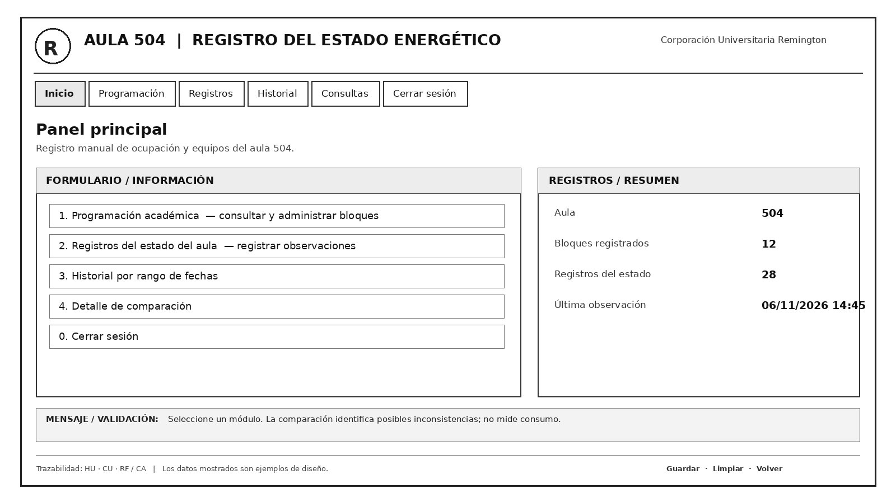

*Nota.* Navegación: 1 y 2 abren el menú de cada entidad; 3 y 4 abren las consultas; 0 cierra el programa. Al iniciar se cargan los dos archivos.

<a id="figura-16"></a>

**Figura 16**
*Mockup: Menú de la programación académica*

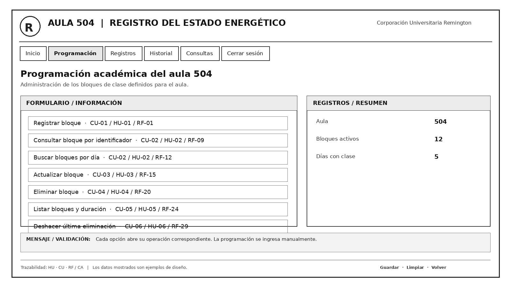

*Nota.* Cada opción muestra el caso de uso, la historia y el requisito principal que realiza.

<a id="figura-17"></a>

**Figura 17**
*Mockup: Formulario de bloque (registrar y actualizar)*

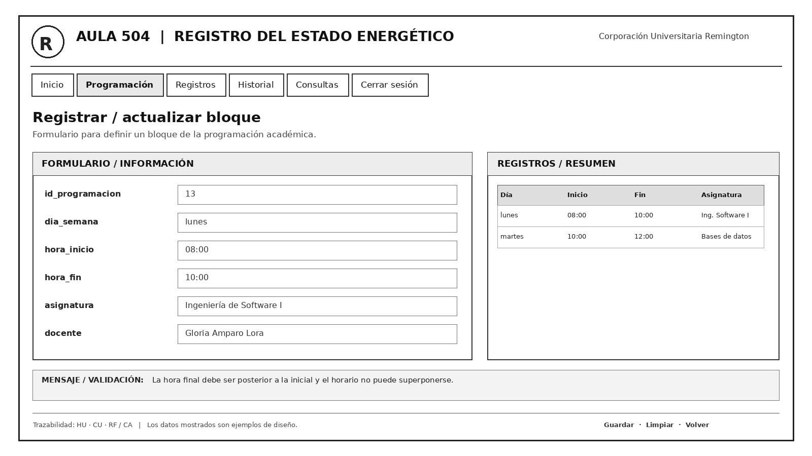

*Nota.* La misma pantalla sirve para actualizar; allí el identificador se muestra y no se puede modificar.

<a id="figura-18"></a>

**Figura 18**
*Mockup: Consulta y búsqueda de bloques*

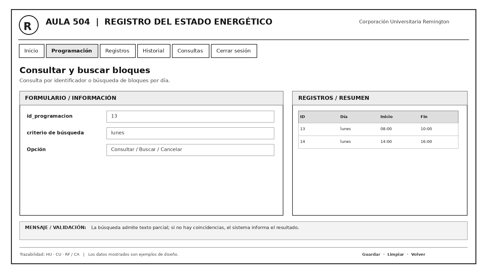

*Nota.* La consulta por identificador y la búsqueda por texto parcial son operaciones distintas.

<a id="figura-19"></a>

**Figura 19**
*Mockup: Listado de bloques con duración, eliminar y deshacer*

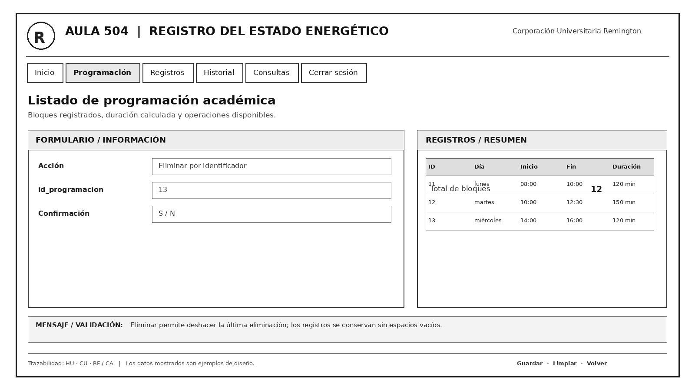

*Nota.* El listado incluye el cálculo de la guía: duración de cada bloque y total de horas por día.

<a id="figura-20"></a>

**Figura 20**
*Mockup: Menú de los registros del estado del aula*

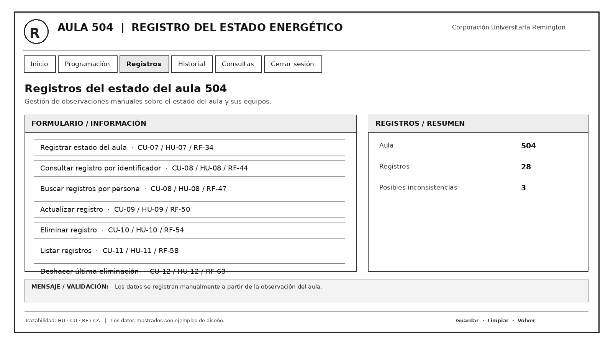

*Nota.* Cada opción muestra el caso de uso, la historia y el requisito principal que realiza.

<a id="figura-21"></a>

**Figura 21**
*Mockup: Formulario de registro del estado (registrar y actualizar)*

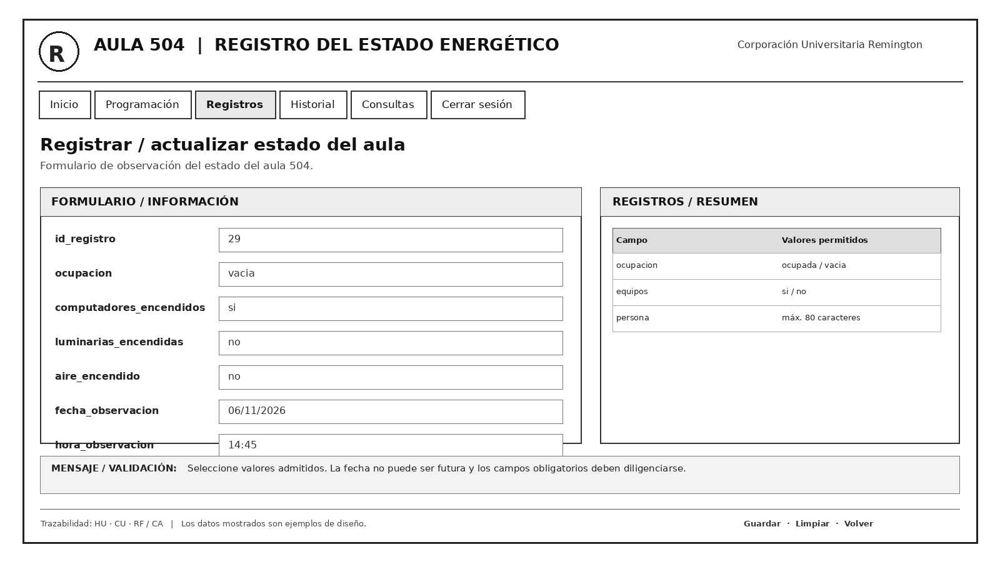

*Nota.* Los valores admitidos de cada campo están al lado de la casilla.

<a id="figura-22"></a>

**Figura 22**
*Mockup: Consulta y búsqueda de registros*

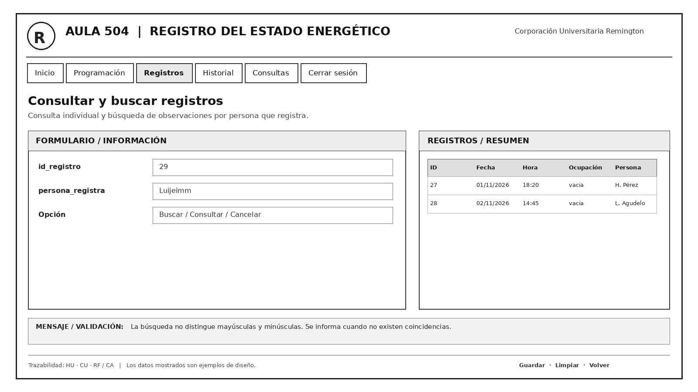

*Nota.* La búsqueda no distingue mayúsculas de minúsculas.

<a id="figura-23"></a>

**Figura 23**
*Mockup: Listado de registros con totales, eliminar y deshacer*

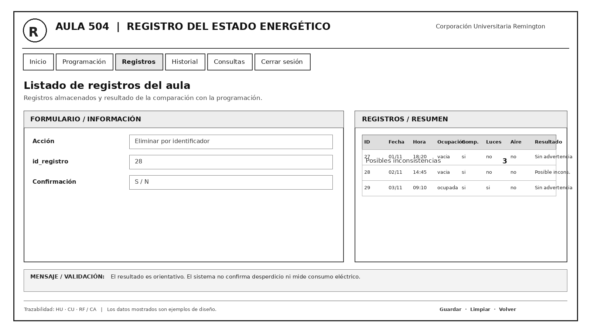

*Nota.* Los totales usan la comparación de CU-16.

<a id="figura-24"></a>

**Figura 24**
*Mockup: Historial por rango de fechas*

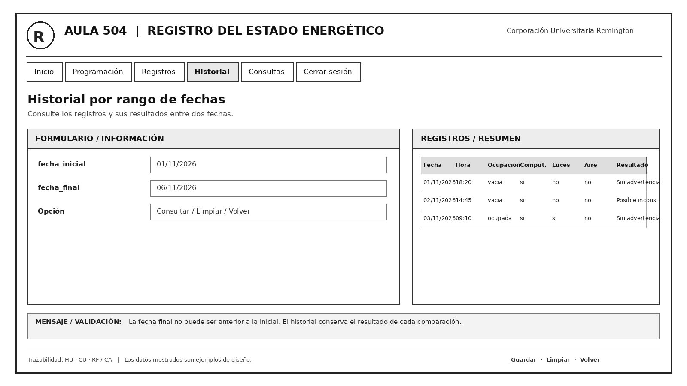

*Nota.* Cada registro muestra el resultado de la comparación.

<a id="figura-25"></a>

**Figura 25**
*Mockup: Detalle de la comparación de un registro*

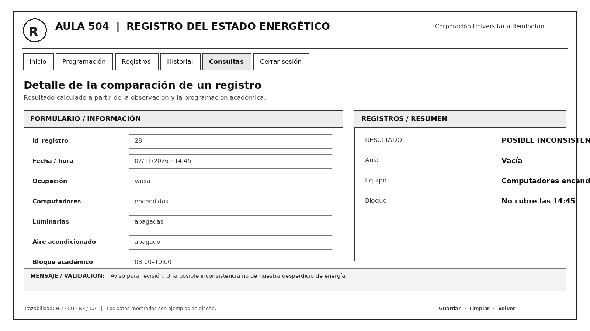

*Nota.* Las otras salidas (sin advertencia, inconclusa) están en la tabla de mensajes de las consultas.

<a id="tabla-91"></a>

**Tabla 91**
*Mensajes de las pantallas de la programación académica*

| **Criterio** | **Tipo** | **Pantalla** | **Mensaje en la línea MENSAJE / RESULTADO** | **RF** |
|---|---|---|---|---|
| CA-01.1 | Camino bueno | Formulario de bloque | «Bloque 1 guardado.» | RF-01 |
| CA-01.2 | Falla | Formulario de bloque | «La hora de fin debe ser posterior a la hora de inicio. El bloque no se guardó.» | RF-02 |
| CA-01.3 | Falla | Formulario de bloque | «El horario se superpone con el bloque 1 (lunes 08:00-10:00). El bloque no se guardó.» | RF-03 |
| CA-01.4 | Falla | Formulario de bloque | «Día no válido. Use: lunes, martes, miercoles, jueves, viernes, sabado o domingo.» | RF-04 |
| CA-01.5 | Falla | Formulario de bloque | «Hora de inicio no válida. Use HH:MM entre 00:00 y 23:59. (o «Hora de fin no válida…»)» | RF-05 |
| CA-01.6 | Falla | Formulario de bloque | «El identificador debe ser un número entero positivo.» | RF-06 |
| CA-01.7 | Falla | Formulario de bloque | «El identificador 1 ya está registrado.» | RF-07 |
| CA-01.8 | Camino bueno | Formulario de bloque | «Bloque 2 guardado.» | RF-03 |
| CA-01.9 | Falla | Formulario de bloque | «Se alcanzó la capacidad máxima de la programación (100 bloques).» | RF-08 |
| CA-02.2 | Falla | Consulta y búsqueda de bloques | «No existe un bloque con el identificador 7.» | RF-10 |
| CA-02.3 | Falla | Consulta y búsqueda de bloques | «El identificador debe ser un número entero positivo.» | RF-11 |
| CA-02.5 | Falla | Consulta y búsqueda de bloques | «No hay coincidencias para «xyz».» | RF-13 |
| CA-02.6 | Falla | Consulta y búsqueda de bloques | «Escriba un texto para buscar.» | RF-14 |
| CA-03.1 | Camino bueno | Formulario de bloque | «Bloque 1 actualizado.» | RF-15 |
| CA-03.2 | Falla | Formulario de bloque | «No existe un bloque con el identificador 7. No se modificó nada.» | RF-16 |
| CA-03.3 | Falla | Formulario de bloque | «<causa de la validación>. Se conservan los datos anteriores del bloque.» | RF-17 |
| CA-03.4 | Falla | Formulario de bloque | «El nuevo horario se superpone con el bloque 2. Se conservan los datos anteriores.» | RF-18 |
| CA-03.5 | Falla | Formulario de bloque | «El identificador debe ser un número entero positivo.» | RF-19 |
| CA-04.1 | Camino bueno | Listado de bloques | «Bloque 2 eliminado. Puede deshacer esta eliminación.» | RF-20 |
| CA-04.2 | Camino alterno | Listado de bloques | «Eliminación cancelada. No se modificó nada.» | RF-21 |
| CA-04.3 | Falla | Listado de bloques | «No existe un bloque con el identificador 7. No se eliminó nada.» | RF-22 |
| CA-04.4 | Falla | Listado de bloques | «El identificador debe ser un número entero positivo.» | RF-23 |
| CA-04.5 | Falla | Listado de bloques | «La pila de deshacer está llena. Deshaga una eliminación o reinicie el programa para poder eliminar.» | RF-79 |
| CA-05.3 | Falla | Listado de bloques | «No hay bloques de programación registrados.» | RF-27 |
| CA-05.4 | Falla | Pantalla principal (al iniciar) | «No se encontraron datos guardados de la programación. Se inicia vacía.» | RF-28 |
| CA-06.1 | Camino bueno | Listado de bloques | «Bloque 2 recuperado.» | RF-29 |
| CA-06.2 | Camino bueno | Listado de bloques | «Bloque 3 recuperado.» | RF-29 |
| CA-06.3 | Falla | Listado de bloques | «No hay nada que deshacer.» | RF-30 |
| CA-06.4 | Falla | Listado de bloques | «No se puede recuperar el bloque 2: su identificador ya está ocupado. Sigue en la pila.» | RF-31 |
| CA-06.5 | Falla | Listado de bloques | «No se puede recuperar el bloque 2: se superpone con el bloque 5. Sigue en la pila.» | RF-32 |
| CA-06.6 | Falla | Listado de bloques | «No se puede recuperar el bloque: la programación está llena (100). Sigue en la pila.» | RF-33 |

<a id="tabla-92"></a>

**Tabla 92**
*Mensajes de las pantallas de los registros del aula*

| **Criterio** | **Tipo** | **Pantalla** | **Mensaje en la línea MENSAJE / RESULTADO** | **RF** |
|---|---|---|---|---|
| CA-07.1 | Camino bueno | Formulario de registro | «Registro 1 guardado.» | RF-34 |
| CA-07.2 | Falla | Formulario de registro | «Faltan datos obligatorios: ocupacion.» | RF-35 |
| CA-07.3 | Falla | Formulario de registro | «Valor no admitido en ocupacion. Use: ocupada o vacia. (igual para los estados: si o no; y persona_registra sin punto y coma)» | RF-36 |
| CA-07.4 | Falla | Formulario de registro | «Fecha no válida. Use dd/mm/aaaa con una fecha que exista.» | RF-37 |
| CA-07.5 | Falla | Formulario de registro | «La observación no puede ser posterior al momento actual.» | RF-38 |
| CA-07.6 | Falla | Formulario de registro | «Hora no válida. Use HH:MM entre 00:00 y 23:59.» | RF-39 |
| CA-07.7 | Falla | Formulario de registro | «El identificador 1 ya está registrado.» | RF-40 |
| CA-07.8 | Falla | Formulario de registro | «El identificador debe ser un número entero positivo.» | RF-41 |
| CA-07.9 | Falla | Formulario de registro | «persona_registra admite máximo 80 caracteres.» | RF-42 |
| CA-07.10 | Falla | Formulario de registro | «Se alcanzó la capacidad máxima de registros (200).» | RF-43 |
| CA-08.2 | Falla | Consulta y búsqueda de registros | «No existe un registro con el identificador 7.» | RF-45 |
| CA-08.3 | Falla | Consulta y búsqueda de registros | «El identificador debe ser un número entero positivo.» | RF-46 |
| CA-08.5 | Falla | Consulta y búsqueda de registros | «No hay coincidencias para «xyz».» | RF-48 |
| CA-08.6 | Falla | Consulta y búsqueda de registros | «Escriba un texto para buscar.» | RF-49 |
| CA-09.1 | Camino bueno | Formulario de registro | «Registro 1 actualizado.» | RF-50 |
| CA-09.2 | Falla | Formulario de registro | «No existe un registro con el identificador 7. No se modificó nada.» | RF-51 |
| CA-09.3 | Falla | Formulario de registro | «El identificador debe ser un número entero positivo.» | RF-52 |
| CA-09.4 | Falla | Formulario de registro | «<causa de la validación>. Se conservan los datos anteriores del registro.» | RF-53 |
| CA-10.1 | Camino bueno | Listado de registros | «Registro 2 eliminado. Puede deshacer esta eliminación.» | RF-54 |
| CA-10.2 | Camino alterno | Listado de registros | «Eliminación cancelada. No se modificó nada.» | RF-55 |
| CA-10.3 | Falla | Listado de registros | «No existe un registro con el identificador 7. No se eliminó nada.» | RF-56 |
| CA-10.4 | Falla | Listado de registros | «El identificador debe ser un número entero positivo.» | RF-57 |
| CA-10.5 | Falla | Listado de registros | «La pila de deshacer está llena. Deshaga una eliminación o reinicie el programa para poder eliminar.» | RF-80 |
| CA-11.3 | Falla | Listado de registros | «No hay registros del estado del aula.» | RF-61 |
| CA-11.4 | Falla | Pantalla principal (al iniciar) | «No se encontraron registros guardados. Se inicia sin registros.» | RF-62 |
| CA-12.1 | Camino bueno | Listado de registros | «Registro 2 recuperado.» | RF-63 |
| CA-12.2 | Camino bueno | Listado de registros | «Registro 3 recuperado.» | RF-63 |
| CA-12.3 | Falla | Listado de registros | «No hay nada que deshacer.» | RF-64 |
| CA-12.4 | Falla | Listado de registros | «No se puede recuperar el registro 2: su identificador ya está ocupado. Sigue en la pila.» | RF-65 |
| CA-12.5 | Falla | Listado de registros | «No se puede recuperar el registro: hay 200 registros. Sigue en la pila.» | RF-66 |

<a id="tabla-93"></a>

**Tabla 93**
*Mensajes de las pantallas de consulta*

| **Criterio** | **Tipo** | **Pantalla** | **Mensaje en la línea MENSAJE / RESULTADO** | **RF** |
|---|---|---|---|---|
| CA-13.2 | Falla | Historial | «La fecha final no puede ser anterior a la fecha inicial.» | RF-68 |
| CA-13.3 | Falla | Historial | «No hay registros entre 01/10/2026 y 05/10/2026.» | RF-69 |
| CA-13.4 | Falla | Historial | «Fecha inicial no válida. Use dd/mm/aaaa con una fecha que exista. (o «Fecha final…»)» | RF-70 |
| CA-13.5 | Falla | Historial | «Falta la fecha final. (o «Falta la fecha inicial»)» | RF-71 |
| CA-14.1 | Camino bueno | Detalle de la comparación | «RESULTADO: POSIBLE INCONSISTENCIA. Aula vacía, computadores encendidos y ningún bloque del lunes cubre las 10:00 (el bloque 08:00-10:00 termina a las 10:00).» | RF-72 |
| CA-14.2 | Camino alterno | Detalle de la comparación | «RESULTADO: SIN ADVERTENCIA. El aula estaba registrada como ocupada.» | RF-73 |
| CA-14.3 | Camino alterno | Detalle de la comparación | «RESULTADO: SIN ADVERTENCIA. Las 08:00 están dentro del bloque 08:00-10:00.» | RF-74 |
| CA-14.4 | Camino alterno | Detalle de la comparación | «RESULTADO: SIN ADVERTENCIA. No había elementos encendidos.» | RF-75 |
| CA-14.5 | Falla | Detalle de la comparación | «RESULTADO: COMPARACIÓN INCONCLUSA. No hay programación cargada para el martes.» | RF-76 |
| CA-14.6 | Falla | Detalle de la comparación | «No existe un registro con el identificador 70.» | RF-77 |
| CA-14.7 | Falla | Detalle de la comparación | «El identificador debe ser un número entero positivo.» | RF-78 |

### 26. Prototipo funcional

#### 10. Prototipo

**Estado.** El diseño del prototipo está completo en las secciones 4, 7 y 9. El código Java ya se ejecutó: las seis capturas de la sección 10.6 son de esa ejecución. Quedan pendientes la columna de predicción de la hoja de la sección 10.7, que cada integrante escribe a mano, y el enlace al repositorio.

##### 10.1 Lenguaje e interfaz

El prototipo se programa en Java estándar, con menú por consola, como permite la guía. Lo que se evalúa es la estructura de datos y la trazabilidad: las pantallas programadas deben ser las de la sección 9, con los mismos campos, opciones y mensajes. El programa escribe sus textos sin tildes para que se lean bien en la consola de Windows; fuera de eso, los mensajes son los de las Tablas 91 a 93.

##### 10.2 El reparto: una entidad cada una

<a id="tabla-94"></a>

**Tabla 94**
*Reparto de entidades*

| **Integrante** | **Entidad** | **Qué programa** |
|---|---|---|
| Hilary Pérez Zúñiga | PROGRAMACION_ACADEMICA (HU-01 a HU-06) | Arreglo con contador, CRUDL, búsqueda por día, listado con duración y total de horas, pila propia para deshacer, archivo programacion.txt y la validación de superposición (CU-15). |
| Luijeimm Agudelo Godoy | REGISTRO_ESTADO (HU-07 a HU-12) y consultas (HU-13 y HU-14) | Arreglo con contador, CRUDL, búsqueda por persona, listado con totales, pila propia para deshacer, archivo registros.txt y la comparación (CU-16), que llama a la búsqueda de bloques por día escrita por la otra integrante: es el punto de contacto obligatorio entre las dos entidades. |

##### 10.3 Lo que hace el programa de cada una

<a id="tabla-95"></a>

**Tabla 95**
*Operaciones del prototipo y requisitos que cumplen*

| **Operación** | **Qué valida y qué hace** | **Requisitos** |
|---|---|---|
| C · Crear | Valida identificador (entero positivo, no repetido), capacidad, campos y formatos; escribe en la casilla [contador] y sube el contador. | Programación: RF-01, RF-06, RF-07, RF-08, RF-04, RF-05, RF-02, RF-03<br>Registros: RF-34, RF-41, RF-40, RF-43, RF-35, RF-36, RF-37, RF-38, RF-39, RF-42 |
| R · Consultar y buscar | Recorre de 0 a contador − 1. Consulta exacta por identificador y búsqueda por texto parcial, sin distinguir mayúsculas. | Programación: RF-09, RF-10, RF-11, RF-12, RF-13, RF-14<br>Registros: RF-44, RF-45, RF-46, RF-47, RF-48, RF-49 |
| U · Actualizar | Reemplaza en la misma casilla los campos permitidos; el identificador no cambia; vuelve a validar. | Programación: RF-15, RF-16, RF-19, RF-17, RF-18<br>Registros: RF-50, RF-51, RF-52, RF-53 |
| D · Eliminar | Pide confirmación; apila una copia; corre a la izquierda lo que está a la derecha y baja el contador. | Programación: RF-20, RF-21, RF-22, RF-23, RF-79<br>Registros: RF-54, RF-55, RF-56, RF-57, RF-80 |
| L · Listar con cálculo | Muestra hasta el contador. Programación: duración por bloque y total de horas por día. Registros: total y posibles inconsistencias. | Programación: RF-24, RF-27<br>Registros: RF-58, RF-61 |
| Deshacer | Mira la cima; si se puede recuperar, desapila y escribe en [contador]; si no, avisa y el elemento sigue en la pila. | Programación: RF-29, RF-30, RF-31, RF-32, RF-33<br>Registros: RF-63, RF-64, RF-65, RF-66 |
| Guardar y cargar | Guarda después de cada cambio exitoso (y por tanto al salir); carga al iniciar; si no hay archivo, inicia vacío. La pila no se guarda. | Programación: RF-25, RF-26, RF-28<br>Registros: RF-59, RF-60, RF-62 |
| Consultas cruzadas | Historial por rango y detalle de la comparación (CU-13, CU-14, CU-16). | Historial: RF-67, RF-68, RF-69, RF-70, RF-71<br>Detalle: RF-72, RF-73, RF-74, RF-75, RF-76, RF-77, RF-78 |

##### 10.4 El arreglo con contador y la pila

Cada entidad guarda sus elementos en un arreglo de tamaño fijo (100 bloques o 200 registros) y una variable contador que dice cuántas casillas están ocupadas. Eliminar es correr hacia la izquierda todo lo que está a la derecha del eliminado y bajar el contador; así no quedan huecos. La pila es una colección en la que el último que entra es el primero que sale, escrita a mano sobre un arreglo, con las cinco operaciones de la guía (apilar, desapilar, cima, estaVacia y tamano) y una más, estaLlena. Cada entidad tiene su propia pila y su arreglo interno es privado, así que desde afuera no se puede leer ni cambiar una posición. No se usan ArrayList, LinkedList ni java.util.Stack, como exige la guía. Antes de eliminar se revisa con estaLlena() que la pila no esté llena (CA-04.5 y CA-10.5) y antes de deshacer se mira la cima sin sacarla, para no perder el elemento si la recuperación se rechaza (CA-06.4 a CA-06.6, CA-12.4 y CA-12.5).

##### 10.5 Cómo se documenta el código

Cada clase lleva una cabecera con el proyecto, la entidad, quién la programó, la fecha y los códigos de este documento; cada método que cumple un requisito lleva un comentario con su código. Los nombres de las variables son los del diccionario. Estas son las cabeceras que corresponden a la línea base:

```java
/* ===========================================================
 * Proyecto       : Registro del estado energético del aula 504
 * Entidad        : PROGRAMACION_ACADEMICA (maestra)
 * Programado por : Hilary Pérez Zúñiga
 * Fecha          : 04/11/2026 (ajustado el 05/11/2026)
 * -----------------------------------------------------------
 * HU-01 a HU-06  Registrar, consultar y buscar, actualizar,
 *                eliminar, listar y deshacer bloques
 * RF             RF-01 a RF-33, RF-79
 * RN-03          Dos bloques del mismo día no se superponen
 * -----------------------------------------------------------
 * Criterios: CA-01.1 a CA-06.6
 * Estructuras: Arreglo con contador . Pila propia
 * =========================================================== */
 
// RF-03 · CA-01.3 · CA-01.8 · RN-03 — rechaza el bloque si se superpone; acepta contiguos
static ProgramacionAcademica seSuperpone(String dia, String ini, String fin, int idPropio) { ... }
```

```java
/* ===========================================================
 * Proyecto       : Registro del estado energético del aula 504
 * Entidad        : REGISTRO_ESTADO (transaccional)
 * Programado por : Luijeimm Agudelo Godoy
 * Fecha          : 04/11/2026 (ajustado el 05/11/2026)
 * -----------------------------------------------------------
 * HU-07 a HU-12  Registrar, consultar y buscar, actualizar,
 *                eliminar, listar y deshacer registros
 * HU-13, HU-14   Historial por rango y detalle de la comparación
 * RF             RF-34 a RF-78, RF-80
 * RN-01, RN-02, RN-04
 * -----------------------------------------------------------
 * Criterios: CA-07.1 a CA-14.7
 * Estructuras: Arreglo con contador . Pila propia
 * =========================================================== */
 
// RF-76 · CA-14.5 · RN-01 — sin bloques ese día: comparación inconclusa
static int comparar(RegistroEstado r) { ... }
```

##### 10.6 Las seis capturas

Se toman con el programa corriendo, en el orden que fija la guía y dentro del documento. Se hacen sobre la entidad REGISTRO_ESTADO; la otra integrante puede repetirlas con la programación. Las seis imágenes son la salida de la consola de una sola ejecución del código del repositorio (versión del 5 de noviembre), hecha el 6 de noviembre de 2026 desde una carpeta sin datos. Las generó la herramienta de inteligencia artificial al ejecutar el programa, como se registra en el Anexo B.

<a id="tabla-96"></a>

**Tabla 96**
*Capturas que pide la guía y criterio que evidencia cada una*

| **N.º** | **Lo que pide la guía** | **Cómo se hace en el prototipo** | **Criterio** |
|---|---|---|---|
| 1 | Crear tres registros y listarlos | Registros: crear 1, 2 y 3 (CU-07) y listar (CU-11) | CA-07.1 · CA-11.1 |
| 2 | Intentar crear uno con el identificador repetido: lo rechaza y avisa | Registros: crear otro con id 1 | CA-07.7 |
| 3 | Eliminar el del medio y listar: no queda hueco | Registros: eliminar el 2 y confirmar; listar | CA-10.1 |
| 4 | Deshacer: el eliminado vuelve | Registros: deshacer; listar | CA-12.1 |
| 5 | Deshacer otra vez sin haber eliminado nada: un mensaje, no un error | Registros: deshacer de nuevo | CA-12.3 |
| 6 | Cerrar, volver a abrir y ver que los datos siguen ahí | Salir (0), ejecutar de nuevo y listar registros | CA-11.2 |

<a id="figura-26"></a>

**Figura 26**
*Prototipo: crear tres registros y listarlos*

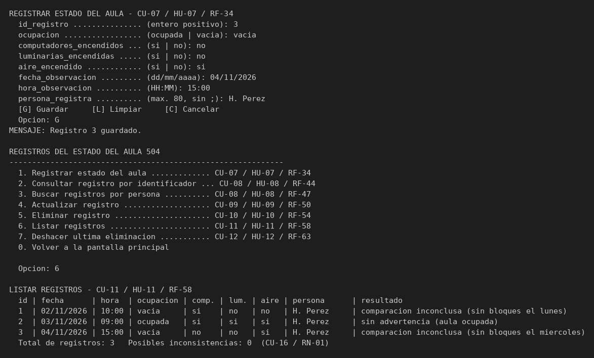

*Nota.* Salida de la consola al ejecutar el programa del repositorio (versión del 5 de noviembre) el 6 de noviembre de 2026, desde una carpeta sin datos. Se crearon los registros 1, 2 y 3; la imagen muestra el tercero y el listado con los tres, el resultado de su comparación y «Total de registros: 3» (CA-07.1, CA-11.1). No hay bloques cargados, por eso los registros vacíos salen como comparación inconclusa.

<a id="figura-27"></a>

**Figura 27**
*Prototipo: intentar crear uno con el identificador repetido: lo rechaza y avisa*

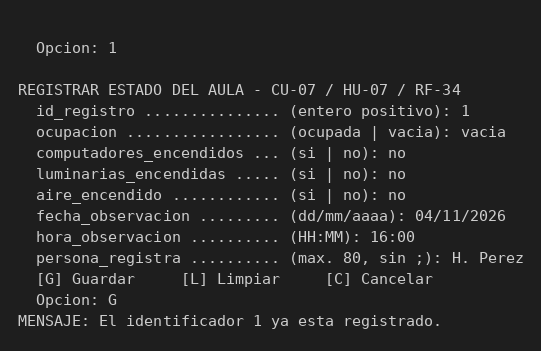

*Nota.* Misma ejecución. Al escribir de nuevo el id_registro 1 y pulsar G, el programa no crea el registro y avisa «El identificador 1 ya esta registrado.» (CA-07.7).

<a id="figura-28"></a>

**Figura 28**
*Prototipo: eliminar el del medio y listar: no queda hueco*

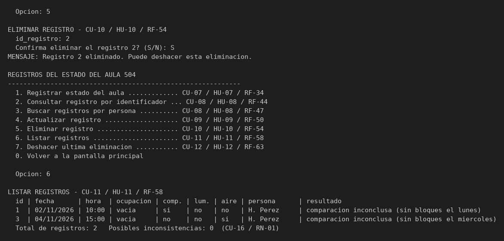

*Nota.* Misma ejecución. Se elimina el registro 2, que está en el medio, y se lista: quedan 1 y 3 seguidos, sin hueco, y el total baja a 2 (CA-10.1).

<a id="figura-29"></a>

**Figura 29**
*Prototipo: deshacer: el eliminado vuelve*

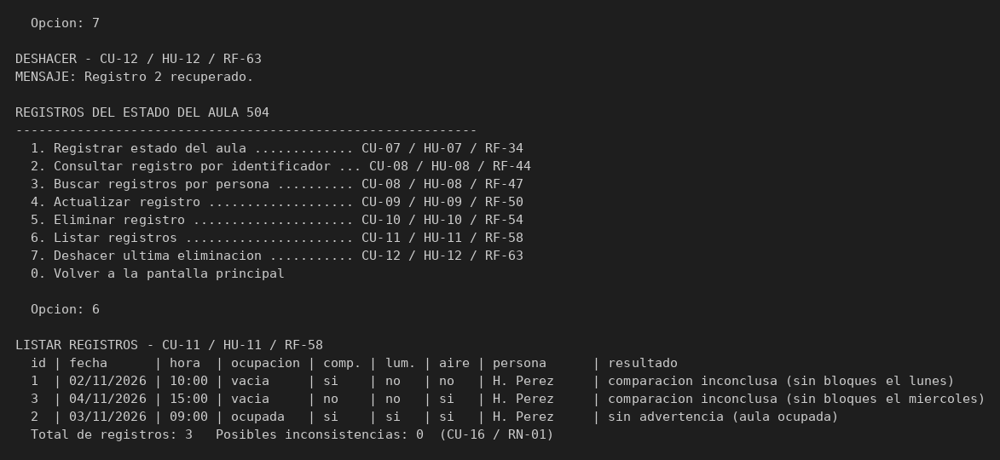

*Nota.* Misma ejecución. Al deshacer vuelve el registro 2 con todos sus datos; el listado lo muestra de último y el total sube a 3 (CA-12.1).

<a id="figura-30"></a>

**Figura 30**
*Prototipo: deshacer otra vez sin haber eliminado nada: un mensaje, no un error*

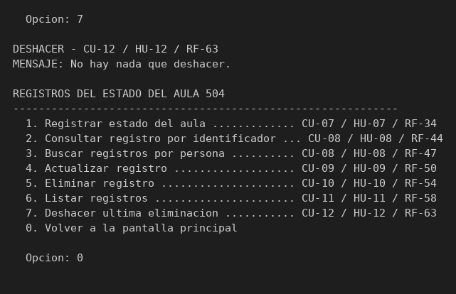

*Nota.* Misma ejecución. Con la pila vacía, deshacer muestra «No hay nada que deshacer.» y el programa sigue en el menú, sin cambiar los datos (CA-12.3).

<a id="figura-31"></a>

**Figura 31**
*Prototipo: cerrar, volver a abrir y ver que los datos siguen ahí*

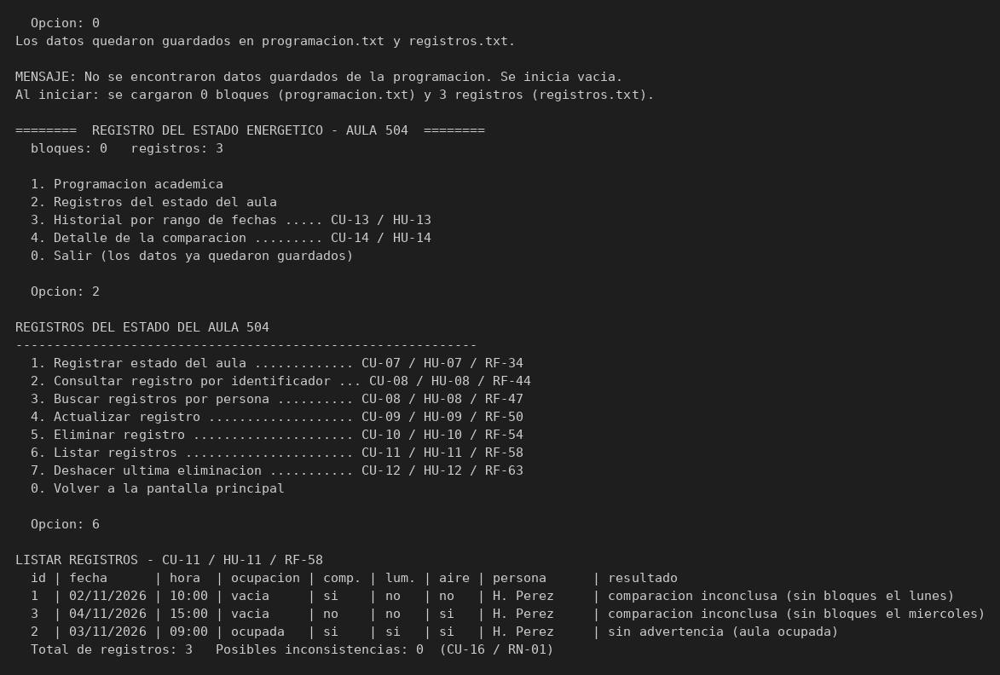

*Nota.* Arriba, el cierre de la misma ejecución; abajo, el programa abierto de nuevo: carga 3 registros de registros.txt y el listado muestra los mismos 1, 3 y 2 (CA-11.2). La pila no se guarda, así que empieza vacía.

##### 10.7 La hoja de predicción

Se escribe a mano, antes de ejecutar, y se entrega antes de mostrar el programa (guía, sección 10.9). Si las dos columnas no coinciden, el código no se entendió. La guía no pide firma, pero como el trabajo es de la pareja, la hoja que se entrega en la sustentación la firman las dos integrantes, aunque la exponga una sola. La Tabla 97 tiene las tres filas de la guía y tres pruebas más. La columna «Lo que predigo» se deja en blanco porque se escribe a mano. La columna «Lo que pasó» corresponde a la ejecución de la versión del 5 de noviembre de las Figuras 26 a 31. La fila 5 se ejecutó aparte, sobre la programación académica, con los bloques 1 (lunes 08:00–10:00), 2 (lunes 10:00–12:00) y 3 (martes 14:00–16:00).

<a id="tabla-97"></a>

**Tabla 97**
*Hoja de predicción (formato)*

| **Qué va a pasar si…** | **Lo que predigo** | **Lo que pasó** |
|---|---|---|
| Elimino el registro del medio y listo |  | Se eliminó el registro 2, que estaba en el medio; el listado mostró 1 y 3 seguidos, sin hueco, y «Total de registros: 2» (Figura 28). |
| Oprimo deshacer |  | Salió «Registro 2 recuperado.»; el listado mostró 1, 3 y 2: el 2 volvió de último con todos sus datos y el total subió a 3 (Figura 29). |
| Oprimo deshacer sin haber eliminado nada |  | Salió «No hay nada que deshacer.»; el programa siguió en el menú y no cambió los datos (Figura 30). |
| Registro un elemento con un identificador que ya existe |  | Salió «El identificador 1 ya esta registrado.»; no se creó el registro (Figura 27). |
| Elimino un bloque, registro otro que se le superpone y oprimo deshacer |  | Se eliminó el bloque 2 (lunes 10:00–12:00) y se registró el bloque 4 (lunes 10:30–11:30). Al deshacer salió «No se puede recuperar el bloque 2: se superpone con el bloque 4. Sigue en la pila.» y el listado siguió con 1, 3 y 4 (CA-06.5). |
| Cierro el programa, lo abro y listo |  | Al volver a abrir salió «se cargaron 0 bloques … y 3 registros» y el listado mostró los mismos 1, 3 y 2 (Figura 31). |

##### 10.8 La sustentación

La guía fija cinco minutos por pareja frente al programa corriendo (sección 10.10). Para esta entrega la sustentación es de 20 minutos y la hace sola Hilary Pérez Zúñiga. Por eso Hilary responde también las preguntas sobre la entidad que programó Luijeimm Agudelo Godoy (REGISTRO_ESTADO y las consultas): explica cómo funciona y dónde está cada cosa en el código, sin presentarlo como código propio. La Tabla 98 dice dónde está cada respuesta en el diseño y en el código. Las líneas citadas son las de la versión del 5 de noviembre y se comprobaron quitando cada línea en una copia del programa.

<a id="tabla-98"></a>

**Tabla 98**
*Preguntas de la sustentación y dónde está la respuesta en el diseño*

| **Pregunta posible (guía, secciones 10.10 y 11)** | **Dónde está la respuesta** |
|---|---|
| Elimine el primer registro y muestre qué pasa con el contador. | CU-04 y CU-10, paso 5. GestorProgramacion.eliminar(), líneas 238 a 241 (en GestorRegistro.eliminar(), líneas 259 a 262): todos los que están a la derecha se corren una casilla a la izquierda y el contador baja en uno. |
| Quite el control de pila vacía y muestre qué pasa. | CA-06.3 y CA-12.3. El control es la línea 275 de GestorProgramacion (300 en GestorRegistro). Sin él, deshacer usa un bloque que no existe y se produce un NullPointerException; el programa no se cierra solo porque Main lo atrapa y avisa (RNF-05). |
| ¿Por qué al eliminar hay que desplazar? ¿Qué pasaría si no? | CA-04.1 y CA-10.1. Línea 239 de GestorProgramacion (260 en GestorRegistro). Si solo se pone null, el listado encuentra la casilla vacía y se produce un error; si solo se baja el contador, el eliminado sigue a la vista y el último desaparece. |
| Muestre dónde se valida que el identificador no se repita y qué pasa si se borra esa línea. | CU-01 y CU-07, paso 4 (CA-01.7, CA-07.7): línea 135 de GestorProgramacion y 156 de GestorRegistro. Sin ella se guardan dos elementos con el mismo identificador; consultar o eliminar solo encuentra el primero y, al volver a abrir, la carga descarta el repetido. |
| ¿Por qué no se puede deshacer en el orden que uno quiera? | Es una pila: solo se saca el último que entró (CA-06.2, CA-12.2). desapilar() solo trabaja con la cima. |
| ¿Por qué no se puede modificar el tercer elemento de la pila, si en el arreglo sí? | La pila solo ofrece apilar, desapilar, cima, estaVacia, estaLlena y tamano; no tiene acceso por posición. Su arreglo datos es private: pila.datos[2] no compila. |
| ¿De qué pregunta de la entrevista salió esta historia? | Nota de la Tabla 28, que resume la Tabla 27: cada historia con la pregunta de donde sale. HU-06 y HU-12 salen de la guía, no del formulario. |
| ¿Qué le cambió a lo que devolvió la IA, y por qué? | Anexo B, última columna. La de Hilary se armó con lo que quedó registrado en el chat con la herramienta; la de Luijeimm indica que no hay solicitudes propias registradas. |

#### Cabecera del programa

<a id="figura-32"></a>

**Figura 32**
*Cabecera y pantalla principal del programa en ejecución*

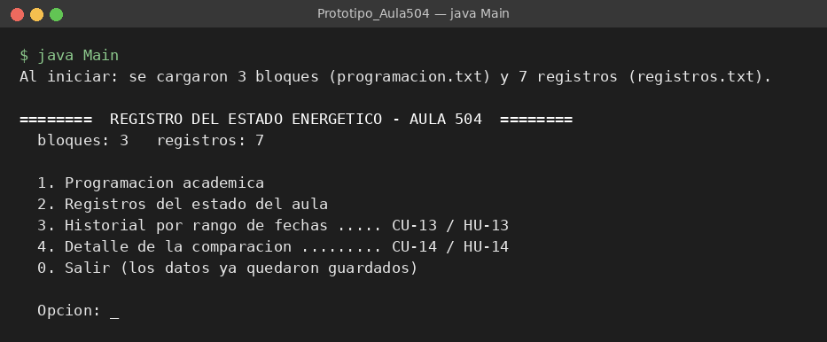

*Nota.* Salida de la consola al ejecutar `java Main` con el código de `src/` y los archivos de `datos/` (3 bloques y 7 registros), el 10 de noviembre de 2026. Elaboración propia.

---

## Declaración de uso de inteligencia artificial

La inteligencia artificial se utilizó como apoyo para organizar y revisar el documento, redactar un primer borrador del guion de entrevista, estructurar tablas y localizar información para orientar la búsqueda de fuentes. En la versión corregida del Cuadrante 2 también se utilizó para contrastar el documento con la rúbrica de la docente, redibujar el mapa conceptual corrigiendo errores de escritura y preparar los formatos de prueba y de evidencia. No se utilizó para simular entrevistas, inventar observaciones, fabricar resultados de pruebas, inventar referencias ni sustituir la validación con usuarios. El uso de inteligencia artificial en el Cuadrante 3 se registra en la bitácora del Anexo B.

<a id="tabla-24"></a>

**Tabla 24**
*Declaración de uso de inteligencia artificial en el Cuadrante 2*

| **Herramienta** | **Sección en que se usó** | **Para qué se usó** | **Qué debe verificar el equipo** |
|---|---|---|---|
| ChatGPT | Estructura general y redacción | Organizar el documento conforme a la guía, mejorar redacción y proponer estructura. | Que el contenido corresponda al proyecto propio y pueda sustentarse oralmente. |
| ChatGPT + búsqueda web | Estado del arte y marco teórico | Localizar fuentes reales y resumir información para orientar la construcción del estado del arte. | Abrir cada fuente antes de citarla y conservar solo referencias verificadas. |
| Copilot | Guion de entrevista | Proponer preguntas específicas a partir del problema y alcance del proyecto. | Validar el guion con la docente y probarlo con una persona real; no inventar respuestas. |
| Claude | Instrumento de observación y versión corregida del documento | Organizar campos de observación; revisar el documento frente a la rúbrica; redibujar el mapa conceptual; redactar las tablas de alcance, exclusiones y límites; preparar los formatos de prueba de soluciones y de evidencia; verificar datos bibliográficos de dos referentes. | Revisar que cada texto refleje decisiones del equipo; diligenciar los formatos solo con pruebas, entrevistas y observaciones realmente realizadas. |

La bitácora de cada integrante está en el [Anexo B](#anexo-b-bitácora-de-uso-de-inteligencia-artificial).

---

## Referencias

Ahmed, M. A., Chavez, S. A., Eltamaly, A. M., Garces, H. O., Rojas, A. J., & Kim, Y.-C. (2022). Toward an intelligent campus: IoT platform for remote monitoring and control of smart buildings. *Sensors, 22*(23), Artículo 9045. https://doi.org/10.3390/s22239045

Congreso de Colombia. (2024). *Ley 2407 de 2024*. Cancillería de Colombia, Normograma. https://cancilleria.gov.co/normograma/compilacion/docs/ley_2407_2024.htm

Cornell University. (s. f.). *Building energy dashboard*. Cornell Sustainability. https://sustainable.cornell.edu/buildings-energy/building-energy-dashboard

Delgado Mera, R. J., & Véliz Noboa, B. (2026). Sistema internet de las cosas (IoT), para la automatización y monitoreo de iluminación y climatización: Impulso a la eficiencia energética en aulas universitarias. *Revista de Investigaciones en Energía, Medio Ambiente y Tecnología (RIEMAT)*. https://revistas.utm.edu.ec/index.php/Riemat/article/view/7824

EnergyCAP. (2026). *Energy and utility management for higher education*. https://www.energycap.com/industries/higher-education/

Gonzalez Salcedo, L. O., Araujo Badiel, A. V., & Mejía Carmona, D. F. (2023). Metodologías para la evaluación de la eficiencia energética en edificaciones universitarias: Revisión literaria. *Ingeniería y Competitividad*. https://dialnet.unirioja.es/servlet/articulo?codigo=9824629

GridPoint. (2026). *GridPoint Intelligence*. https://www.gridpoint.com/

International Energy Agency. (s. f.). *Glossary: Energy efficiency*. https://www.iea.org/glossary

ISO. (2011). *ISO/IEC 25010:2011. Systems and software engineering — Systems and software Quality Requirements and Evaluation (SQuaRE) — System and software quality models*. International Organization for Standardization. https://www.iso.org/standard/35733.html

ISO. (2018a). *ISO 50001:2018. Sistemas de gestión de la energía*. International Organization for Standardization. https://www.iso.org/es/norma/50001

ISO. (2018b). *ISO/IEC/IEEE 29148:2018. Systems and software engineering — Life cycle processes — Requirements engineering*. International Organization for Standardization. https://www.iso.org/standard/72089.html

Jazuli, M. I., & Sisephaputra, B. (2026). IoT-based electricity and lecture room usage management information system at State University of Surabaya. *Journal of Emerging Information Systems and Business Intelligence*. https://ejournal.unesa.ac.id/index.php/JEISBI/article/view/76220

Johnson Controls. (s. f.). *Metasys UI energy dashboard and reporting feature user guide*. https://docs.johnsoncontrols.com/bas/r/Metasys/en-US/Metasys-UI-Energy-Dashboard-and-Reporting-Feature-User-Guide/16.0/Introduction

Johnson Controls. (2026). *OpenBlue*. https://openblue.johnsoncontrols.com/

Moreno Arrieta, F. J., Vides Herrera, C. A., Ropero Castillo, C. C., Ramón Valencia, J. D., & Ruiz Ayala, D. C. (2025). Sistema para la eficiencia energética en edificaciones educativas utilizando tecnologías IoT. *Prospectiva, 23*(1). https://ojs.uac.edu.co/index.php/prospectiva/es/article/view/3768

Moura, P., Moreno, J. I., López López, G., & Alvarez-Campana, M. (2021). IoT platform for energy sustainability in university campuses. *Sensors, 21*(2), Artículo 357. https://doi.org/10.3390/s21020357

Naciones Unidas. (2026a). *Goal 7: Affordable and clean energy*. United Nations Sustainable Development Goals. https://sdgs.un.org/goals/goal7

Naciones Unidas. (2026b). *Goal 12: Responsible consumption and production*. United Nations Sustainable Development Goals. https://sdgs.un.org/goals/goal12

Ofem, O. A., Ime, I., Njama-Abang, O., & Iwara, O. (2026). Real-time monitoring internet of things-based smart energy management system for university campuses. *Global Journal of Pure and Applied Sciences, 32*(4), 537–546. https://doi.org/10.4314/gjpas.v32i4.5

Pazhanimuthu, C., Chandrika, V. S., Baranilingesan, I., Ravindran, S., & Praveena, P. (2020). Implementation of IOT based smart energy management system in college campus. *International Journal of Future Generation Communication and Networking, 13*(4). https://sersc.org/journals/index.php/IJFGCN/article/view/32847

Pesantes Ocampo, L. A. (2024). *Sistema de Gestión Energética (SGEn) basado en medidores inteligentes y plataforma de monitoreo para promover la eficiencia energética y la cultura de uso sostenible en laboratorios y aulas en un campus universitario usando NILM* [Proyecto de titulación, Escuela Superior Politécnica del Litoral]. https://www.dspace.espol.edu.ec/handle/123456789/63030

Pontificia Universidad Javeriana Cali. (s. f.). *CoMo: Sistema para controlar el uso de equipos en aulas según los horarios académicos*. Vitela, repositorio institucional. https://vitela.javerianacali.edu.co/items/017caff9-8863-482c-af0a-77ee9fcbc790

Schneider Electric. (2026). *Energy management for large buildings: EcoStruxure Building Operation and Building Advisor*. https://www.se.com/ww/en/work/software/ecostruxure-building/large-buildings-energy-management/

Seong, N. C., & Hong, G. (2021). Comparison of energy consumption depending on the occupancy-based HVAC control in a university campus building. *Journal of Korean Institute of Architectural Sustainable Environment and Building Systems, 15*(6), 646–658. https://www.kci.go.kr/kciportal/ci/sereArticleSearch/ciSereArtiView.kci?sereArticleSearchBean.artiId=ART002790317

Shyr, W.-J., Zeng, L.-W., Lin, C.-K., Lin, C.-M., & Hsieh, W.-Y. (2017). Application of an energy management system via the Internet of Things on a university campus. *Eurasia Journal of Mathematics, Science and Technology Education*. https://www.ejmste.com/article/application-of-an-energy-management-system-via-the-internet-of-things-on-a-university-campus-5384

Spacewell Energy. (2026). *DEXMA Analyse: Real-time energy intelligence platform*. https://www.dexma.com/spacewell-energy-platform-dexma-analyse/

Téllez-Gutiérrez, S. M., Gomez Vasquez, D. M., & Rico Lizarazo, M. F. (2026). Análisis comparativo del consumo energético de un edificio universitario a partir de medición tradicional y medición inteligente: Estudio de caso. *SICEL*. https://revistas.unal.edu.co/index.php/SICEL/article/view/121243

Unidad de Planeación Minero Energética. (s. f.). *Programa de Uso Racional y Eficiente de la Energía (PROURE)*. https://www.upme.gov.co/simec/planeacion-energetica/proure/

Universidad Nacional de Colombia. (s. f.). *Cargas energéticas*. Oficina de Gestión Ambiental, Sede Bogotá. https://ogabogota.unal.edu.co/componente-antropico/energia/cargas-energeticas/

---

## Anexos

### Anexo A. Instrumento aplicado: formulario de Google

El formulario se aplicó del 2 al 30 de octubre de 2026. Esta tabla reconstruye sus doce preguntas y opciones a partir del resumen de respuestas exportado; la evidencia original son las capturas de la hoja de respuestas que se insertan en la sección 1 de la Parte II. Si alguna redacción u opción no coincide con la captura, prevalece la captura.

<a id="tabla-99"></a>

**Tabla 99**
*Preguntas y opciones del formulario aplicado*

| **N.º** | **Tipo** | **Pregunta** | **Opciones** |
|---|---|---|---|
| 1 | Abierta | ¿Podría explicarnos paso a paso cómo realiza actualmente la revisión de un aula de sistemas cuando termina una actividad o cuando el aula queda sin estudiantes? | Texto libre |
| 2 | Opción múltiple (una respuesta) | Durante esa revisión, ¿qué aspectos verifica en los computadores, las luminarias y el aire acondicionado? | Computadores · Luminarias · Aire acondicionado · Estado de puertas del aula · Otro |
| 3 | Abierta | ¿Cómo determina actualmente si el aula está ocupada, si una actividad ya terminó o si el aula se encuentra disponible? | Texto libre |
| 4 | Opción múltiple (una respuesta) | ¿Qué información o herramientas consulta para saber si el aula debería estar siendo utilizada en ese momento? | Horario de clases · Programación académica · Información de estudiantes · Información de docentes · No consulta ninguna |
| 5 | Abierta | Cuando durante una revisión encuentra algún computador, luminaria o aire acondicionado encendido y considera que no debería estarlo, ¿qué procedimiento sigue? | Texto libre |
| 6 | Abierta | Después de realizar una acción sobre alguno de estos elementos, ¿queda algún registro de lo encontrado, de la acción realizada o de la fecha y hora? ¿Cómo se conserva esa información? | Texto libre |
| 7 | Lista desplegable | En las aulas 504, 506 y 605, ¿con qué frecuencia encuentra computadores, luminarias o aire acondicionado encendidos sin personas presentes? | Casi a diario · Varias veces por semana · Una o dos veces por semana · Pocas veces al mes · Nunca |
| 8 | Opción múltiple | Desde que termina una actividad en un aula de sistemas, ¿cuánto tiempo suele pasar hasta que se revisa el estado de los equipos? | Menos de 15 minutos · Entre 15 y 30 minutos · Entre 30 minutos y 1 hora · Más de 1 hora · No hay un momento fijo de revisión |
| 9 | Escala 1 a 5 | ¿Qué tan importante considera detectar que un aula está sin personas mientras alguno de sus computadores, luminarias o aire acondicionado permanece encendido? | 1 a 5 |
| 10 | Opción múltiple (una respuesta) | Si se detectara que el aula 504 está sin personas pero algún equipo, luminaria o el aire acondicionado sigue encendido, ¿qué información necesitaría para decidir si requiere atención? | Estado de ocupación del aula · Horario o programación académica · Qué elemento permanece encendido · Tiempo que lleva encendido · Motivo de la actividad que se realizaba · Fecha y hora |
| 11 | Escala 1 a 5 | ¿Qué tan fácil sería para usted registrar manualmente el estado del aula (ocupación, luces, computadores y aire) al terminar su revisión? | 1 a 5 |
| 12 | Casillas de verificación | Si el estado del aula quedara registrado en un sistema, ¿cómo preferiría recibir la información cuando se detecte que algún elemento permanece encendido sin personas presentes? | Una alerta inmediata · Un resumen de las situaciones detectadas · Un aviso dentro del sistema para revisarlo después · Un registro para consultar al final de la jornada · Otra forma |

*Nota.* Las opciones de las preguntas cerradas se tomaron del resumen de respuestas y se verificaron con las capturas de la hoja de respuestas. La opción «Otro» de la pregunta 2 no tenía campo para escribir. El formulario no pidió el rol ni un identificador de quien respondía.

### Anexo B. Bitácora de uso de inteligencia artificial

La guía pide una tabla por estudiante. La última columna es la que se califica y la escribe cada integrante con sus propias palabras: si dice «nada», significa que no revisó lo que entregó. La tabla de Hilary se armó con lo que quedó registrado en el chat con la herramienta de inteligencia artificial. En este cuadrante no quedaron registradas solicitudes de Luijeimm a la herramienta: el trabajo con inteligencia artificial lo hizo Hilary y está en su tabla.

<a id="tabla-100"></a>

**Tabla 100**
*Bitácora de Hilary Pérez Zúñiga*

| **Sección** | **Qué le pedí** | **Qué me devolvió** | **Qué le cambié y por qué** |
|---|---|---|---|
| Parte II, 1.3 y 1.4 (evidencia del formulario) | Insertar debajo de cada pregunta las dos capturas de la hoja de respuestas, en orden, con título APA 7, sin recortarlas ni inventar las que faltaran. | Las Figuras 2 a 13 con título y nota, el recuento de cada pregunta y la marca de pendiente en las preguntas 9 y 11, que no tenían captura. | Le corregí que en el formulario solo la pregunta 12 admite varias respuestas; las preguntas 2, 4, 8 y 10 son de una sola. Por eso la diferencia entre las preguntas 1 y 2 se explica como un límite del instrumento y no como una contradicción de quienes respondieron. |
| Parte II, 1.2 (respuestas analizadas) | Corregir el número de respuestas del formulario. Le ofrecí que cambiara los nombres repetidos de la hoja. | Contó 32 respuestas, no aceptó cambiar nombres y dejó por fuera las segundas respuestas de una misma persona (filas 21 y 26): 30 analizadas. | No cambié el resultado: acepté analizar 30 respuestas. Queda por devolver a la hoja los nombres originales que yo había cambiado a mano. |
| Parte I, 3.1 (mapa conceptual) | Revisar el mapa conceptual del Cuadrante 2 y optimizarlo si estaba mal hecho. | El mapa redibujado en digital, con 24 conceptos, las palabras de enlace completas y dos enlaces cruzados. | Acepté el mapa redibujado tal como lo devolvió. |
| Parte II, 10 (prototipo) | Alinear el código Java del prototipo con los mockups, los mensajes y los requisitos del documento. | Las 8 clases ajustadas: mensajes de las Tablas 91 a 93, botones [G] [L] [C], horas HH:MM y fechas dd/mm/aaaa estrictas, historial ordenado por fecha y los códigos reales en los comentarios. | Acepté el código ajustado y pedí que se subiera a GitHub desde mi cuenta. |
| Parte II, 8 (repositorio) | Separar partes del documento en archivos .md para GitHub: actores, entrevista, observaciones, objetivos, historias de usuario y requisitos funcionales. | Siete archivos .md sacados del documento, sin las capturas que muestran nombres de personas. | Los organicé en tres carpetas (1-Contexto, 2-Objetivos y 3-Análisis) y renombré objetivo-especifico.md como objetivos-especificos.md.  |
| Todo el documento (revisión) | Una revisión como analista de requisitos y que hiciera las correcciones línea por línea. | Una lista de hallazgos (6 críticos, 9 contradicciones y 10 mejoras) y las correcciones dentro del documento. | Le pedí que hiciera todas las correcciones en el documento y las acepté. |
|  |  |  |  |

<a id="tabla-101"></a>

**Tabla 101**
*Bitácora de Luijeimm Agudelo Godoy*

| **Sección** | **Qué le pedí** | **Qué me devolvió** | **Qué le cambié y por qué** |
|---|---|---|---|
| Todo el cuadrante | No hay solicitudes propias registradas. | — | Las solicitudes a la herramienta de inteligencia artificial de este cuadrante las hizo Hilary Pérez Zúñiga y están en la Tabla 100. |

### Anexo C. Observaciones realizadas en la Torre 1

Resumen de las tres observaciones realizadas por el equipo en la Torre 1, citado desde la sección 2.1 de la Parte I y la sección 1.1 de la Parte II. La fecha de la tercera observación se corrigió según lo informado por el equipo (Anexo E).

<a id="tabla-102"></a>

**Tabla 102**
*Observaciones realizadas en la Torre 1*

| **Observación** | **Fecha y hora** | **Aulas** | **Hallazgo** |
|---|---|---|---|
| Primera | 15 de agosto de 2026, 2:45 p. m. | 504, 506 y 605 | En el 504, luces apagadas y tres computadores encendidos sin personas. En el 506 y el 605, aire acondicionado y luminarias encendidos con los espacios vacíos. Minutos después ingresó el encargado, apagó los computadores del 504 y los aires y luces del 506 y 605. |
| Segunda | 8 de septiembre de 2026, 4:22 p. m. | 504 | Tras un parcial virtual de inglés, los equipos de cómputo estaban apagados. Antes de cerrar, el docente apagó el aire acondicionado y las luces y cerró la puerta. No se identificaron equipos encendidos sin personas; este registro sirve de comparación con las situaciones anteriores. |
| Tercera | 31 de octubre de 2026, 10:52 a. m. | 503, 506 y otras | En el 503, seis computadores encendidos y en uso, con estudiantes y docentes. En el 506, diez computadores encendidos, de los cuales tres no estaban en uso; uno mostraba la pantalla de ingreso de contraseña (equipo encendido sin uso). Las demás aulas estaban cerradas y no se pudo verificar su estado. |

### Anexo D. Formato de evidencias de la prueba de soluciones

Formato para documentar la prueba real de cada solución (Parte I, sección 5.2) y respaldar cada calificación de la matriz (sección 5.4). Cada captura se guarda con un nombre del tipo S1-captura-1 y se cita en la columna de evidencia. Mientras no se diligencie, las calificaciones siguen en NE.

<a id="tabla-103"></a>

**Tabla 103**
*Registro de la prueba por solución*

| **Solución** | **Fecha de prueba** | **Tarea que se intentó** | **Resultado observado** | **Captura (archivo)** |
|---|---|---|---|---|
| S1 EnergyCAP |  |  |  |  |
| S2 EcoStruxure |  |  |  |  |
| S3 OpenBlue |  |  |  |  |
| S4 DEXMA |  |  |  |  |
| S5 Metasys |  |  |  |  |
| S6 Cornell |  |  |  |  |

<a id="tabla-104"></a>

**Tabla 104**
*Evidencia por celda de la matriz*

| **Solución** | **Criterio** | **Puntaje (0–5)** | **Evidencia (captura o nota)** |
|---|---|---|---|
| S1 EnergyCAP | Adecuación funcional |  |  |
| S1 EnergyCAP | Usabilidad |  |  |
| S1 EnergyCAP | Compatibilidad |  |  |
| S1 EnergyCAP | Confiabilidad |  |  |
| S2 EcoStruxure | Adecuación funcional |  |  |
| S2 EcoStruxure | Usabilidad |  |  |
| S2 EcoStruxure | Compatibilidad |  |  |
| S2 EcoStruxure | Confiabilidad |  |  |
| S3 OpenBlue | Adecuación funcional |  |  |
| S3 OpenBlue | Usabilidad |  |  |
| S3 OpenBlue | Compatibilidad |  |  |
| S3 OpenBlue | Confiabilidad |  |  |
| S4 DEXMA | Adecuación funcional |  |  |
| S4 DEXMA | Usabilidad |  |  |
| S4 DEXMA | Compatibilidad |  |  |
| S4 DEXMA | Confiabilidad |  |  |
| S5 Metasys | Adecuación funcional |  |  |
| S5 Metasys | Usabilidad |  |  |
| S5 Metasys | Compatibilidad |  |  |
| S5 Metasys | Confiabilidad |  |  |
| S6 Cornell | Adecuación funcional |  |  |
| S6 Cornell | Usabilidad |  |  |
| S6 Cornell | Compatibilidad |  |  |
| S6 Cornell | Confiabilidad |  |  |

### Anexo E. Registro de cambios del Cuadrante 2

El Cuadrante 2 fue aprobado con modificaciones. Para mantener la coherencia con el Cuadrante 3 se actualizaron las tablas y frases que lo contradecían, sin cambiar el problema aprobado, las observaciones ni la hipótesis. Esta tabla deja constancia de cada cambio: qué decía el texto aprobado, qué dice ahora y por qué.

<a id="tabla-105"></a>

**Tabla 105**
*Texto aprobado y texto actualizado en el Cuadrante 2*

| **Ubicación** | **Texto aprobado** | **Texto actualizado** | **Motivo** |
|---|---|---|---|
| 2.1 Entorno observado | Las observaciones complementarias del 8 y 9 de septiembre de 2026… | Las observaciones complementarias del 8 de septiembre y del 31 de octubre de 2026… | Corrección de la fecha y la hora de la tercera observación informada por el equipo (31 de octubre de 2026, 10:52 a. m.); el hallazgo no cambia. |
| 2.4 Actores | Este actor es el priorizado para la entrevista (sección 6.2). | Este actor fue el priorizado para la entrevista (sección 6.2); en el Cuadrante 3 no se logró contactarlo… | Hecho ocurrido en el Cuadrante 3. |
| 2.5 Justificación, tercer párrafo | …se podrán identificar posibles situaciones de desperdicio de energía, generar alertas y conservar un historial de los registros. | …se podrán identificar posibles inconsistencias entre el estado observado y la programación, que podrían indicar un uso innecesario de energía, y conservar un historial. El prototipo no mide el consumo ni confirma que haya desperdicio. | El texto prometía detectar desperdicio; el prototipo solo compara datos digitados. |
| 2.6 Hipótesis | (sin cambios) | Se agrega un párrafo que explica cómo se pone a prueba en el Cuadrante 3. | La hipótesis aprobada se conserva literal. |
| 2.7 Alcance y tabla de información | (sin cambios) | Se agrega un párrafo inicial y una nota a la tabla que remiten al alcance modificado. | Es el «alcance anterior» que la guía del tercer cuadrante pide comparar; no se puede reescribir. |
| 2.8 Referentes iniciales | «…genera alertas» y referentes sin cita | «…señala posibles inconsistencias» y cita autor-fecha en cada referente | Coherencia de términos y APA 7. |
| 2.9 Innovación | …generar alertas… / …no queda un registro de lo encontrado (aspecto que se verificará en la entrevista). | …señalar posibles inconsistencias… / …según el formulario, 21 de 30 personas dicen que no queda registro o no conocen ninguno. | Coherencia de términos y dato ya verificado con el formulario. |
| 2.10 Concepto de la docente | Tabla en blanco | «Aprobada con modificaciones (según lo informado por el equipo)»; observaciones y firma pendientes | No hay soporte escrito en los archivos; no se inventa el contenido. |
| 3.2 Valor del proyecto | Ambiental: «situaciones de posible desperdicio». Económico: «Ayuda a evitar el pago de energía que no corresponde al uso real del aula…». Innovación: «…alertas…» | Ambiental: «posibles inconsistencias». Económico: «Aporta información documentada para que la institución pueda revisar el uso de la energía… El prototipo no mide ni reduce el consumo». Innovación: «señalamiento de posibles inconsistencias» | El valor económico prometía un ahorro que el prototipo no puede demostrar. |
| 3.1 Figura 1 (mapa conceptual) | Mapa con errores de digitación («regiatro», «Innovacióm», «se copará», «Identicar»), dos relaciones sin palabra de enlace y los términos «situaciones de posible desperdicio» y «el costo… lo que reduce». | Mapa redibujado con las mismas cuatro ramas: 24 conceptos, una palabra de enlace en cada relación, dos enlaces cruzados («se apoya en» y «permite detectar») y los términos «posibles inconsistencias» y «ayuda a documentar el posible desperdicio». | Corrección de forma y coherencia de términos con el Cuadrante 3: el prototipo no mide ni reduce el consumo. El valor de cada rama no cambia. |
| 3.2 Enlaces cruzados | Las alertas permiten actuar sobre el uso innecesario de energía… / …identificar el desperdicio cuyo costo se busca reducir. | Las alertas, entendidas como el aviso de una posible inconsistencia, permiten revisar… / …reconocer situaciones que podrían ser desperdicio y que la institución puede revisar. | Mismo motivo; los conceptos del mapa no cambian. |
| 4.1 Objetivo general | …compararlos con la programación académica e identificar y alertar sobre posibles situaciones de desperdicio de energía. | …compararlos con la programación académica e identificar posibles inconsistencias que podrían indicar un uso innecesario de energía, sin medir el consumo ni confirmar que exista desperdicio. | El objetivo prometía más de lo que el prototipo hace. |
| 4.2 Objetivo específico 2 | …qué debe registrar, comparar, alertar y conservar el prototipo. | …qué debe registrar, comparar, señalar y conservar el prototipo. | Coherencia de términos. |
| 4.2 Objetivo específico 3 | …prototipo de baja fidelidad que represente… la consulta de la programación académica… las alertas… | …prototipo funcional en consola que represente… la carga de la programación académica… el señalamiento de posibles inconsistencias… | La guía del tercer cuadrante exige un prototipo programado en Java. |
| 5.1 Rastreo | Sin citas en el texto; referente 7 con «et al.» en la lista; PROURE con año 2022 | Cita autor-fecha en cada fila; autores completos de Ofem et al.; PROURE como página sin fecha (s. f.) | APA 7: toda referencia debe citarse y la lista no admite «et al.». |
| 5.5 Vacío y factor diferenciador | …registro manual + programación académica + alertas… | …registro manual y programación académica…; se indica que el factor quedó como RNF-01 | Coherencia de términos y trazabilidad. |
| 5.6 Qué se programa y qué se conecta | Envío del aviso: se conecta (correo). Almacenamiento: se conecta (motor de base de datos). Acceso de usuarios: se conecta (autenticación). Comparación: «se define en el Cuadrante 3». | Aviso: en pantalla. Almacenamiento: arreglos y archivos de texto. Acceso: no se implementa. Comparación: RN-01 y RN-02. | El Cuadrante 2 aplazaba esta elección al Cuadrante 3; la guía del tercer cuadrante exige archivos de texto. |
| 5.6 Exclusiones | Seis elementos | Se agregan dos filas: tiempo encendido; avisos externos, perfiles y seguimiento de alertas | Exclusiones decididas en el Cuadrante 3. |
| 5.6 Límites C2–C3 | Dos columnas | Se agrega la columna «Estado en el Cuadrante 3» | Muestra qué se cumplió y qué sigue pendiente. |
| 6.1 y 6.2 Técnicas y actores | Estado «pendiente»; campos [iniciales del encargado], [medio de contacto] | Estado real de aplicación y de contacto | Hechos del Cuadrante 3; no se dejan marcadores vacíos. |
| 7.1 Concepto «Alerta» | …su condición exacta se definirá después de la elicitación. | Aviso en pantalla cuando el resultado es «posible inconsistencia» según RN-01 y RN-02… | La condición ya se definió en el Cuadrante 3. |
| 8.1 Guion de entrevista | Guion «pendiente de validación» | Se explica cómo se adaptó al formulario aplicado (Anexo A) | El instrumento aplicado es distinto del guion. |
| 8.1 y 8.2 Formularios vacíos | Ficha de evidencia de entrevista, ficha de evidencia de observación y Anexo B «Guion para diligenciar» (en blanco) | Se retiran; se conserva el guion y el registro de campo de la observación | Formatos en blanco de actividades que no se aplicaron de esa forma; la evidencia real está en el Anexo A y en la sección 1 del Cuadrante 3. |
| Lista de verificación | Entrevista y observación «pendientes» | Estado actualizado | Hechos del Cuadrante 3. |
| Anexos | A: insumos del C1; B: guion; C: prueba de soluciones | A: instrumento aplicado; B: bitácora de IA; C: insumos del C1; D: prueba de soluciones | La guía del tercer cuadrante fija los anexos A y B. |
| Referencias | Naciones Unidas (2026) dos veces; «Ofem, O. A., et al.»; sin normas ISO/IEC | Naciones Unidas (2026a, 2026b); cuatro autores de Ofem et al.; se agregan ISO/IEC 25010 e ISO/IEC/IEEE 29148 | APA 7 y normas citadas en el Cuadrante 3. |

### Anexo F. Decisiones de diseño que no salen del formulario

Son decisiones técnicas del equipo, necesarias para que los criterios de falla sean verificables. Ninguna sale de una respuesta del formulario y así se declara.

<a id="tabla-106"></a>

**Tabla 106**
*Decisiones de diseño del equipo*

| **Decisión** | **Por qué** |
|---|---|
| Identificador escrito por la persona usuaria | La guía pide crear «validando que el identificador no esté repetido». |
| Fecha en formato dd/mm/aaaa y horas en HH:MM de 24 horas | Es el formato de uso común en Colombia; sin un formato fijo no se puede verificar «formato inválido». |
| Valores de texto en minúscula y sin tilde (vacia, miercoles, sabado, si, no) | El programa compara textos y guarda en archivo; así «vacía» y «vacia» no se leen como valores distintos. |
| Capacidad de 100 bloques y 200 registros; cada pila de deshacer con la misma capacidad que su arreglo | La guía exige un arreglo de tamaño fijo; 200 permite medir RNF-03. Si la pila está llena no se elimina, para que nunca se pierda una copia (CA-04.5 y CA-10.5). |
| Guardar después de cada cambio exitoso, además de al salir | Cumple «guardar al salir» de la guía y evita perder datos si el programa se cierra de forma inesperada. |
| Una pila de deshacer por entidad | La guía reparte una entidad por integrante, cada una con su propia pila. |
| Lo recuperado con deshacer se agrega al final del arreglo | La hoja de predicción de la guía: «vuelve el que acabo de eliminar, de último». |
| Orden de evaluación de la comparación (RN-01) | Primero la ocupación, luego los elementos, luego si hay bloques ese día y por último si alguno cubre la hora. Así una misma observación no puede dar dos resultados. |
| La comparación se calcula con la programación vigente al consultar | No se guarda el resultado: si la programación se corrige, el resultado de los registros anteriores también cambia (RN-01). |
| Dos roles y no cargos institucionales | El formulario no preguntó el rol; los actores son funciones dentro del prototipo, como en la secuencia de la docente. |

### Anexo G. Correspondencia con la versión anterior del Cuadrante 3

La versión anterior tenía 5 historias, 52 criterios y 54 requisitos. Siguiendo la secuencia de la docente se reorganizó en una historia por operación; esta tabla muestra de dónde sale cada criterio actual, para comprobar que nada aprobado se perdió.

<a id="tabla-107"></a>

**Tabla 107**
*Criterio actual y su origen*

| **Criterio actual** | **Historia** | **Origen en la versión de 52 criterios** |
|---|---|---|
| CA-01.1 | HU-01 | CA-02.1 |
| CA-01.2 | HU-01 | CA-02.2 |
| CA-01.3 | HU-01 | CA-02.3 |
| CA-01.4 | HU-01 | CA-02.4 |
| CA-01.5 | HU-01 | CA-02.5 |
| CA-01.6 | HU-01 | CA-02.6 |
| CA-01.7 | HU-01 | CA-02.7 |
| CA-01.8 | HU-01 | Nuevo · regla de contiguos que ya estaba en RF-20 |
| CA-01.9 | HU-01 | Nuevo · capacidad del arreglo |
| CA-02.1 | HU-02 | CA-02.8 |
| CA-02.2 | HU-02 | CA-02.9 |
| CA-02.3 | HU-02 | CA-02.10 |
| CA-02.4 | HU-02 | CA-02.11 |
| CA-02.5 | HU-02 | Nuevo · falla de búsqueda |
| CA-02.6 | HU-02 | Nuevo · falla de búsqueda |
| CA-03.1 | HU-03 | CA-02.12 |
| CA-03.2 | HU-03 | Nuevo · faltaba en programación |
| CA-03.3 | HU-03 | CA-02.13 |
| CA-03.4 | HU-03 | CA-02.14 |
| CA-03.5 | HU-03 | Nuevo · patrón de identificador |
| CA-04.1 | HU-04 | CA-02.15 |
| CA-04.2 | HU-04 | CA-02.16 |
| CA-04.3 | HU-04 | CA-02.17 |
| CA-04.4 | HU-04 | Nuevo · patrón de identificador |
| CA-04.5 | HU-04 | Nuevo en v3.1 · la pila no puede desbordarse |
| CA-05.1 | HU-05 | CA-02.18 + cálculo de duración |
| CA-05.2 | HU-05 | CA-02.20 (guardar y cargar) |
| CA-05.3 | HU-05 | CA-02.19 |
| CA-05.4 | HU-05 | CA-02.20 (archivo inexistente) |
| CA-06.1 | HU-06 | CA-05.1 (programación) |
| CA-06.2 | HU-06 | Nuevo · prueba de la pila |
| CA-06.3 | HU-06 | CA-05.2 (programación) |
| CA-06.4 | HU-06 | CA-05.3 (programación) |
| CA-06.5 | HU-06 | Nuevo · deshacer no puede romper RN-03 |
| CA-06.6 | HU-06 | Nuevo · capacidad del arreglo |
| CA-07.1 | HU-07 | CA-01.1 |
| CA-07.2 | HU-07 | CA-01.2 |
| CA-07.3 | HU-07 | Nuevo · valores admitidos del diccionario |
| CA-07.4 | HU-07 | CA-01.3 (formato y existencia) |
| CA-07.5 | HU-07 | CA-01.3 (fecha futura) + hora futura |
| CA-07.6 | HU-07 | CA-01.4 |
| CA-07.7 | HU-07 | CA-01.5 |
| CA-07.8 | HU-07 | Nuevo · faltaba en registros |
| CA-07.9 | HU-07 | Nuevo · tamaño del diccionario |
| CA-07.10 | HU-07 | Nuevo · capacidad del arreglo |
| CA-08.1 | HU-08 | CA-01.6 |
| CA-08.2 | HU-08 | CA-01.7 |
| CA-08.3 | HU-08 | CA-01.8 |
| CA-08.4 | HU-08 | CA-01.9 |
| CA-08.5 | HU-08 | Nuevo · falla de búsqueda |
| CA-08.6 | HU-08 | Nuevo · falla de búsqueda |
| CA-09.1 | HU-09 | CA-01.10 |
| CA-09.2 | HU-09 | CA-01.11 |
| CA-09.3 | HU-09 | Nuevo · patrón de identificador |
| CA-09.4 | HU-09 | CA-01.12 |
| CA-10.1 | HU-10 | CA-01.13 |
| CA-10.2 | HU-10 | CA-01.14 |
| CA-10.3 | HU-10 | CA-01.15 |
| CA-10.4 | HU-10 | Nuevo · patrón de identificador |
| CA-10.5 | HU-10 | Nuevo en v3.1 · la pila no puede desbordarse |
| CA-11.1 | HU-11 | CA-01.16 + totales |
| CA-11.2 | HU-11 | CA-01.18 (guardar y cargar) |
| CA-11.3 | HU-11 | CA-01.17 |
| CA-11.4 | HU-11 | CA-01.18 (archivo inexistente) |
| CA-12.1 | HU-12 | CA-05.1 (registros) |
| CA-12.2 | HU-12 | Nuevo · prueba de la pila |
| CA-12.3 | HU-12 | CA-05.2 (registros) |
| CA-12.4 | HU-12 | CA-05.3 (registros) |
| CA-12.5 | HU-12 | Nuevo · capacidad del arreglo |
| CA-13.1 | HU-13 | CA-03.1 |
| CA-13.2 | HU-13 | CA-03.2 |
| CA-13.3 | HU-13 | CA-03.3 |
| CA-13.4 | HU-13 | CA-03.4 |
| CA-13.5 | HU-13 | CA-03.5 |
| CA-14.1 | HU-14 | CA-04.1 + CA-04.2 |
| CA-14.2 | HU-14 | CA-04.3 |
| CA-14.3 | HU-14 | CA-04.4 |
| CA-14.4 | HU-14 | CA-04.5 |
| CA-14.5 | HU-14 | CA-04.6 |
| CA-14.6 | HU-14 | Nuevo · faltaba en HU-04 |
| CA-14.7 | HU-14 | Nuevo · patrón de identificador |

*Nota.* Los criterios marcados «Nuevo» son fallas o pruebas de funciones que ya existían; ninguno agrega una función al sistema.

### Anexo H. Fichas de casos de uso

*Nota.* Son las fichas de la sección 4.2 del documento, sin cambios. Se ubican aquí porque el apartado 20 presenta solo el diagrama.

Cada ficha indica el identificador del caso de uso, su actor principal, el objetivo, la precondición, los flujos principal y alterno, y la postcondición.

<a id="tabla-48"></a>

**Tabla 48**
*Ficha CU-01 · Gestionar aulas*

| **Campo** | **Contenido** |
|---|---|
| Identificador | CU-01 |
| Actor principal | Administrador |
| Objetivo | Permitir gestionar aulas. |
| Precondición | Usuario autorizado y datos requeridos disponibles. |
| Flujo principal | Seleccionar opción, ingresar datos, validar información y confirmar resultado. |
| Flujo alterno | Datos inválidos, inexistentes o duplicados. |
| Postcondición | Información actualizada correctamente. |

<a id="tabla-49"></a>

**Tabla 49**
*Ficha CU-02 · Gestionar personas*

| **Campo** | **Contenido** |
|---|---|
| Identificador | CU-02 |
| Actor principal | Administrador |
| Objetivo | Permitir gestionar personas. |
| Precondición | Usuario autorizado y datos requeridos disponibles. |
| Flujo principal | Seleccionar opción, ingresar datos, validar información y confirmar resultado. |
| Flujo alterno | Datos inválidos, inexistentes o duplicados. |
| Postcondición | Información actualizada correctamente. |

<a id="tabla-50"></a>

**Tabla 50**
*Ficha CU-03 · Gestionar programación académica*

| **Campo** | **Contenido** |
|---|---|
| Identificador | CU-03 |
| Actor principal | Administrador |
| Objetivo | Permitir gestionar programación académica. |
| Precondición | Usuario autorizado y datos requeridos disponibles. |
| Flujo principal | Seleccionar opción, ingresar datos, validar información y confirmar resultado. |
| Flujo alterno | Datos inválidos, inexistentes o duplicados. |
| Postcondición | Información actualizada correctamente. |

<a id="tabla-51"></a>

**Tabla 51**
*Ficha CU-04 · Gestionar observaciones*

| **Campo** | **Contenido** |
|---|---|
| Identificador | CU-04 |
| Actor principal | Observador |
| Objetivo | Permitir gestionar observaciones. |
| Precondición | Usuario autorizado y datos requeridos disponibles. |
| Flujo principal | Seleccionar opción, ingresar datos, validar información y confirmar resultado. |
| Flujo alterno | Datos inválidos, inexistentes o duplicados. |
| Postcondición | Información actualizada correctamente. |

<a id="tabla-52"></a>

**Tabla 52**
*Ficha CU-05 · Gestionar ocupación*

| **Campo** | **Contenido** |
|---|---|
| Identificador | CU-05 |
| Actor principal | Observador |
| Objetivo | Permitir gestionar ocupación. |
| Precondición | Usuario autorizado y datos requeridos disponibles. |
| Flujo principal | Seleccionar opción, ingresar datos, validar información y confirmar resultado. |
| Flujo alterno | Datos inválidos, inexistentes o duplicados. |
| Postcondición | Información actualizada correctamente. |

<a id="tabla-53"></a>

**Tabla 53**
*Ficha CU-06 · Gestionar luminarias*

| **Campo** | **Contenido** |
|---|---|
| Identificador | CU-06 |
| Actor principal | Observador |
| Objetivo | Permitir gestionar luminarias. |
| Precondición | Usuario autorizado y datos requeridos disponibles. |
| Flujo principal | Seleccionar opción, ingresar datos, validar información y confirmar resultado. |
| Flujo alterno | Datos inválidos, inexistentes o duplicados. |
| Postcondición | Información actualizada correctamente. |

<a id="tabla-54"></a>

**Tabla 54**
*Ficha CU-07 · Gestionar computadores*

| **Campo** | **Contenido** |
|---|---|
| Identificador | CU-07 |
| Actor principal | Observador |
| Objetivo | Permitir gestionar computadores. |
| Precondición | Usuario autorizado y datos requeridos disponibles. |
| Flujo principal | Seleccionar opción, ingresar datos, validar información y confirmar resultado. |
| Flujo alterno | Datos inválidos, inexistentes o duplicados. |
| Postcondición | Información actualizada correctamente. |

<a id="tabla-55"></a>

**Tabla 55**
*Ficha CU-08 · Gestionar aire acondicionado*

| **Campo** | **Contenido** |
|---|---|
| Identificador | CU-08 |
| Actor principal | Observador |
| Objetivo | Permitir gestionar aire acondicionado. |
| Precondición | Usuario autorizado y datos requeridos disponibles. |
| Flujo principal | Seleccionar opción, ingresar datos, validar información y confirmar resultado. |
| Flujo alterno | Datos inválidos, inexistentes o duplicados. |
| Postcondición | Información actualizada correctamente. |

<a id="tabla-56"></a>

**Tabla 56**
*Ficha CU-09 · Ejecutar comparación de observaciones*

| **Campo** | **Contenido** |
|---|---|
| Identificador | CU-09 |
| Actor principal | Sistema |
| Objetivo | Permitir ejecutar comparación de observaciones. |
| Precondición | Usuario autorizado y datos requeridos disponibles. |
| Flujo principal | Seleccionar opción, ingresar datos, validar información y confirmar resultado. |
| Flujo alterno | Datos inválidos, inexistentes o duplicados. |
| Postcondición | Información actualizada correctamente. |

<a id="tabla-57"></a>

**Tabla 57**
*Ficha CU-10 · Gestionar historial*

| **Campo** | **Contenido** |
|---|---|
| Identificador | CU-10 |
| Actor principal | Consultor |
| Objetivo | Permitir gestionar historial. |
| Precondición | Usuario autorizado y datos requeridos disponibles. |
| Flujo principal | Seleccionar opción, ingresar datos, validar información y confirmar resultado. |
| Flujo alterno | Datos inválidos, inexistentes o duplicados. |
| Postcondición | Información actualizada correctamente. |

<a id="tabla-58"></a>

**Tabla 58**
*Ficha CU-11 · Gestionar alertas*

| **Campo** | **Contenido** |
|---|---|
| Identificador | CU-11 |
| Actor principal | Consultor |
| Objetivo | Permitir gestionar alertas. |
| Precondición | Usuario autorizado y datos requeridos disponibles. |
| Flujo principal | Seleccionar opción, ingresar datos, validar información y confirmar resultado. |
| Flujo alterno | Datos inválidos, inexistentes o duplicados. |
| Postcondición | Información actualizada correctamente. |

<a id="tabla-59"></a>

**Tabla 59**
*Ficha CU-12 · Deshacer última eliminación*

| **Campo** | **Contenido** |
|---|---|
| Identificador | CU-12 |
| Actor principal | Administrador / Observador |
| Objetivo | Permitir deshacer última eliminación. |
| Precondición | Usuario autorizado y datos requeridos disponibles. |
| Flujo principal | Seleccionar opción, ingresar datos, validar información y confirmar resultado. |
| Flujo alterno | Datos inválidos, inexistentes o duplicados. |
| Postcondición | Información actualizada correctamente. |
